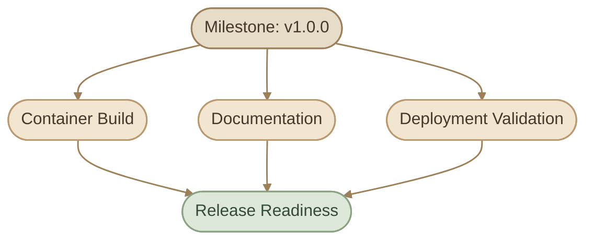
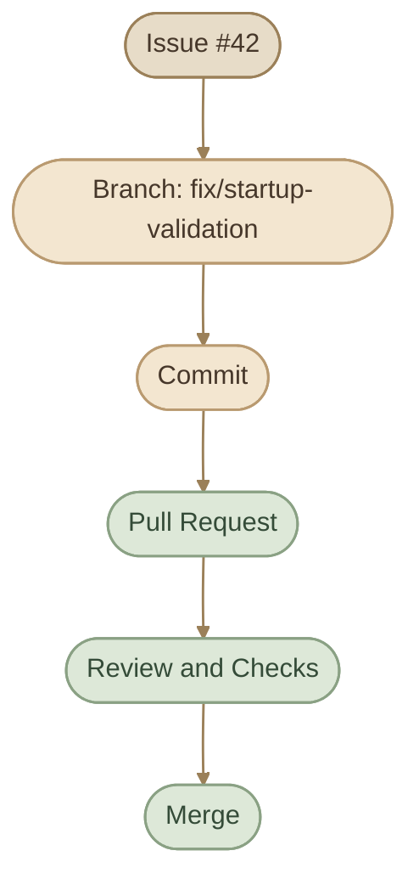
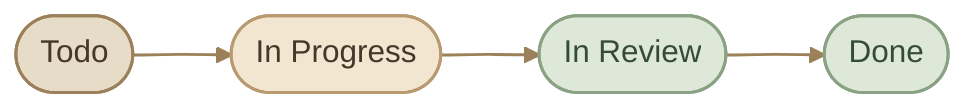
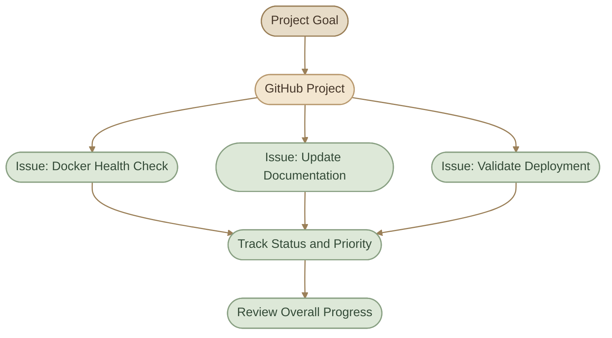

## Introduction

GitHub مش مجرد منصة لاستضافة الكود؛ هو كمان مكان تقدر تدير من خلاله الشغل المطلوب على المشروع، وتتابع المشاكل، وتوزّع المسؤوليات، وتخطط للإصدارات.

تخيّل إنك بتطوّر مشروع DevOps وظهر عندك عدد من المهام:

<CardGrid columns={2} label="Sample Tasks">
  <InfoCard title="Fix Docker build" description="إصلاح مشكلة في Docker build." icon="wrench" variant="concept" />
  <InfoCard title="Health checks" description="إضافة health checks للـ application." icon="pulse" variant="concept" />
  <InfoCard title="Deployment docs" description="تحسين توثيق عملية deployment." icon="layers" variant="concept" />
  <InfoCard title="Kubernetes review" description="مراجعة إعدادات Kubernetes." icon="modules" variant="concept" />
  <InfoCard title="New release" description="تجهيز إصدار جديد من المشروع." icon="flag" variant="concept" />
</CardGrid>

بدل ما تسجل المهام في ملفات عشوائية أو تعتمد على الذاكرة، تقدر تستخدم GitHub Issues لتنظيمها، وLabels لتصنيفها، وAssignees لتحديد المسؤولين عنها، وMilestones لتجميع المهام المرتبطة بهدف أو إصدار، وGitHub Projects لمتابعة التقدم.

<CardGrid columns={2} label="What You Will Learn">
  <InfoCard variant="concept" title="Issues" description="تسجيل Bugs والمهام والتحسينات ومتابعة النقاش حولها." icon="pulse" tags={["Tasks", "Bugs"]} />
  <InfoCard variant="feature" title="Labels & Milestones" description="تصنيف العمل وتحديد المسؤوليات وتجميع المهام حسب الأهداف." icon="tag" tags={["Organization", "Planning"]} />
  <InfoCard variant="feature" title="Automation" description="ربط Issues بالـ commits والـ Pull Requests واستخدام closing keywords." icon="git-pull-request" tags={["Workflow", "Automation"]} />
  <InfoCard variant="insight" title="Projects & Discussions" description="تنظيم التخطيط والتقدم، وفصل النقاشات العامة عن المهام القابلة للتتبع." icon="modules" tags={["Planning", "Collaboration"]} />
</CardGrid>

## 1. GitHub Issues

### What Is an Issue?

الـ **Issue** هي وحدة لتسجيل ومتابعة موضوع يحتاج إلى نقاش أو إجراء داخل المشروع.

ممكن تكون:

<CardGrid columns={2} label="Issue Types">
  <InfoCard title="Bug" description="مشكلة في السلوك الحالي." icon="wrench" variant="concept" />
  <InfoCard title="Feature Request" description="ميزة جديدة مقترحة." icon="flag" variant="concept" />
  <InfoCard title="Task" description="مهمة تنفيذ أو صيانة." icon="tag" variant="concept" />
  <InfoCard title="Documentation" description="تحسين أو تصحيح التوثيق." icon="layers" variant="concept" />
  <InfoCard title="Question" description="سؤال متعلق بالمشروع، إذا كان استخدام Issues مناسبًا له." icon="pulse" variant="concept" />
</CardGrid>

الـ Issue عادةً تحتوي على عنوان ووصف، ويمكن إضافة Labels وAssignees وMilestone، بالإضافة إلى التعليقات والروابط ذات الصلة.

### I. Anatomy of an Issue

مثال على Issue في مشروع DevOps:

**Title:**
`Add health checks to the Dockerized application`

**Description:**

```markdown
## Problem

The application container does not currently expose
a health status that Docker can use.

## Expected Behavior

The application should expose a health endpoint,
and the container should use an appropriate health check.

## Acceptance Criteria

- [ ] Add a health endpoint.
- [ ] Configure the container health check.
- [ ] Document how to verify the health status.
- [ ] Test the behavior when the application is unhealthy.
```

القيمة هنا مش في شكل الـ Markdown نفسه، لكن في وضوح المشكلة والنتيجة المطلوبة وشروط اعتبار المهمة مكتملة.

### II. Create an Issue

من داخل repository على GitHub:

<Steps>
<li>

<InfoCard title="Open the Issues tab" icon="pulse">

افتح تبويب **Issues**.

</InfoCard>

</li>
<li>

<InfoCard title="Start a new issue" description="اختَر إنشاء Issue جديدة." icon="flag" />

</li>
<li>

<InfoCard title="Write the title" description="اكتب عنوانًا يوضح المطلوب." icon="tag" />

</li>
<li>

<InfoCard title="Add the description" description="أضف وصفًا يحتوي على السياق والتفاصيل اللازمة." icon="layers" />

</li>
<li>

<InfoCard title="Apply labels" description="اختَر Labels مناسبة." icon="tag" />

</li>
<li>

<InfoCard title="Assign an owner" description="عيّن المسؤول عن المهمة إذا كان ذلك مناسبًا." icon="network" />

</li>
<li>

<InfoCard title="Link a milestone" description="اربطها بـ Milestone أو Project عند الحاجة." icon="branch" />

</li>
<li>

<InfoCard title="Create it" description="أنشئ الـ Issue." icon="git-merge" />

</li>
</Steps>

قد تختلف الخيارات الظاهرة حسب صلاحياتك وإعدادات repository.

### III. Write Good Issue Titles

العنوان الجيد يوضح العمل المطلوب من غير تفاصيل زائدة.

<TableCard title="Weak vs Better Titles">
<TableCard>
| Weak Title | Better Title |
|---|---|
| `Bug` | `Fix container startup failure when configuration is missing` |
| `Improve docs` | `Document the local Kubernetes setup procedure` |
| `New feature` | `Add readiness and liveness probes to the deployment` |
| `Problem with CI` | `Fix test job failing on pull requests` |
</TableCard>
</TableCard>

خلي العنوان محددًا قدر الإمكان، واستخدم الوصف لتوضيح التفاصيل والـ acceptance criteria.

<InfoCard variant="tip" title="One Issue, One Clear Outcome" description="حاول أن يكون لكل Issue هدف واضح يمكن مناقشة تقدمه وتحديد اكتماله. لو المهمة ضخمة أو تشمل أعمالًا مستقلة كثيرة، قسّمها إلى مهام أصغر أو استخدم طريقة تنظيم مناسبة." icon="flag" />

## 2. Labels and Assignees

### I. Labels

الـ **Labels** هي tags بتساعدك تصنّف Issues وPull Requests حسب طبيعة العمل أو أولويته أو حالته.

أمثلة على Labels ممكن تستخدمها:

<TableCard title="Example Labels">
<TableCard>
| Label | Purpose |
|---|---|
| `bug` | مشكلة تحتاج إلى إصلاح |
| `enhancement` | ميزة أو تحسين |
| `documentation` | عمل متعلق بالتوثيق |
| `good first issue` | مهمة مناسبة للمساهمين الجدد، إذا كانت فعلًا مناسبة |
| `priority:high` | مهمة ذات أولوية مرتفعة وفق معايير المشروع |
| `needs-triage` | عنصر يحتاج إلى مراجعة وتصنيف أولي |
</TableCard>
</TableCard>

GitHub يوفر بعض الـ default labels، وتقدر تضيف Labels مخصصة حسب احتياج المشروع.

### II. Organize Labels by Purpose

في مشروع أكبر، حاول تتجنب إنشاء عشرات الـ Labels المتداخلة من غير قواعد واضحة.

ممكن تقسّمها ذهنيًا إلى مجموعات:

<CardGrid columns={2} label="Label Groups">
  <InfoCard variant="concept" title="Type" icon="tag">

`bug`, `enhancement`, `documentation`

</InfoCard>
  <InfoCard variant="concept" title="Priority" icon="flag">

`priority:high`, `priority:medium`, `priority:low`

</InfoCard>
  <InfoCard variant="concept" title="Status" icon="pulse">

`needs-triage`, `blocked`

</InfoCard>
  <InfoCard variant="concept" title="Contribution" icon="network">

`good first issue`, `help wanted`

</InfoCard>
</CardGrid>

دي طريقة تنظيم مقترحة، وليست تصنيفًا إجباريًا في GitHub.

### III. Assignees

الـ **Assignee** هو الشخص المسؤول عن متابعة Issue أو تنفيذ العمل المرتبط بها.

مثلًا:

<CardGrid columns={1} label="Assignment Examples">
  <InfoCard title="Docker configuration" description="Issue خاصة بـ Docker configuration: تُسند للشخص المسؤول عن containerization." icon="cube" variant="concept" />
  <InfoCard title="Documentation" description="Issue خاصة بالتوثيق: تُسند للشخص الذي سيحدّث المستندات." icon="layers" variant="concept" />
  <InfoCard title="Deployment problem" description="Issue خاصة بمشكلة deployment: تُسند إلى المسؤول عن التحقيق في المشكلة." icon="cloud" variant="concept" />
</CardGrid>

تعيين شخص لا يعني أن بقية الفريق ممنوع من المساهمة؛ هو تحديد للمسؤولية الأساسية والمتابعة.

### IV. Labels vs Assignees

<TableCard title="Labels vs Assignees">
<TableCard>
| Feature | Labels | Assignees |
|---|---|---|
| Main purpose | تصنيف العنصر | تحديد المسؤول عن متابعته |
| Example | `bug`, `documentation` | مستخدم أو عضو فريق |
| Can help with filtering? | نعم | نعم |
| Answers the question | ما نوع العمل؟ | من المسؤول عنه؟ |
</TableCard>
</TableCard>

<InfoCard variant="insight" title="Classification Is Not Ownership" description="الـ Label يصف الـ Issue، بينما الـ Assignee يحدد المسؤول عنها. استخدام الاتنين معًا يسهّل فهم العمل وتوزيعه." icon="network" />

## 3. Milestones

### I. What Is a Milestone?

الـ **Milestone** بتجمع Issues وPull Requests مرتبطة بهدف أو مرحلة من المشروع.

مثلًا، لو بتجهّز الإصدار `v1.0.0` من مشروعك، ممكن تعمل Milestone باسم:

`v1.0.0 — Initial Release`

وتربط بها المهام المطلوبة قبل الإصدار.



### II. What Can a Milestone Track?

يمكن استخدام Milestones لتنظيم العمل حسب:

<CardGrid columns={2} label="Milestone Scope">
  <InfoCard title="Release" description="إصدار معين." icon="flag" variant="concept" />
  <InfoCard title="Stage" description="مرحلة من مراحل تنفيذ المشروع." icon="layers" variant="concept" />
  <InfoCard title="Deadline" description="هدف محدد بموعد نهائي." icon="pulse" variant="concept" />
  <InfoCard title="Bundle" description="مجموعة مهام لازم تكتمل معًا." icon="modules" variant="concept" />
</CardGrid>

حسب نوع الـ Milestone وإعداداتها، يمكن متابعة العناصر المرتبطة بها والتقدم نحو إكمالها.

### III. Example: Project Milestones

<TableCard title="Milestone Examples">
<TableCard>
| Milestone | Example Scope |
|---|---|
| `v0.1.0 — Foundation` | Initial structure and basic configuration |
| `v0.2.0 — Containerization` | Dockerfile and Compose setup |
| `v0.3.0 — Deployment` | Kubernetes deployment and service |
| `v1.0.0 — Initial Release` | Documentation, validation, and release readiness |
</TableCard>
</TableCard>

دي أمثلة توضيحية لتقسيم مشروع تدريبي؛ مش شرط كل مشروع يستخدم Milestone لكل إصدار.

### IV. Milestone vs Label vs Project

<CardGrid columns={3} label="Three Levels of Organization">
  <InfoCard variant="concept" title="Label" icon="tag">

تصنيف العنصر، مثل `bug`.

</InfoCard>
  <InfoCard title="Milestone" description="تجميع عناصر مرتبطة بهدف أو مرحلة." icon="flag" variant="concept" />
  <InfoCard title="GitHub Project" description="مساحة أوسع لتنظيم ومتابعة العمل باستخدام views وfields وغيرها." icon="modules" variant="concept" />
</CardGrid>

تقدر تستخدمهم مع بعض؛ كل واحد بيحل مشكلة تنظيم مختلفة.

## 4. Issue Templates and Forms

### I. Why Use Issue Templates?

لو كل شخص بيكتب Issues بطريقة مختلفة، ممكن تلاقي Bug report من غير خطوات إعادة الإنتاج، أو Feature Request من غير وصف واضح للنتيجة المطلوبة.

**Issue Templates** بتوفر هيكلًا موحدًا يساعد المساهمين على تقديم المعلومات المطلوبة.

أمثلة:

<CardGrid columns={3} label="Template Examples">
  <InfoCard title="Bug Report" description="Bug Report." icon="wrench" variant="concept" />
  <InfoCard title="Feature Request" description="Feature Request." icon="flag" variant="concept" />
  <InfoCard title="Docs Improvement" description="Documentation Improvement." icon="layers" variant="concept" />
</CardGrid>

في GitHub، يمكن إعداد Issue templates باستخدام ملفات داخل:

```text
.github/
└── ISSUE_TEMPLATE/
    ├── bug_report.md
    ├── feature_request.md
    └── config.yml
```

### II. Markdown Issue Template

مثال لملف `.github/ISSUE_TEMPLATE/bug_report.md`:

```markdown
---
name: Bug Report
about: Report unexpected behavior
title: "[Bug]: "
labels: bug
assignees: ""
---

## Describe the Bug

Explain what happened.

## Steps to Reproduce

1. Go to ...
2. Run ...
3. Observe ...

## Expected Behavior

Explain what should happen.

## Actual Behavior

Explain what happened instead.

## Environment

- OS:
- Runtime or tool version:
- Relevant configuration:

## Additional Context

Add logs or screenshots when appropriate.
Remove secrets and sensitive information before submitting.
```

الـ frontmatter في بداية الملف بيحدد بيانات مثل الاسم والوصف والـ labels الافتراضية.

### III. Issue Forms

**Issue Forms** بتسمح لك بإنشاء نماذج أكثر تنظيمًا من ملفات Markdown التقليدية، باستخدام عناصر مثل:

<CardGrid columns={2} label="Form Elements">
  <InfoCard title="Input fields" description="Input fields." icon="tag" variant="concept" />
  <InfoCard title="Textareas" description="Textareas." icon="layers" variant="concept" />
  <InfoCard title="Dropdowns" description="Dropdowns." icon="modules" variant="concept" />
  <InfoCard title="Checkboxes" description="Checkboxes." icon="shield" variant="concept" />
</CardGrid>

ملفات الـ forms بتكون عادةً بصيغة YAML داخل `.github/ISSUE_TEMPLATE/`.

مثال مبسط لملف `.github/ISSUE_TEMPLATE/bug-report.yml`:

```yaml
name: Bug Report
description: Report unexpected behavior
title: "[Bug]: "
labels:
  - bug
body:
  - type: markdown
    attributes:
      value: |
        Describe the issue clearly.
        Do not include passwords or tokens.

  - type: textarea
    id: problem
    attributes:
      label: Problem Description
      description: What happened?
      placeholder: Describe the unexpected behavior.
    validations:
      required: true

  - type: textarea
    id: reproduction
    attributes:
      label: Steps to Reproduce
      description: Explain how to reproduce the problem.
    validations:
      required: true

  - type: textarea
    id: expected
    attributes:
      label: Expected Behavior
      description: What should happen instead?
    validations:
      required: true
```

ده مثال تأسيسي؛ تقدر توسّعه بإضافة أسئلة مناسبة للمشروع.

### IV. When to Use Markdown Templates vs Forms

<TableCard title="Markdown Templates vs Issue Forms">
<TableCard>
| Markdown Templates | Issue Forms |
|---|---|
| مناسبة لوصف حر وبسيط | مناسبة لجمع معلومات منظمة |
| إعدادها مباشر باستخدام Markdown | إعدادها يعتمد على YAML وحقول محددة |
| تتيح للمستخدم كتابة محتوى مرن | تساعد في تقليل المعلومات الناقصة |
| مناسبة لقوالب عامة | مفيدة للـ bug reports المتكررة |
</TableCard>
</TableCard>

<InfoCard variant="concept" title="Note" icon="flag">

<InfoCard variant="concept" title="Note" icon="flag">

**مهم:** وجود template لا يضمن أن كل Issue ستكون مكتملة، لكنه يوضح للمساهم ما المعلومات التي يحتاج المشروع إليها.

</InfoCard>

</InfoCard>

## 5. Linking Issues to Commits and Pull Requests

### I. Why Link Work to an Issue?

ربط الـ Issue بالتغييرات البرمجية يساعدك تفهم:

<CardGrid columns={2} label="Why Link Work">
  <InfoCard title="Intent" description="ليه التغيير اتعمل." icon="flag" variant="concept" />
  <InfoCard title="Problem" description="إيه المشكلة التي يعالجها." icon="wrench" variant="concept" />
  <InfoCard title="Trace" description="أي commit أو Pull Request مرتبط بالمهمة." icon="branch" variant="concept" />
  <InfoCard title="Status" description="هل المهمة انتهت أم ما زالت قيد التنفيذ." icon="pulse" variant="concept" />
</CardGrid>

مثلًا، عندك Issue رقم `42` خاصة بإصلاح مشكلة في container startup.

يمكنك الإشارة إليها في commit message:

```bash
git commit -m "Fix container startup validation (#42)"
```

الإشارة إلى رقم Issue تساعد على الربط والسياق، لكن **مجرد ذكر رقم Issue في commit message لا يعني بالضرورة إغلاقها تلقائيًا**.

### II. Reference an Issue in a Pull Request

داخل وصف Pull Request، يمكنك كتابة:

```markdown
## Summary

- Validate required container configuration.
- Improve startup error messages.

## Related Issue

Refs #42
```

`Refs #42` بتوضح العلاقة بالـ Issue، لكنها لا تُستخدم عادةً كـ closing keyword لإغلاقها تلقائيًا.

### III. Linking Relationships



الـ Issue ممكن ترتبط بأكثر من commit أو Pull Request حسب طبيعة المهمة. المهم إن الروابط توضح السياق بدل ما تكون مجرد أرقام غير مفهومة.

## 6. Closing Keywords

### I. What Are Closing Keywords?

GitHub يدعم كلمات معينة في commit messages وأوصاف Pull Requests لإغلاق Issues تلقائيًا عند تحقق شروط الإغلاق.

من الكلمات الشائعة:

<CardGrid columns={3} label="Closing Keywords">
  <InfoCard variant="concept" title="close" icon="branch">

`close` / `closes` / `closed`

</InfoCard>
  <InfoCard variant="concept" title="fix" icon="wrench">

`fix` / `fixes` / `fixed`

</InfoCard>
  <InfoCard variant="concept" title="resolve" icon="shield">

`resolve` / `resolves` / `resolved`

</InfoCard>
</CardGrid>

يمكن استخدامها مع رقم Issue، مثل:

```text
Fixes #42
```

أو داخل وصف Pull Request:

```markdown
## Summary

Fix the startup validation issue and add regression tests.

Closes #42
```

### II. Common Examples

```text
Fixes #42
Closes #15
Resolves #87
```

ويمكن الإشارة إلى أكثر من Issue باستخدام صياغة مناسبة، مثل:

```text
Fixes #42, closes #43
```

### III. Important Behavior

في workflow شائع على GitHub، لو كتبت closing keyword في وصف Pull Request المرتبط بالـ base branch الصحيح، يتم إغلاق الـ Issue تلقائيًا عند دمج الـ Pull Request.

لكن انتبه إلى الآتي:

<CardGrid columns={2} label="Closing Keyword Caveats">
  <InfoCard variant="warning" title="#42 alone" icon="tag">

كتابة `#42` وحدها لا تعني إغلاق Issue.

</InfoCard>
  <InfoCard variant="warning" title="Refs is not closing" icon="branch">

`Refs #42` تربط العمل بالـ Issue، لكنها ليست closing keyword.

</InfoCard>
  <InfoCard title="Commits in branches" description="عند استخدام closing keywords في commit messages، قد تختلف النتيجة حسب مكان الـ commit والفرع الذي ينتمي إليه." icon="network" variant="warning" />
  <InfoCard title="Non-default base" description="لو الـ Pull Request استهدف فرعًا غير الـ default branch، فقد لا تُغلق الـ Issue بالطريقة التي تتوقعها تلقائيًا؛ راجع سلوك GitHub والفرع المستهدف." icon="flag" variant="warning" />
  <InfoCard title="Correct reference" description="لازم يكون رقم الـ Issue صحيحًا وأن تكون الصياغة واضحة." icon="pulse" variant="warning" />
</CardGrid>

<InfoCard variant="warning" title="Linking Is Not Closing" description="ذكر رقم Issue أو استخدام Refs لا يساوي الإغلاق التلقائي. استخدم closing keyword مناسبًا، وتأكد من سياق الدمج والفرع المستهدف." icon="branch" />

## 7. GitHub Discussions

### I. What Are Discussions?

**GitHub Discussions** مساحة للنقاش والتبادل المعرفي حول المشروع، خصوصًا عندما لا يكون الموضوع مهمة واضحة تحتاج إلى التتبع كـ Issue.

قد تستخدم Discussions في:

<CardGrid columns={2} label="Discussion Uses">
  <InfoCard title="Questions" description="طرح الأسئلة العامة." icon="pulse" variant="concept" />
  <InfoCard title="Ideas" description="مشاركة الأفكار." icon="flag" variant="concept" />
  <InfoCard title="Help" description="طلب المساعدة." icon="network" variant="concept" />
  <InfoCard title="Design" description="مناقشة تصميم أو اتجاه تقني." icon="modules" variant="concept" />
  <InfoCard title="Announcements" description="مشاركة الإعلانات والتجارب." icon="cloud" variant="concept" />
</CardGrid>

الـ Discussions ليست بديلًا عن Issues في كل الحالات؛ الاختيار يعتمد على طبيعة الموضوع.

### II. Discussions vs Issues

<TableCard title="Discussions vs Issues">
<TableCard>
| Aspect | Issues | Discussions |
|---|---|---|
| Main purpose | متابعة مشكلة أو مهمة أو طلب تغيير | النقاش والأسئلة وتبادل الأفكار |
| Typical example | إصلاح Bug محدد | مناقشة أفضل تصميم لحل المشكلة |
| Tracking work | مناسبة لتتبع العمل المطلوب | مناسبة للحوار قبل أو أثناء تحديد العمل |
| Outcome | قد تنتهي بإصلاح أو إكمال مهمة | قد تنتج عنها فكرة أو Issue جديدة |
</TableCard>
</TableCard>

### III. Example Workflow

تخيّل إن أحد المساهمين عنده سؤال:

<Callout type="note" title="Question">
Should we use Docker Compose or Kubernetes for the local development environment?
</Callout>

لو الموضوع ما زال نقاشًا مفتوحًا، Discussion قد تكون مناسبة.

لو النقاش انتهى بقرار إضافة Kubernetes manifests، تقدر تنشئ Issue محددة تتضمن:

<CardGrid columns={2} label="From Discussion to Issue">
  <InfoCard title="What" description="المطلوب تنفيذه." icon="tag" variant="concept" />
  <InfoCard title="Why" description="سبب القرار." icon="flag" variant="concept" />
  <InfoCard title="Acceptance" description="شروط القبول." icon="shield" variant="concept" />
  <InfoCard title="Link" description="أي روابط إلى النقاش الأصلي." icon="branch" variant="concept" />
</CardGrid>

بكده النقاش يحتفظ بالسياق، والـ Issue تصبح وحدة العمل القابلة للمتابعة.

## 8. GitHub Projects — Basics

### I. What Is GitHub Projects?

**GitHub Projects** أداة لإدارة العمل تساعدك على تنظيم ومتابعة Issues وPull Requests وعناصر العمل الأخرى في views قابلة للتخصيص.

حسب إعدادات المشروع والميزات المتاحة، يمكن استخدام:

<CardGrid columns={3} label="Project Features">
  <InfoCard title="Table view" description="Table view." icon="modules" variant="concept" />
  <InfoCard title="Board view" description="Board view." icon="layers" variant="concept" />
  <InfoCard title="Roadmap view" description="Roadmap view." icon="flag" variant="concept" />
  <InfoCard title="Custom fields" description="Custom fields." icon="sliders" variant="concept" />
  <InfoCard title="Filters" description="Filters and grouping." icon="tag" variant="concept" />
  <InfoCard title="Automations" description="Automations." icon="cycle" variant="concept" />
</CardGrid>

GitHub Projects الحديثة تعتمد على عناصر وحقول يمكن تنظيمها بطرق مختلفة؛ مش مجرد قائمة Issues تقليدية.

### II. Board View

في Board view، تقدر ترتب عناصر العمل في أعمدة تمثل مراحل مختلفة.

مثال:



ده مثال على workflow ممكن تعمله داخل Project. أسماء الأعمدة وترتيبها قابلة للتغيير حسب احتياجك.

### III. Table View

الـ Table view بتعرض عناصر العمل في صورة جدول، ويمكنك إضافة حقول مناسبة مثل:

<TableCard title="Example Table View">
<TableCard>
| Item | Status | Priority | Area |
|---|---|---|---|
| Add container health check | In Progress | High | Docker |
| Document deployment process | Todo | Medium | Documentation |
| Fix startup validation | In Review | High | Application |
</TableCard>
</TableCard>

الجدول هنا مثال على طريقة تنظيم البيانات، وليس بيانات مأخوذة من مشروع حقيقي.

### IV. How Projects Work with Issues

الـ Issue تسجل المهمة وتفاصيلها، بينما الـ Project يساعدك في متابعة مجموعة من المهام معًا.



### V. Create a Basic Project

من واجهة GitHub:

<Steps>
<li>

<InfoCard title="Open Projects" description="افتح قسم Projects وأنشئ Project جديدًا." icon="modules" />

</li>
<li>

<InfoCard title="Pick a view" description="اختَر طريقة العرض المناسبة كبداية." icon="layers" />

</li>
<li>

<InfoCard title="Add work items" description="أضف Issues أو Pull Requests ذات الصلة." icon="tag" />

</li>
<li>

<InfoCard title="Add Status" description="أضف Status field لمتابعة مراحل العمل." icon="pulse" />

</li>
<li>

<InfoCard title="Add extra fields" description="أضف حقولًا أخرى مثل Priority أو Area عند الحاجة." icon="sliders" />

</li>
<li>

<InfoCard title="Group and filter" description="استخدم filters أو grouping لتنظيم العرض." icon="branch" />

</li>
<li>

<InfoCard title="Keep it updated" description="حدّث الحالات أثناء تقدم الشغل." icon="cycle" />

</li>
</Steps>

الأفضل تبدأ بـ Table أو Board بسيطة. مش محتاج تضيف عددًا كبيرًا من الحقول والـ automations قبل ما يكون عندك workflow واضح.

### VI. Issue vs Milestone vs Project

<TableCard title="Issue vs Milestone vs Project">
<TableCard>
| Tool | Main Question | Example |
|---|---|---|
| Issue | ما المهمة أو المشكلة المطلوب التعامل معها؟ | Add a health check |
| Milestone | ما مجموعة المهام المرتبطة بهدف أو إصدار؟ | `v1.0.0` |
| Project | كيف نخطط للعمل ونتابع تقدمه عبر عدة عناصر؟ | Deployment Roadmap |
</TableCard>
</TableCard>

تقدر تجمع الأدوات دي في workflow واحد:

<CardGrid columns={2} label="One Workflow">
  <InfoCard title="Record" description="تسجل المهمة كـ Issue." icon="pulse" variant="concept" />
  <InfoCard title="Classify" description="تصنفها باستخدام Labels." icon="tag" variant="concept" />
  <InfoCard title="Assign" description="تعيّن المسؤول عنها." icon="network" variant="concept" />
  <InfoCard title="Milestone" description="تربطها بـ Milestone لو مرتبطة بإصدار أو مرحلة." icon="flag" variant="concept" />
  <InfoCard title="Track" description="تضيفها إلى Project لمتابعة حالتها." icon="modules" variant="concept" />
  <InfoCard title="Link PR" description="تربطها بالـ Pull Request الذي ينفذ التغيير." icon="git-pull-request" variant="concept" />
  <InfoCard title="Close" description="تستخدم closing keyword مناسبًا لإغلاقها عند اكتمال العمل." icon="git-merge" variant="concept" />
</CardGrid>

## 9. Practical Lab: Manage a Small DevOps Project

هنطبّق المفاهيم على مشروع تدريبي صغير لإدارة تحسينات Docker وdocumentation.

<Steps>
<li>

<InfoCard title="Create Three Issues" icon="pulse" />

أنشئ Issues للمهام التالية:

**Issue 1: Add Docker Health Check**

```markdown
## Goal

Add a health check to the container.

## Acceptance Criteria

- [ ] Define the health check.
- [ ] Verify healthy behavior.
- [ ] Document the verification steps.
```

**Issue 2: Document Local Setup**

```markdown
## Goal

Document how to run the project locally.

## Acceptance Criteria

- [ ] List prerequisites.
- [ ] Document setup commands.
- [ ] Add troubleshooting notes.
```

**Issue 3: Validate Deployment Configuration**

```markdown
## Goal

Review and validate the deployment configuration.

## Acceptance Criteria

- [ ] Check required configuration.
- [ ] Validate the deployment manifests.
- [ ] Document validation results.
```

</li>
<li>

<InfoCard title="Add Labels and Assignees" icon="tag" />

استخدم Labels مناسبة مثل:

<CardGrid columns={2} label="Lab Labels">
  <InfoCard variant="concept" title="enhancement" icon="flag">

`enhancement`

</InfoCard>
  <InfoCard variant="concept" title="documentation" icon="layers">

`documentation`

</InfoCard>
  <InfoCard variant="concept" title="priority:high" icon="pulse">

`priority:high`

</InfoCard>
  <InfoCard variant="concept" title="needs-triage" icon="tag">

`needs-triage`

</InfoCard>
</CardGrid>

اختَر Labels تعبر فعلًا عن طبيعة كل مهمة، وعيّن المسؤول المناسب إذا كنت تعمل ضمن فريق.

</li>
<li>

<InfoCard title="Create a Milestone" icon="flag" />

أنشئ Milestone باسم:

`v0.1.0 — DevOps Foundation`

اربط بها الـ Issues التي تدخل فعلًا ضمن نطاق الإصدار التدريبي.

</li>
<li>

<InfoCard title="Create an Issue Template" icon="layers" />

أضف Bug Report template داخل:

```text
.github/ISSUE_TEMPLATE/bug_report.md
```

جرّب إنشاء Issue جديدة وتأكد من أن النموذج يساعدك في جمع المعلومات اللازمة.

</li>
<li>

<InfoCard title="Create a Project" icon="modules" />

أنشئ Project باسم:

`DevOps Learning Roadmap`

استخدم Board view بحالات مثل:

<CardGrid columns={2} label="Board Columns">
  <InfoCard title="Todo" description="Todo" icon="tag" variant="concept" />
  <InfoCard title="In Progress" description="In Progress" icon="cycle" variant="concept" />
  <InfoCard title="In Review" description="In Review" icon="pulse" variant="concept" />
  <InfoCard title="Done" description="Done" icon="shield" variant="concept" />
</CardGrid>

أضف الـ Issues الثلاثة وتابع تقدمها.

</li>
<li>

<InfoCard title="Link a Pull Request" icon="git-pull-request" />

لو عندك تغيير فعلي مرتبط بإحدى المهام، افتح Pull Request يشرح التغيير واربطه بالـ Issue.

في وصف الـ Pull Request، استخدم مثلًا:

```markdown
Fixes #42
```

استبدل `42` برقم الـ Issue الفعلي، وتأكد من استهداف الفرع المناسب حتى يتم الإغلاق التلقائي وفق قواعد GitHub.

</li>
<li>

<InfoCard title="Review the Workflow" icon="git-merge" />

في نهاية التجربة، تأكد أنك تقدر تجاوب عن الأسئلة دي:

<CardGrid columns={2} label="Review Questions">
  <InfoCard title="Open work" description="ما المهام المفتوحة؟" icon="pulse" variant="concept" />
  <InfoCard title="Ownership" description="من المسؤول عن كل مهمة؟" icon="network" variant="concept" />
  <InfoCard title="Next release" description="ما المهام المرتبطة بالإصدار القادم؟" icon="flag" variant="concept" />
  <InfoCard title="In progress" description="أي المهام قيد التنفيذ؟" icon="cycle" variant="concept" />
  <InfoCard title="Code link" description="ما التغيير البرمجي الذي يعالج Issue معينة؟" icon="branch" variant="concept" />
  <InfoCard title="Discussion vs Issue" description="هل النقاش يحتاج Discussion أم Issue؟" icon="modules" variant="concept" />
  <InfoCard title="Project health" description="هل الـ Project يعرض تقدمًا واضحًا أم يحتاج تبسيطًا؟" icon="sliders" variant="concept" />
</CardGrid>

</li>
</Steps>

## Summary

<CardGrid columns={2} label="Key Takeaways">
  <InfoCard variant="summary" title="Issues" description="لتسجيل Bugs والمهام والتحسينات ومتابعة تفاصيلها." icon="pulse" />
  <InfoCard variant="summary" title="Labels" description="لتصنيف العمل وتسهيل البحث والفلترة." icon="tag" />
  <InfoCard variant="summary" title="Assignees" description="لتحديد المسؤول عن متابعة المهمة." icon="network" />
  <InfoCard variant="summary" title="Milestones" description="لتجميع Issues وPull Requests مرتبطة بهدف أو إصدار." icon="flag" />
  <InfoCard variant="summary" title="Issue Templates" description="لتوحيد شكل البلاغات والطلبات." icon="layers" />
  <InfoCard variant="summary" title="Issue Forms" description="لجمع معلومات منظمة باستخدام حقول محددة." icon="sliders" />
  <InfoCard variant="summary" title="Commit and PR Links" description="لتوضيح العلاقة بين المهمة والتغيير البرمجي." icon="branch" />
  <InfoCard variant="summary" title="Closing Keywords" description="لإغلاق Issues تلقائيًا عند تحقق شروط GitHub المناسبة." icon="git-merge" />
  <InfoCard variant="summary" title="Discussions" description="للنقاش والأسئلة وتبادل الأفكار." icon="modules" />
  <InfoCard variant="summary" title="GitHub Projects" description="لتنظيم العمل ومتابعة التقدم باستخدام views وfields." icon="cube" />
</CardGrid>
