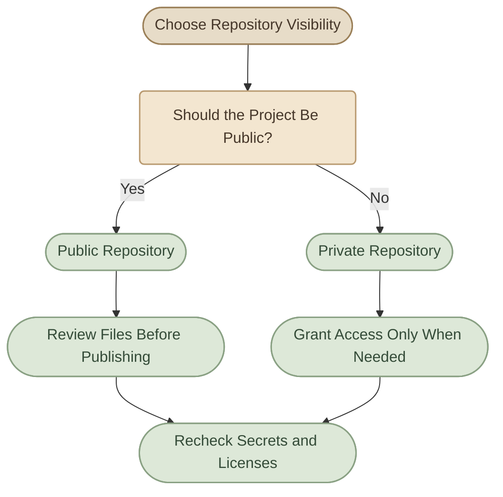
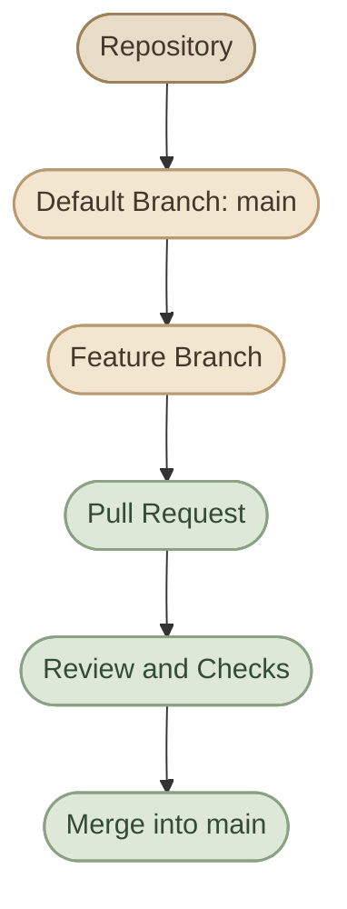

## Introduction

Git هو أداة **Version Control System** بتتابع تغييرات الملفات وتدير تاريخها، بينما GitHub منصة بتستضيف Git repositories وبتضيف أدوات للتعاون وإدارة المشاريع والتحكم في الوصول.

لما تنشئ repository على GitHub، فأنت مش بس بتجهّز مكان للكود؛ أنت بتحدد كمان إزاي الناس هتفهم المشروع، وإزاي هتساهم فيه، ومين يقدر يشوفه أو يعدّله، وإيه القواعد الأساسية لإدارته.

<CardGrid columns={2} label="What You Will Learn">
  <InfoCard variant="concept" title="Repository Structure" description="فهم مكونات الـ repository ودور كل ملف أساسي فيه." icon="layers" tags={["Structure", "Metadata"]} />
  <InfoCard variant="feature" title="Repository Settings" description="إنشاء repository وضبط visibility والـ default branch والإعدادات." icon="sliders" tags={["Configuration", "Access"]} />
  <InfoCard variant="insight" title="Project Documentation" description="استخدام README وLICENSE وCONTRIBUTING لتوضيح المشروع وتنظيم المساهمة فيه." icon="layers" tags={["Documentation", "Open Source"]} />
  <InfoCard variant="tip" title="Templates" description="تسريع إنشاء المشاريع باستخدام repository templates و.gitignore templates." icon="cube" tags={["Reuse", "Consistency"]} />
</CardGrid>

## 1. GitHub Repository Structure

### I. What Is a GitHub Repository?

الـ **GitHub Repository** هو مساحة للمشروع تحتوي على الملفات وتاريخ التغييرات، بالإضافة إلى إعدادات ومعلومات خاصة بالمشروع على GitHub.

الـ repository غالبًا بيضم ثلاثة أنواع رئيسية من المحتوى:

<CardGrid columns={3} label="Repository Content">
  <InfoCard title="Project files" description="الكود، ملفات الإعدادات، الاختبارات، والـ documentation." icon="code" variant="concept" />
  <InfoCard title="Git history" description="الـ commits والـ branches والـ tags التي يتتبعها Git." icon="branch" variant="concept" />
  <InfoCard title="GitHub resources" description="مثل Issues وPull Requests وDiscussions، حسب إعدادات المشروع واحتياجاته." icon="git-pull-request" variant="concept" />
</CardGrid>

مش كل عنصر من العناصر دي ملف داخل مجلد المشروع. الـ Issues والـ Pull Requests مثلًا موارد على منصة GitHub، بينما `README.md` و`LICENSE` ملفات داخل الـ repository.

### II. A Typical Repository Layout

```text
my-project/
├── .github/
│   ├── ISSUE_TEMPLATE/
│   ├── PULL_REQUEST_TEMPLATE.md
│   └── workflows/
├── src/
├── tests/
├── docs/
├── .gitignore
├── README.md
├── LICENSE
├── CONTRIBUTING.md
└── package.json
```

ده مثال توضيحي، مش structure إجباري لكل مشروع. أسماء المجلدات والملفات بتختلف حسب اللغة والـ framework وطبيعة المشروع.

<CardGrid columns={2} label="Core Repository Components">
  <InfoCard variant="concept" title="Source & Tests" description="مجلدات الكود والاختبارات. تنظيمها يعتمد على لغة المشروع ومعماريته." icon="code" />
  <InfoCard variant="feature" title="README.md" description="الصفحة التعريفية الأساسية التي تظهر عادةً عند فتح repository." icon="layers" />
  <InfoCard variant="feature" title=".github/" description="مجلد اختياري يحتوي على إعدادات وملفات تعاون خاصة بـ GitHub، مثل issue templates وبعض workflow definitions." icon="sliders" />
  <InfoCard variant="tip" title=".gitignore" description="يحدد الملفات والمسارات التي يتجاهلها Git عند اكتشاف الملفات غير المتتبعة." icon="wrench" />
</CardGrid>

### III. Git Repository vs GitHub Repository

<TableCard title="Git vs GitHub Repository">
| Aspect | Git Repository | GitHub Repository |
|---|---|---|
| Core purpose | تتبع تاريخ الملفات وإدارة التغييرات | استضافة Git repository وإتاحة التعاون حوله |
| Commits & branches | مدعومة بواسطة Git | تظهر وتُدار عبر GitHub أيضًا |
| Local operation | يعمل محليًا بدون اتصال بالإنترنت | يحتاج اتصالًا للوصول إلى الخدمة |
| Issues & Pull Requests | ليست جزءًا من Git نفسه | أدوات تعاون توفرها منصة GitHub |
| Access management | يعتمد على الوصول إلى ملفات الـ repository والبيئة المحيطة | يوفر إعدادات صلاحيات ورؤية للـ repository |
</TableCard>

**الخلاصة:** Git هو نظام إدارة الإصدارات، وGitHub هو منصة تستضيف Git repositories وتضيف أدوات للتعاون والإدارة.

## 2. Creating and Configuring Repositories

### I. Create a Repository on GitHub

لإنشاء repository جديد:

<Steps>
<li>

<InfoCard title="Sign in" description="افتح حسابك على GitHub." icon="network" />

</li>
<li>

<InfoCard title="Start a new repository" description="اختَر إنشاء repository جديد من واجهة GitHub." icon="cloud" />

</li>
<li>

<InfoCard title="Name it" description="أدخل اسمًا واضحًا للمشروع." icon="tag" />

</li>
<li>

<InfoCard title="Describe it" description="أضف وصفًا مختصرًا لو كان مفيدًا." icon="layers" />

</li>
<li>

<InfoCard title="Choose visibility" description="اختَر الـ visibility المناسبة." icon="shield" />

</li>
<li>

<InfoCard title="Initialize" description="قرر إذا كنت تريد تهيئة repository بملف README أو `.gitignore` أو LICENSE." icon="code" />

</li>
<li>

<InfoCard title="Create" description="راجع الإعدادات، ثم أنشئ repository." icon="git-merge" />

</li>
</Steps>

اسم الـ repository الأفضل يكون واضحًا، سهل القراءة، ويعبّر عن غرض المشروع، مثل:

```text
linux-operations-labs
dockerized-node-app
kubernetes-learning-notes
```

تجنب الأسماء العامة جدًا مثل `project1` أو `test123` للمشاريع التي تنوي الاحتفاظ بها أو عرضها.

### II. Initialize with README, `.gitignore`, and License

أثناء إنشاء repository، قد تعرض لك GitHub خيارات لتهيئته بملفات أساسية:

<CardGrid columns={3} label="Starter Files">
  <InfoCard title="README" description="لتوضيح هدف المشروع وطريقة استخدامه." icon="layers" variant="concept" />
  <InfoCard title=".gitignore" description="لاستبعاد ملفات محلية أو مولدة لا ينبغي تتبعها." icon="wrench" variant="concept" />
  <InfoCard title="License" description="لتحديد شروط استخدام الكود وتوزيعه." icon="shield" variant="concept" />
</CardGrid>

اختَر الملفات التي تناسب المشروع. لو عندك repository محلي يحتوي بالفعل على commits، انتبه عند ربطه بـ repository بعيد جديد تم تهيئته بملفات أو commits مستقلة؛ قد تحتاج إلى معالجة اختلاف التاريخين بدلًا من افتراض أن أول `push` سينجح تلقائيًا.

### III. Connect a Local Repository to GitHub

لو أنشأت repository فارغًا على GitHub وعندك مشروع محلي موجود بالفعل، تقدر تربطه بالـ remote:

```bash
git remote add origin git@github.com:OWNER/REPOSITORY.git
git branch -M main
git push -u origin main
```

استبدل `OWNER` و`REPOSITORY` بالقيم الصحيحة، وتأكد أن SSH access مضبوط وأن الفرع المحلي الذي تريد رفعه هو فعلًا `main`.

لو `origin` موجود بالفعل، افحصه بدل تكرار إضافته:

```bash
git remote -v
```

ولو احتجت تغيير عنوانه:

```bash
git remote set-url origin git@github.com:OWNER/REPOSITORY.git
```

الأوامر السابقة تفترض أن الـ repository المحلي يحتوي على commit واحد على الأقل قبل `push`.

### IV. Configure Repository Settings

بعد إنشاء repository، افتح تبويب **Settings** لمراجعة الإعدادات المتاحة.

الإعدادات التي قد تحتاج إلى مراجعتها تشمل:

<CardGrid columns={2} label="Settings Areas">
  <InfoCard title="General" description="الاسم والوصف وبعض خيارات إدارة repository." icon="sliders" variant="concept" />
  <InfoCard title="Collaborators and access" description="إدارة الأشخاص والفرق المسموح لهم بالوصول، حسب نوع الحساب والـ repository." icon="network" variant="concept" />
  <InfoCard title="Branches" description="إعدادات الفروع والقواعد التي تنطبق عليها." icon="branch" variant="concept" />
  <InfoCard title="Pull Requests" description="بعض خيارات التعامل مع الـ Pull Requests وعمليات الدمج." icon="git-pull-request" variant="concept" />
  <InfoCard title="Pages" description="إعداد استضافة المواقع الثابتة عندما تكون الخدمة متاحة ومناسبة للمشروع." icon="cloud" variant="concept" />
  <InfoCard title="Webhooks أو Integrations" description="ربط أحداث repository بخدمات أخرى عند الحاجة." icon="cycle" variant="concept" />
</CardGrid>

مش كل الإعدادات متاحة لكل repository أو خطة حساب. كمان مكان بعض الخيارات وتسمياتها قد يتغير مع تحديث واجهة GitHub.

<InfoCard variant="tip" title="Configure Only What You Need" description="مش مطلوب تفعّل كل إعداد موجود. ابدأ بالإعدادات التي تخدم المشروع، ثم أضف القيود والحماية كلما احتجت إليها." icon="sliders" />

## 3. Public vs Private Repositories

### I. Public Repositories

الـ **Public Repository** يمكن لأي شخص الوصول إلى محتواه العام عبر GitHub، وفق طبيعة الخدمة وإعدادات المشروع.

مناسب مثلًا لـ:

<CardGrid columns={2} label="Public Use Cases">
  <InfoCard title="Open source" description="Open-source projects." icon="network" variant="concept" />
  <InfoCard title="Docs and notes" description="Documentation وlearning notes التي تريد مشاركتها." icon="layers" variant="concept" />
  <InfoCard title="Portfolio" description="Portfolio projects." icon="flag" variant="concept" />
  <InfoCard title="Teaching material" description="أمثلة تعليمية وأدوات عامة." icon="terminal" variant="concept" />
</CardGrid>

لكن Public لا يعني أن أي شخص يقدر يكتب في repository مباشرةً. صلاحيات الكتابة والإدارة منفصلة عن إمكانية رؤية المحتوى.

### II. Private Repositories

الـ **Private Repository** يقصر الوصول على الأشخاص الذين لديهم صلاحية مناسبة.

مناسب مثلًا لـ:

<CardGrid columns={2} label="Private Use Cases">
  <InfoCard title="Personal work" description="مشاريع شخصية غير منشورة." icon="code" variant="concept" />
  <InfoCard title="Work projects" description="مشاريع عمل داخلية." icon="modules" variant="concept" />
  <InfoCard title="Unpublished material" description="كود أو documentation لا تريد نشرها للعامة." icon="layers" variant="concept" />
  <InfoCard title="Controlled access" description="مشاريع تتطلب إدارة وصول محددة." icon="shield" variant="concept" />
</CardGrid>

لكن Private لا يعني أن تخزين الأسرار داخل Git أصبح آمنًا تلقائيًا. ما زلت تحتاج إلى حماية الـ credentials، وتحديد صلاحيات الوصول، ومراجعة أي integrations أو collaborators.

### III. Comparison

<TableCard title="Public vs Private">
| Aspect | Public | Private |
|---|---|---|
| General visibility | متاح للعامة | مقتصر على من لديهم صلاحية |
| Portfolio use | مناسب لعرض مشاريعك العامة | مناسب للمشاريع التي لا تريد نشرها |
| Collaboration | يمكن التعاون مع مساهمين وفق الصلاحيات | التعاون يتطلب منح الوصول المناسب |
| Secret protection | ضروري | ضروري أيضًا |
| Best use | Open source والمحتوى العام | المشاريع الداخلية أو غير المنشورة |
</TableCard>

### IV. How to Choose



قبل تحويل repository إلى Public، راجع الملفات وتاريخ Git وأي معلومات حساسة. تغيير visibility لا يمحو الأسرار التي سبق أن دخلت التاريخ، ولا يضمن إزالة نسخ سابقة لدى أشخاص أو خدمات أخرى.

<InfoCard variant="warning" title="Public Is a Publishing Decision" description="قبل النشر العام، راجع الكود والـ commit history والـ license والملفات المحلية التي ربما دخلت بالخطأ. لا تعتمد على إخفاء repository وحده لحماية الأسرار." icon="shield" />

## 4. Default Branch and Repository Settings

### I. What Is the Default Branch?

الـ **Default Branch** هو الفرع الذي تعتبره GitHub الفرع الأساسي للـ repository في عدد من الواجهات والعمليات.

في مشاريع كثيرة، اسمه `main`، لكنه اسم شائع وليس شرطًا تقنيًا ثابتًا.

الـ default branch يُستخدم عادةً كنقطة مرجعية لعرض المشروع، وفتح Pull Requests، وتحديد الفرع الأساسي الذي تُقارن به التغييرات في workflows شائعة.



### II. Changing the Default Branch

قد تحتاج لتغيير الـ default branch عند نقل مشروع قديم إلى naming convention جديد أو عند اعتماد فرع أساسي مختلف.

قبل التغيير:

<Steps>
<li>

<InfoCard title="Verify the new branch" description="تأكد أن الفرع الجديد موجود ويحتوي على التاريخ والمحتوى المطلوبين." icon="branch" />

</li>
<li>

<InfoCard title="Review protection rules" description="راجع إعدادات الحماية وbranch rules المرتبطة بالفرع القديم." icon="shield" />

</li>
<li>

<InfoCard title="Audit workflows" description="راجع workflows وintegrations التي تشير إلى اسم الفرع القديم." icon="cycle" />

</li>
<li>

<InfoCard title="Switch the default" description="غيّر default branch من إعدادات GitHub." icon="sliders" />

</li>
<li>

<InfoCard title="Update local clones" description="حدّث clones المحلية والـ automation حسب الحاجة." icon="terminal" />

</li>
</Steps>

تغيير default branch لا يعني تلقائيًا حذف الفرع القديم أو إعادة كتابة تاريخه. تعامل مع حذف الفروع كعملية منفصلة.

### III. Repository Settings Worth Understanding

<CardGrid columns={2} label="Key Settings">

<InfoCard title="Branch protection and rulesets" icon="shield" variant="feature">

تساعد في تطبيق قواعد على فروع محددة، مثل اشتراط Pull Request أو نجاح checks قبل الدمج، بحسب نوع القاعدة والإعدادات المتاحة.

</InfoCard>

<InfoCard title="Merge options" icon="git-merge" variant="feature">

يمكن أن تتيح GitHub خيارات مختلفة لدمج Pull Requests، مثل merge commit أو squash merge أو rebase merge. اختيار الطريقة المناسبة يعتمد على workflow الفريق وتفضيلاته.

</InfoCard>

<InfoCard title="Collaborator access" icon="network" variant="feature">

امنح كل شخص أقل مستوى صلاحيات يحتاجه. لا تمنح صلاحيات إدارية لمجرد أن الشخص يحتاج إلى المساهمة في الكود.

</InfoCard>

<InfoCard title="Features" icon="modules" variant="feature">

يمكن إدارة بعض إمكانات التعاون، مثل Issues وDiscussions وWiki، وفق احتياج المشروع وتوافر الخيارات.

</InfoCard>

</CardGrid>

<InfoCard variant="insight" title="Settings Define the Collaboration Model" description="إعدادات repository بتحدد جزءًا كبيرًا من طريقة التعاون: مين يقدر يوصل، إزاي التغييرات تدخل الفروع الأساسية، وإيه أدوات إدارة المشروع المتاحة." icon="sliders" />

## 5. README, LICENSE and CONTRIBUTING

دي ثلاثة ملفات مختلفة في الهدف، ومن الأفضل عدم التعامل معها على أنها بدائل لبعضها.

### I. README.md

الـ README هو المدخل الأساسي لفهم المشروع.

غالبًا GitHub يعرضه في صفحة repository، لذلك المفروض يجاوب بسرعة عن الأسئلة المهمة:

<CardGrid columns={2} label="What a README Answers">
  <InfoCard title="What?" description="المشروع ده بيعمل إيه؟" icon="pulse" variant="concept" />
  <InfoCard title="Why?" description="ليه موجود؟" icon="flag" variant="concept" />
  <InfoCard title="Setup?" description="إزاي أجهّزه وأشغّله؟" icon="wrench" variant="concept" />
  <InfoCard title="Requirements?" description="ما المتطلبات الأساسية؟" icon="layers" variant="concept" />
  <InfoCard title="Usage?" description="إزاي أستخدمه؟" icon="terminal" variant="concept" />
  <InfoCard title="Test or contribute?" description="إزاي أختبره أو أساهم فيه؟" icon="git-pull-request" variant="concept" />
</CardGrid>

مثال لهيكل README:

```markdown
# Project Name

A short description of the project and its purpose.

## Features

- Feature one
- Feature two

## Prerequisites

- Required runtime or tools
- Required dependencies

## Installation

Steps to prepare the project.

## Usage

Examples of how to use it.

## Testing

How to run the tests.

## Contributing

See [CONTRIBUTING.md](CONTRIBUTING.md).

## License

See [LICENSE](LICENSE).
```

ده skeleton عام؛ عدّل الأقسام حسب طبيعة المشروع. مشروع documentation مثلًا قد يحتاج قسمًا لهيكل المحتوى وطريقة تشغيل الموقع محليًا بدل قسم API usage.

### II. LICENSE

ملف `LICENSE` يحدد الشروط القانونية التي تحكم استخدام العمل وإعادة توزيعه وتعديله، وفق نص الرخصة المختارة.

من الرخص الشائعة في المشاريع البرمجية:

<CardGrid columns={3} label="Common Licenses">
  <InfoCard title="MIT License" description="رخصة بسيطة ومرنة نسبيًا." icon="shield" variant="concept" />
  <InfoCard title="Apache License 2.0" description="تتضمن أحكامًا إضافية، منها أحكام مرتبطة ببراءات الاختراع." icon="shield" variant="concept" />
  <InfoCard title="GNU GPL" description="رخصة copyleft تفرض شروطًا على بعض أشكال إعادة التوزيع والعمل المشتق." icon="shield" variant="concept" />
</CardGrid>

اختيار الرخصة قرار قانوني له تبعات، وليس مجرد إضافة ملف شكلي. راجع شروط الرخصة المناسبة لمشروعك ومحتواه، ولا تفترض أن كل ملف داخل repository مملوك لك أو متاح لإعادة الاستخدام.

وجود repository عام وحده لا يعني أن الكود أصبح متاحًا تحت رخصة مفتوحة المصدر.

### III. CONTRIBUTING.md

الملف ده بيوضح للناس إزاي يساهموا في المشروع.

ممكن يحتوي على:

<CardGrid columns={2} label="CONTRIBUTING Contents">
  <InfoCard title="Dev setup" description="طريقة إعداد بيئة التطوير." icon="terminal" variant="concept" />
  <InfoCard title="Naming rules" description="قواعد تسمية الفروع والـ commits." icon="branch" variant="concept" />
  <InfoCard title="Tests" description="خطوات تشغيل الاختبارات." icon="shield" variant="concept" />
  <InfoCard title="Formatting" description="أسلوب formatting أو linting." icon="code" variant="concept" />
  <InfoCard title="Issues and PRs" description="كيفية فتح Issue أو Pull Request." icon="git-pull-request" variant="concept" />
  <InfoCard title="Review standards" description="معايير المراجعة المقبولة للمشروع." icon="pulse" variant="concept" />
</CardGrid>

مثال:

```markdown
# Contributing

Thanks for your interest in contributing!

## Development Setup

1. Fork or clone the repository.
2. Install the required dependencies.
3. Create a branch for your change.

## Before Submitting

- Run the relevant tests.
- Check formatting and linting.
- Update documentation when necessary.

## Pull Requests

- Explain the problem and the proposed solution.
- Keep changes focused.
- Include testing details.
```

المحتوى ده نقطة بداية، ومش بديلًا عن متطلبات المشروع الفعلية.

### IV. How These Files Work Together

<CardGrid columns={2} label="Repository Documentation Files">
  <InfoCard variant="feature" title="README.md" description="What is this project, and how do I use it?" icon="layers" tags={["Project Overview"]} />
  <InfoCard variant="feature" title="LICENSE" description="Under what terms may others use, modify, or redistribute this work?" icon="shield" tags={["Legal Terms"]} />
  <InfoCard variant="feature" title="CONTRIBUTING.md" description="How should contributors prepare and submit changes?" icon="git-pull-request" tags={["Collaboration"]} />
  <InfoCard variant="tip" title="Keep Them Consistent" description="حدّث الملفات عند تغيّر خطوات التشغيل أو قواعد المساهمة أو شروط الترخيص." icon="shield" />
</CardGrid>

## 6. Repository Templates

### I. What Is a Repository Template?

الـ **Repository Template** هو repository تقدر تستخدمه كنقطة بداية لإنشاء مشاريع جديدة لها structure أو configuration متكرر.

مثلًا، لو عندك عدة مشاريع بنفس التنظيم الأساسي، ممكن تعمل template يحتوي على:

```text
project-template/
├── .github/
├── docs/
├── tests/
├── .gitignore
├── README.md
└── CONTRIBUTING.md
```

بعد تفعيل repository كـ template، يمكن إنشاء repositories جديدة انطلاقًا منه عبر واجهة GitHub.

### II. When Are Templates Useful?

<CardGrid columns={2} label="Template Benefits">
  <InfoCard title="Consistent structure" description="توحيد structure المشاريع داخل فريق." icon="cube" variant="concept" />
  <InfoCard title="Starter docs" description="تجهيز ملفات documentation الأساسية." icon="layers" variant="concept" />
  <InfoCard title="Shared config" description="تضمين ملفات configuration وlinting مشتركة." icon="sliders" variant="concept" />
  <InfoCard title="PR and issue templates" description="توفير issue أو Pull Request templates." icon="tag" variant="concept" />
  <InfoCard title="Less manual setup" description="تقليل تكرار الإعداد اليدوي للمشاريع الجديدة." icon="cycle" variant="concept" />
</CardGrid>

### III. Create a Template Repository

بشكل عام:

<Steps>
<li>

<InfoCard title="Build the base" description="أنشئ repository يحتوي على الملفات الأساسية التي تريد إعادة استخدامها." icon="cube" />

</li>
<li>

<InfoCard title="Scrub secrets" description="راجع أنه لا يحتوي على secrets أو بيانات خاصة بمشروع معين." icon="shield" />

</li>
<li>

<InfoCard title="Open settings" description="افتح إعدادات repository." icon="sliders" />

</li>
<li>

<InfoCard title="Enable template" description="فعّل خيار استخدامه كـ template إذا كان متاحًا." icon="flag" />

</li>
<li>

<InfoCard title="Use the template" description="عند إنشاء مشروع جديد، استخدم خيار إنشاء repository من template." icon="git-merge" />

</li>
</Steps>

واجهة GitHub قد تختلف قليلًا حسب التحديثات، لذلك راجع الإعدادات الحالية عند التطبيق.

### IV. Template vs Fork vs Clone

<TableCard title="Template vs Fork vs Clone">
| Feature | Template | Fork | Clone |
|---|---|---|---|
| Primary purpose | بدء repository جديد من structure جاهز | إنشاء نسخة مرتبطة بالـ upstream repository | إنشاء working copy محلية |
| Relationship to source | لا ينشئ عادةً علاقة fork | يحتفظ بعلاقة fork على GitHub | لا ينشئ وحده علاقة fork على GitHub |
| Typical use | Project scaffolding | المساهمة في مشروع آخر أو تطوير fork | العمل محليًا على repository |
| Git history | يعتمد على طريقة إنشاء template والخيارات المستخدمة | يُحافظ عادةً على تاريخ المشروع الأصلي | ينقل تاريخ Git المتاح في المصدر المستنسخ |
</TableCard>

**نقطة مهمة:** إنشاء مشروع من template ليس بديلًا عن `git clone`. الأول ينشئ repository جديدًا اعتمادًا على قالب، بينما الثاني ينشئ نسخة محلية من repository موجود.

<InfoCard variant="comparison" title="Template or Fork?" description="استخدم Template لبدء مشروع مستقل من structure متكرر. استخدم Fork عندما تحتاج نسخة مرتبطة بمشروع موجود وتريد المساهمة فيه أو تطويرها بشكل منفصل." icon="cube" />

## 7. `.gitignore` Templates

### I. Why Use a `.gitignore` Template?

ملف `.gitignore` يحتوي على patterns يستخدمها Git لتجاهل ملفات غير متتبعة. GitHub يوفّر قوالب جاهزة للعديد من لغات البرمجة والـ frameworks وأنظمة التشغيل.

مثلًا، قد تحتاج في مشروع Python إلى تجاهل cache وvirtual environments، بينما مشروع Node.js يحتاج غالبًا إلى تجاهل `node_modules`.

### II. Example: Node.js

```gitignore
node_modules/
dist/
.env
.env.*
!.env.example
npm-debug.log*
```

القواعد دي مثال توضيحي، وقد تحتاج إلى تعديلها حسب build output وطريقة إدارة البيئة في المشروع.

### III. Example: Python

```gitignore
__pycache__/
*.py[cod]
.venv/
venv/
.pytest_cache/
.env
```

### IV. Example: Operating System Files

```gitignore
.DS_Store
Thumbs.db
```

### V. Choose a GitHub `.gitignore` Template

عند إنشاء repository جديد على GitHub، قد تقدر تختار `.gitignore` template يناسب اللغة أو الأدوات المستخدمة.

ولو المشروع موجود بالفعل، تقدر تضيف أو تعدّل `.gitignore` محليًا:

```bash
touch .gitignore
```

بعد تعديل الملف:

```bash
git status
git diff -- .gitignore
```

لو الملف غير متتبع:

```bash
git add .gitignore
git commit -m "Add gitignore rules"
```

### VI. `.gitignore` Limitations

القواعد لا توقف تتبع ملف تمت إضافته بالفعل إلى Git. لو الملف متتبع وتريد إيقاف تتبعه مع الاحتفاظ بنسخته المحلية:

```bash
git rm --cached path/to/file
```

ثم أضف المسار إلى `.gitignore` واعمل commit بالتغيير المناسب.

تذكر أيضًا أن تجاهل الملفات لا يحذفها من الـ commit history. لو الملف يحتوي على secret سبق نشره، اتبع إجراءات التعامل مع الأسرار المكشوفة بدل الاكتفاء بتعديل `.gitignore`.

<InfoCard variant="warning" title="Review Templates Before Using Them" description="القالب نقطة بداية، مش ضمان أن كل القواعد مناسبة لمشروعك. راجع الملفات المتولدة والـ build outputs والـ environment files قبل أول commit." icon="wrench" />

## 8. Practical Lab: Create a Well-Configured Repository

هنطبّق المفاهيم على repository تجريبي. تقدر تستخدم مشروعًا جديدًا أو مجلدًا محليًا مخصصًا للتدريب.

<Steps>
<li>

<InfoCard title="Create the Repository" icon="cloud" />

أنشئ repository باسم:

```text
github-repository-lab
```

اختَر visibility حسب هدف التجربة، وأضف README و`.gitignore` لو احتجت.

</li>
<li>

<InfoCard title="Inspect the Repository" icon="terminal" />

بعد إنشاء repository، افحص الملفات المحلية:

```bash
git status
git branch --show-current
git remote -v
```

الأوامر دي تساعدك تتأكد من حالة الملفات والفرع الحالي وعناوين الـ remotes.

</li>
<li>

<InfoCard title="Improve the README" icon="layers" />

أنشئ README واضحًا يحتوي على:

<CardGrid columns={2} label="README Checklist">
  <InfoCard title="Name" description="اسم المشروع." icon="tag" variant="concept" />
  <InfoCard title="Goal" description="الهدف من التجربة." icon="flag" variant="concept" />
  <InfoCard title="Requirements" description="المتطلبات." icon="layers" variant="concept" />
  <InfoCard title="Setup" description="خطوات الإعداد." icon="wrench" variant="concept" />
  <InfoCard title="Run or test" description="طريقة تشغيل أو اختبار المشروع." icon="terminal" variant="concept" />
  <InfoCard title="Contributing notes" description="ملاحظات المساهمة إن كانت مطلوبة." icon="git-pull-request" variant="concept" />
</CardGrid>

</li>
<li>

<InfoCard title="Review .gitignore" icon="wrench" />

تأكد من تجاهل الملفات المحلية غير المطلوبة. لا تضف قواعد واسعة لمجرد أن القالب يحتوي عليها؛ افهم كل pattern وتأثيره.

</li>
<li>

<InfoCard title="Choose a License" icon="shield" />

لو المشروع مخصص للنشر أو إعادة الاستخدام، حدّد ما إذا كنت ستضيف رخصة مناسبة. لا تختَر رخصة عشوائيًا من غير فهم شروطها.

</li>
<li>

<InfoCard title="Review Repository Settings" icon="sliders" />

افحص:

<CardGrid columns={2} label="Settings Review">
  <InfoCard title="Visibility" description="Visibility." icon="shield" variant="concept" />
  <InfoCard title="Default branch" description="Default branch." icon="branch" variant="concept" />
  <InfoCard title="Collaborators" description="Collaborator access." icon="network" variant="concept" />
  <InfoCard title="Branch rules" description="Branch rules أو protection options المتاحة." icon="tag" variant="concept" />
  <InfoCard title="Features" description="Features التي يحتاجها المشروع." icon="modules" variant="concept" />
</CardGrid>

</li>
<li>

<InfoCard title="Final Review" icon="git-merge" />

قبل اعتبار repository جاهزًا للمشاركة، راجع:

```bash
git status
git log --oneline -5
git ls-files
```

وبجانب الفحص المحلي، راجع صفحة repository على GitHub للتأكد من ظهور الملفات والإعدادات المطلوبة.

</li>
</Steps>

## Summary

<CardGrid columns={2} label="Key Takeaways">
  <InfoCard variant="summary" title="GitHub Repository" description="يجمع ملفات المشروع وتاريخه وموارد التعاون المرتبطة به." icon="cube" />
  <InfoCard variant="summary" title="Repository Settings" description="تحكم في خيارات الإدارة والوصول والتعاون." icon="sliders" />
  <InfoCard variant="summary" title="Public vs Private" description="الاختيار يعتمد على الجمهور المستهدف وحساسية المشروع؛ ولا يغني عن حماية الأسرار." icon="shield" />
  <InfoCard variant="summary" title="Default Branch" description="الفرع الأساسي الذي تعتمد عليه عدة واجهات وworkflows في GitHub." icon="branch" />
  <InfoCard variant="summary" title="README" description="يشرح هدف المشروع وإعداده واستخدامه." icon="layers" />
  <InfoCard variant="summary" title="LICENSE" description="يحدد شروط استخدام العمل وإعادة توزيعه." icon="flag" />
  <InfoCard variant="summary" title="CONTRIBUTING" description="يوضح كيفية المشاركة في المشروع." icon="git-pull-request" />
  <InfoCard variant="summary" title="Repository Templates" description="تعيد استخدام structure وإعدادات جاهزة لبدء مشاريع جديدة." icon="cube" />
  <InfoCard variant="summary" title=".gitignore Templates" description="تساعد في اختيار قواعد تجاهل مناسبة، لكنها تحتاج إلى مراجعة حسب المشروع." icon="wrench" />
</CardGrid>
