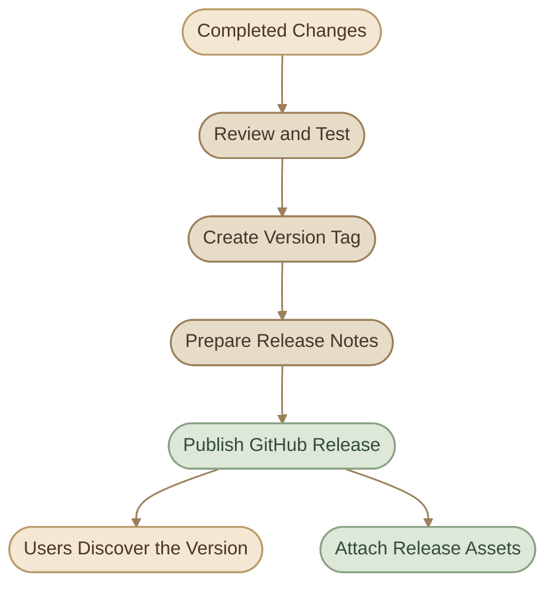
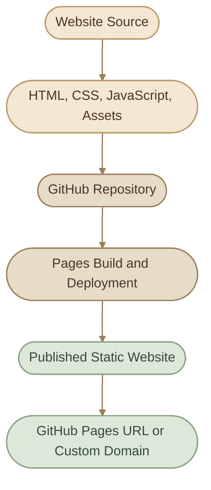

## Introduction

إدارة الـ Repository مش بتنتهي بعد ما ترفع الكود. مع الوقت هتحتاج تتابع Issues وPull Requests، تنشر Releases، تحدّث إعدادات المشروع، وتقرر هل المشروع لسه نشط ولا محتاج يتأرشف أو ينتقل لمالك جديد.

في الدرس ده هنستخدم أدوات GitHub نفسها، خصوصًا `gh`، عشان تنجز المهام دي من الـ Terminal.

<CardGrid columns={2} label="What You Will Learn">
  <InfoCard variant="concept" title="GitHub CLI" description="التعامل مع Repositories وIssues وPull Requests وReleases مباشرة من الـ Terminal." icon="terminal" tags={["gh", "Automation"]} />
  <InfoCard variant="concept" title="Repository Lifecycle" description="إدارة إعدادات المشروع وإصداراته، واتخاذ قرارات Archive أو Delete أو Transfer." icon="branch" tags={["Maintenance", "Lifecycle"]} />
  <InfoCard variant="concept" title="Discoverability" description="تحسين وصف المشروع وTopics والملفات التي تساعد الناس على فهمه والوصول إليه." icon="tag" tags={["Topics", "Metadata"]} />
  <InfoCard variant="concept" title="GitHub Pages" description="فهم استضافة المواقع الثابتة المرتبطة بالـ Repository واستخداماتها." icon="cloud" tags={["Static Sites", "Documentation"]} />
</CardGrid>

## 1. GitHub CLI (`gh`)

الـ **GitHub CLI** هو أداة رسمية بتخليك تتعامل مع GitHub من الـ Terminal بدل ما تعتمد على المتصفح في كل عملية.

خلّي بالك من الفرق:

<CardGrid columns={2} label="git vs gh">
  <InfoCard variant="comparison" title="git" icon="branch">

`git`: بيتعامل أساسًا مع الـ Repository المحلي والـ Git objects والـ branches والـ commits والـ remotes.

  </InfoCard>
  <InfoCard variant="comparison" title="gh" icon="terminal">

`gh`: بيتعامل مع ميزات GitHub، زي Pull Requests وIssues وReleases وإدارة الـ Repositories.

  </InfoCard>
</CardGrid>

الاتنين بيكملوا بعض، ومش واحد بديل كامل للتاني.

### I. Check Whether `gh` Is Installed

```bash
gh --version
```

لو الأمر مش موجود، راجع طريقة التثبيت الرسمية المناسبة لتوزيعتك من [GitHub CLI Manual](https://cli.github.com/manual/).

### II. Authenticate with GitHub

```bash
gh auth login
```

اتبع التعليمات، واختار `GitHub.com` وطريقة المصادقة المناسبة. بعد إتمام العملية، تحقق من الحالة:

```bash
gh auth status
```

الـ CLI ممكن يخزّن بيانات المصادقة في Credential Store آمن متاح على النظام، لكن طريقة التخزين الفعلية تعتمد على إعدادات جهازك. ما تستخدمش خيار التخزين غير الآمن أو تحط Tokens داخل ملفات عامة.

### III. Useful Commands

<TableCard>
| Command | Purpose |
|---|---|
| `gh repo view` | عرض معلومات الـ Repository الحالي |
| `gh repo view --web` | فتح الـ Repository في المتصفح |
| `gh repo clone OWNER/REPO` | استنساخ Repository |
| `gh issue list` | عرض Issues |
| `gh issue create` | إنشاء Issue |
| `gh pr list` | عرض Pull Requests |
| `gh pr view` | عرض تفاصيل Pull Request |
| `gh release list` | عرض Releases |
| `gh status` | ملخص لبعض الأنشطة المرتبطة بحسابك |
</TableCard>

### IV. Practical Examples

لو أنت داخل مجلد Repository ومحتاج تعرف معلوماته:

```bash
gh repo view
```

افتح الصفحة في المتصفح:

```bash
gh repo view --web
```

اعرض Issues المفتوحة:

```bash
gh issue list --state open
```

اعرض Pull Requests:

```bash
gh pr list
```

اعرض Releases المنشورة:

```bash
gh release list
```

الأوامر السابقة بتوضح نمط الاستخدام، لكن بعض العمليات ممكن تحتاج صلاحيات إضافية أو Repository محدد.

<InfoCard variant="tip" title="Use the Right Tool" description="استخدم git لإدارة تاريخ الكود محليًا، وgh للتعامل مع ميزات GitHub. مثلًا، git commit ينشئ Commit، بينما gh pr create ينشئ Pull Request على GitHub." icon="sliders" />

## 2. Repository Settings and Maintenance

إعدادات الـ Repository بتحدد إزاي المشروع بيتدار، مين يقدر يوصل له، وإيه الميزات المتاحة فيه.

### I. Important Settings

<TableCard>
| Setting | Purpose |
|---|---|
| Visibility | تحديد ما إذا كان الـ Repository Public أو Private، أو Internal حيث يكون الخيار مدعومًا |
| Default branch | تحديد الفرع الافتراضي للمشروع |
| Collaborators and teams | إدارة الوصول |
| Branch protection and rulesets | فرض قواعد على الفروع المهمة |
| Issues and Discussions | تنظيم التواصل مع المستخدمين والمساهمين |
| Pull Request settings | تحديد سياسات الدمج والمراجعة |
| Security settings | إدارة ميزات الحماية المتاحة |
| Pages | إعداد استضافة الموقع عند دعمها |
</TableCard>

مش لازم تغيّر كل الإعدادات لكل مشروع؛ اختار اللي يناسب طبيعة الـ Repository واحتياجاته.

### II. A Simple Maintenance Routine

<CardGrid columns={2} label="Maintenance Routine">
  <InfoCard variant="concept" title="Review Issues and Pull Requests" icon="git-pull-request">

راجع العناصر المفتوحة، وتأكد إن الـ Issues القديمة اتقفلت أو اتحدّثت، وإن التغييرات المهمة خضعت للمراجعة.

  </InfoCard>
  <InfoCard variant="concept" title="Review Access and Security" icon="shield">

راجع Collaborators وTeams والصلاحيات، وتأكد إن إعدادات الحماية متوافقة مع طبيعة المشروع.

  </InfoCard>
  <InfoCard variant="concept" title="Keep Project Metadata Updated" icon="code">

حدّث README والوصف والـ Topics وملفات المساهمة عندما تتغير طريقة استخدام المشروع.

  </InfoCard>
  <InfoCard variant="concept" title="Review Releases and Dependencies" icon="cube">

تأكد من وضوح الإصدارات المنشورة، وراجع التنبيهات الأمنية والتحديثات التي تحتاج تدخلًا.

  </InfoCard>
</CardGrid>

### III. Inspect Repository Metadata with `gh`

```bash
gh repo view --json name,description,url,visibility,defaultBranchRef
```

الأمر ده بيعرض مجموعة من بيانات الـ Repository بصيغة JSON. تقدر تستخدم `--json` مع الحقول المدعومة لتسهيل الفحص أو بناء Scripts.

قبل ما تغيّر إعدادًا حساسًا، افهم تأثيره وتأكد إن عندك الصلاحية المطلوبة.

## 3. Releases and Release Notes

الـ **Release** على GitHub هو طريقة لتقديم نسخة محددة من المشروع للمستخدمين، وغالبًا بيكون مرتبطًا بـ Git Tag.

خلّي الفرق واضح:

<CardGrid columns={3} label="Commit vs Tag vs Release">
  <InfoCard variant="comparison" title="Commit" icon="git-merge">

**Commit:** لقطة من تاريخ التغييرات.

  </InfoCard>
  <InfoCard variant="comparison" title="Tag" icon="tag">

**Tag:** اسم يشير إلى نقطة محددة في تاريخ Git.

  </InfoCard>
  <InfoCard variant="comparison" title="Release" icon="flag">

**Release:** صفحة على GitHub مرتبطة عادةً بـ Tag، ويمكن أن تتضمن Release Notes وملفات قابلة للتنزيل.

  </InfoCard>
</CardGrid>

### IV. From a Tag to a Release



### V. Create a Version Tag

مثال لإصدار `v1.2.0`:

```bash
git tag -a v1.2.0 -m "Release v1.2.0"
git push origin v1.2.0
```

الأمر الأول ينشئ Annotated Tag محليًا، والتاني يرفع الـ Tag إلى الـ Remote المسمى `origin`.

اتأكد إن الـ Tag بيشير إلى الـ Commit الصحيح قبل نشره.

### VI. Create a GitHub Release with `gh`

بعد ما يكون الـ Tag متاحًا على GitHub:

```bash
gh release create v1.2.0 \
  --title "v1.2.0" \
  --notes "Describe the important changes in this release."
```

ده بينشئ Release بالعنوان والـ Notes المحددين. استخدم وصفًا حقيقيًا للتغييرات بدل النص التوضيحي عند النشر الفعلي.

لعرض الإصدارات:

```bash
gh release list
```

ولعرض تفاصيل إصدار محدد:

```bash
gh release view v1.2.0
```

### VII. Writing Useful Release Notes

Release Notes الجيدة بتساعد المستخدم يفهم إيه اللي اتغير، وإيه اللي محتاج يعرفه قبل الترقية.

قالب مقترح:

```markdown
## Highlights

- Summarize the most important changes.

## Improvements

- Describe notable improvements.

## Bug Fixes

- List important fixes.

## Breaking Changes

- Explain incompatible changes and migration steps.

## Upgrade Notes

- Mention any required configuration or migration.
```

مش كل Release محتاج كل الأقسام؛ لو مفيش Breaking Changes، مش لازم تضيف قسم يوحي بوجودها.

<InfoCard variant="tip" title="Version Numbers Need Meaning" description="استخدم Semantic Versioning لما يكون مناسبًا للمشروع: MAJOR للتغييرات غير المتوافقة، MINOR للميزات المتوافقة، وPATCH للإصلاحات المتوافقة." icon="tag" />

## 4. Topics and Repository Discoverability

الـ **Topics** هي كلمات مفتاحية بتضيفها للـ Repository عشان تساعد الناس على فهم نوع المشروع والعثور عليه.

مثلًا، Repository لمشروع DevOps ممكن يستخدم:

```text
devops
docker
kubernetes
linux
infrastructure-as-code
```

اختار Topics بتوصف المشروع فعلًا، بدل إضافة أسماء أدوات أو تقنيات مش مستخدمة فيه.

### I. Improve Discoverability

<CardGrid columns={2} label="Discoverability Checklist">
  <InfoCard variant="feature" title="Clear Repository Name" description="اسم سهل الفهم والتذكر." icon="tag" />
  <InfoCard variant="feature" title="Short Description" description="وصف يوضح وظيفة المشروع بسرعة." icon="code" />
  <InfoCard variant="feature" title="Useful README" description="يشرح الهدف والمتطلبات وطريقة التشغيل." icon="flag" />
  <InfoCard variant="feature" title="Relevant Topics" description="كلمات مفتاحية دقيقة." icon="tag" />
  <InfoCard variant="feature" title="License" description="وضّح شروط استخدام المشروع عندما يكون ذلك مناسبًا." icon="shield" />
  <InfoCard variant="feature" title="Screenshots or Architecture Diagram" description="أضفها لو بتساعد على فهم المشروع." icon="layers" />
  <InfoCard variant="feature" title="Releases" description="انشر نسخًا واضحة لو المشروع بيقدّم إصدارات للمستخدمين." icon="cycle" />
</CardGrid>

### II. Example: DevOps Project Metadata

<InfoCard variant="feature" title="kubernetes-deployment-lab" icon="cube">

A hands-on Kubernetes lab covering deployments, services, configuration, and troubleshooting.

**Example Topics:** kubernetes, devops, containers, cloud-native.

</InfoCard>

المثال توضيحي فقط؛ الفكرة إن الوصف والـ Topics يعكسوا محتوى المشروع الحقيقي.

## 5. Archive vs Delete

لما مشروع يتوقف، عندك أكتر من اختيار. القرار بين **Archive** و**Delete** مهم لأن تأثير كل واحد مختلف.

<TableCard>
| Aspect | Archive | Delete |
|---|---|---|
| Purpose | الاحتفاظ بالمشروع كمرجع غير نشط | إزالة الـ Repository |
| Code and history | يظل موجودًا | تتم إزالة الـ Repository من مكانه الأصلي |
| Changes | يصبح المحتوى والموارد المرتبطة به Read-only | لا يمكن التعامل معه كـ Repository نشط بعد الحذف |
| Reversibility | يمكن إلغاء الأرشفة بصلاحية مناسبة | الاسترجاع ليس مضمونًا ويخضع لسياسات GitHub |
| Best for | مشروع قديم ما زال له قيمة مرجعية | مشروع لم تعد هناك حاجة للاحتفاظ به، بعد مراجعة العواقب |
</TableCard>

### I. When Should You Archive?

أرشِف المشروع لما:

<CardGrid columns={2} label="When to Archive">
  <InfoCard variant="concept" title="يتوقف تطويره، لكن محتواه ما زال مفيدًا." icon="cycle" />
  <InfoCard variant="concept" title="يكون المشروع مثالًا تعليميًا أو مرجعًا تاريخيًا." icon="flag" />
  <InfoCard variant="concept" title="تريد توضيح إنه لم يعد تحت الصيانة النشطة." icon="branch" />
  <InfoCard variant="concept" title="تحتاج للاحتفاظ بتاريخ Issues وPull Requests والإصدارات." icon="database" />
</CardGrid>

قبل الأرشفة، يُفضّل تحديث README والوصف وإغلاق أو توضيح حالة Issues وPull Requests المفتوحة.

### II. Archive a Repository Using `gh`

```bash
gh repo archive OWNER/REPOSITORY
```

ده أمر بيغيّر حالة الـ Repository على GitHub. استخدمه فقط بعد التأكد من المالك والاسم والقرار؛ بعض الأوامر بتطلب تأكيدًا قبل التنفيذ.

لإلغاء الأرشفة، عند الحاجة والصلاحية المناسبة:

```bash
gh repo unarchive OWNER/REPOSITORY
```

### III. When Should You Delete?

الحذف قرار أشد تأثيرًا. قبل حذف Repository:

<Steps>
<li>

<InfoCard title="Confirm the Owner and Name" icon="flag">

تأكد من المالك والاسم.

</InfoCard>
</li>
<li>

<InfoCard title="Review What You Would Lose" icon="database">

راجع هل فيه بيانات أو Releases أو Issues محتاج تحتفظ بيها.

</InfoCard>
</li>
<li>

<InfoCard title="Check Dependents" icon="network">

تحقق من الـ Clones والـ Forks والأنظمة التي تعتمد عليه.

</InfoCard>
</li>
<li>

<InfoCard title="Follow Team Policy" icon="shield">

تأكد من سياسة المؤسسة أو الفريق.

</InfoCard>
</li>
<li>

<InfoCard title="Keep a Backup if Required" icon="cube">

احتفظ بنسخة احتياطية لو كانت مطلوبة ومسموحًا بها.

</InfoCard>
</li>
</Steps>

الأمر التالي يعرض صيغة الحذف، لكنه **ليس أمرًا للتجربة على مشروع حقيقي**:

```bash
gh repo delete OWNER/REPOSITORY
```

ما تضيفش `--yes` لمجرد تجاوز التأكيد. التأكيد خطوة مهمة لتجنب حذف Repository بالخطأ.

<InfoCard variant="warning" title="Archive First When Unsure" description="لو الهدف هو إيقاف التطوير مع الاحتفاظ بالمشروع، فالأرشفة غالبًا أنسب من الحذف. الحذف قد تكون له عواقب يصعب عكسها." icon="cycle" />

## 6. Repository Transfer — The Concept

الـ **Repository Transfer** هو نقل ملكية Repository من حساب شخصي إلى حساب شخصي آخر أو إلى Organization، وفقًا للصلاحيات وشروط GitHub.

استخداماته تشمل:

<CardGrid columns={3} label="Transfer Use Cases">
  <InfoCard variant="concept" title="نقل مشروع شخصي إلى Organization خاصة بالفريق." icon="network" />
  <InfoCard variant="concept" title="نقل الملكية إلى الجهة المسؤولة عن صيانة المشروع." icon="flag" />
  <InfoCard variant="concept" title="تنظيم Repositories تحت حساب مؤسسي بدل حساب فردي." icon="layers" />
</CardGrid>

### I. What Changes During a Transfer?

الـ Transfer مش مجرد تغيير Remote URL؛ ده تغيير في **الملكية على GitHub**.

قد تنتقل مع الـ Repository عناصر مثل الكود والـ Issues وPull Requests والـ Releases والإعدادات، لكن لازم تراجع تفاصيل GitHub المتعلقة بالعناصر التي تنتقل، والروابط، والتكاملات، والصلاحيات.

### II. Before Transferring

<ChecklistCard title="Before You Transfer" items={['تأكد من صلاحيات Administrator المطلوبة.', 'تحقق من قبول المالك الجديد للمشروع وإمكانية إنشاء Repository في الـ Organization المستهدفة.', 'راجع Collaborators وTeams وIntegrations.', 'راجع الـ Automation والـ Secrets وإعدادات النشر.', 'حدّث أي إعدادات محلية أو تكاملات تعتمد على اسم أو مالك الـ Repository عند الحاجة.']} />

لو اسم الـ Repository أو مالكه اتغير، راجع الـ Remotes المحلية:

```bash
git remote -v
```

وحدّثها إذا لزم الأمر:

```bash
git remote set-url origin NEW_REMOTE_URL
```

استخدم عنوان الـ Remote الجديد الفعلي. الـ Redirects التي قد يوفرها GitHub لا تعني إن كل Integration أو Script هيشتغل بدون تعديل.

<InfoCard variant="concept" title="Transfer Is Not a Fork" description="الـ Fork ينشئ نسخة مرتبطة بمشروع أصلي، بينما الـ Transfer ينقل ملكية الـ Repository نفسه إلى مالك آخر." icon="branch" />

## 7. GitHub Pages — Overview

**GitHub Pages** خدمة لاستضافة مواقع ثابتة من ملفات موجودة في GitHub Repository، ومناسبة لصفحات المشاريع والتوثيق والـ Portfolio.

أمثلة للاستخدام:

<CardGrid columns={2} label="Pages Use Cases">
  <InfoCard variant="concept" title="Portfolio شخصي." icon="flag" />
  <InfoCard variant="concept" title="Documentation site." icon="code" />
  <InfoCard variant="concept" title="Landing page لمشروع مفتوح المصدر." icon="cloud" />
  <InfoCard variant="concept" title="موقع ثابت لعرض محتوى أو أمثلة." icon="layers" />
</CardGrid>

GitHub Pages مش بديل عام عن Backend Server؛ المواقع الثابتة لا تنفذ Backend application على الخادم لمجرد نشر الملفات عليها.

### I. How GitHub Pages Works



### II. Common Setup Options

بحسب إعدادات المشروع:

<CardGrid columns={2} label="Setup Options">
  <InfoCard variant="concept" title="نشر ملفات ثابتة من Branch ومجلد محددين." icon="branch" />
  <InfoCard variant="concept" title="استخدام GitHub Actions لبناء الموقع ونشره." icon="cycle" />
  <InfoCard variant="concept" title="استخدام نطاق افتراضي من GitHub Pages." icon="cloud" />
  <InfoCard variant="concept" title="إعداد Custom Domain عندما يكون ذلك مدعومًا ومطلوبًا." icon="network" />
</CardGrid>

لو الموقع مبني باستخدام Framework زي Astro، غالبًا هتحتاج Build Step ينتج ملفات ثابتة، ثم تنشر الناتج من خلال آلية نشر متوافقة مع إعدادات الموقع.

### III. Important Limitations

<CardGrid columns={2} label="Pages Limitations">
  <InfoCard variant="warning" title="GitHub Pages مخصص للمواقع الثابتة، وليس لتشغيل Backend Server عام." icon="cloud" />
  <InfoCard variant="warning" title="ما تحطش Secrets داخل ملفات الموقع المنشورة؛ الملفات المنشورة متاحة للزوار." icon="shield" />
  <InfoCard variant="warning" title="راجع حدود الاستخدام وسياسات GitHub Pages قبل الاعتماد عليه في مشروع كبير أو حساس." icon="flag" />
  <InfoCard variant="warning" title="إعداد Custom Domain يحتاج ضبط DNS والإعدادات المناسبة." icon="network" />
</CardGrid>

<InfoCard variant="comparison" title="Repository vs Pages" icon="cloud">

**الفرق الأساسي:** الـ Repository بيحتفظ بالمصدر، بينما GitHub Pages بينشر نسخة من الموقع ليتمكن الناس من زيارتها.

</InfoCard>

## 8. Working with Notifications and Mentions

الإشعارات على GitHub بتساعدك تتابع النشاط المرتبط بالمشروعات من غير ما تفتح كل Repository يدويًا.

ممكن توصلك Notifications بسبب:

<CardGrid columns={2} label="Notification Triggers">
  <InfoCard variant="concept" title="Issues أنت مشارك فيها." icon="flag" />
  <InfoCard variant="concept" title="Pull Requests أنت صاحبها أو بتراجعها." icon="git-pull-request" />
  <InfoCard variant="concept" title="مراجعات كود مطلوبة منك." icon="code" />
  <InfoCard variant="concept" title="Discussions أو أنشطة اشتركت في متابعتها." icon="network" />
  <InfoCard variant="concept" title="Mentions مباشرة أو نشاط مرتبط باشتراكاتك." icon="terminal" />
</CardGrid>

### I. How Mentions Work

<CardGrid columns={3} label="Mention Syntax">
  <InfoCard variant="concept" title="@username" icon="terminal">

`@username`: الإشارة إلى حساب GitHub محدد.

  </InfoCard>
  <InfoCard variant="concept" title="@organization/team" icon="network">

`@organization/team`: الإشارة إلى فريق داخل Organization، حسب إعدادات الفريق وصلاحيات الوصول.

  </InfoCard>
  <InfoCard variant="concept" title="#123" icon="git-pull-request">

`#123`: الإشارة إلى Issue أو Pull Request باستخدام رقمها داخل السياق المناسب.

  </InfoCard>
</CardGrid>

مثال داخل Pull Request:

```markdown
@reviewer-name Could you review the deployment configuration?

This change addresses #42.
```

الـ Mention بيساعد في توجيه الانتباه، لكنه مش بديل عن وصف واضح للمطلوب أو تحديد الـ Reviewer المسؤول وفقًا لسياسة المشروع.

### II. Manage Notifications

تقدر تراجع الإشعارات من صفحة Notifications على GitHub، وتستخدم خيارات مثل:

<CardGrid columns={2} label="Notification Actions">
  <InfoCard variant="concept" title="تحديد الإشعار كمقروء." icon="flag" />
  <InfoCard variant="concept" title="الاشتراك أو إلغاء الاشتراك في متابعة نقاش." icon="cycle" />
  <InfoCard variant="concept" title="حفظ إشعارات للرجوع إليها لاحقًا." icon="database" />
  <InfoCard variant="concept" title="تصفية الإشعارات حسب النوع أو المستودع." icon="sliders" />
  <InfoCard variant="concept" title="تعديل إعدادات الإشعارات البريدية أو إعدادات الحساب." icon="code" />
</CardGrid>

ومن الـ Terminal، تقدر تشوف ملخصًا للأنشطة المرتبطة بحسابك:

```bash
gh status
```

ده مفيد لمتابعة بعض الأنشطة ذات الصلة، لكنه مش بديل كامل عن صفحة Notifications وإعداداتها.

### III. Notification Hygiene

<InfoCard variant="tip" title="Make Notifications Actionable" description="استخدم Mentions لما تحتاج فعلًا إلى انتباه شخص معين، وألغِ متابعة النقاشات التي لم تعد مهمة، وراجع العناصر التي تحتاج منك إجراءً بدل ترك كل الإشعارات غير مقروءة." icon="pulse" />

لو بتشتغل مع فريق، خلي الرسائل واضحة: اذكر المطلوب، والسياق، وأي Deadline مهم. ده يقلل الإشعارات غير المفيدة ويسهّل التعاون.

## 9. Practical Lab

هنطبق على Repository تملكه أو مشروع تجريبي. مش هننفذ عمليات حذف أو نقل ملكية فعلية ضمن اللاب.

<Steps>
<li>

<InfoCard title="Verify GitHub CLI" icon="terminal" />

```bash
gh --version
gh auth status
```

تأكد إن الأداة موجودة وإن حساب GitHub الصحيح هو المستخدم.
</li>
<li>

<InfoCard title="Inspect Your Repository" icon="branch" />

من داخل مجلد المشروع:

```bash
git status
git remote -v
gh repo view
```

حدد اسم الـ Repository، والـ Remote، والـ Default Branch من معلومات المشروع المتاحة.
</li>
<li>

<InfoCard title="Review Issues and Pull Requests" icon="git-pull-request" />

```bash
gh issue list --state open
gh pr list
```

اختار Issue أو Pull Request تجريبيًا وافحص تفاصيله من غير ما تغيّر حالة مشروع حقيقي بدون داعٍ.
</li>
<li>

<InfoCard title="Prepare Release Notes" icon="tag" />

اختار إصدارًا افتراضيًا، واكتب Release Notes تحتوي على:

<ChecklistCard title="Release Notes Contents" items={['أهم التغييرات.', 'الإصلاحات.', 'أي Breaking Changes.', 'خطوات الترقية عند الحاجة.']} />

مش مطلوب نشر Release فعلي في اللاب.
</li>
<li>

<InfoCard title="Improve Repository Discoverability" icon="flag" />

راجع العناصر التالية في مشروعك:

<ChecklistCard title="Discoverability Review" items={['اسم واضح.', 'وصف مختصر ودقيق.', 'README مفيد.', 'Topics مناسبة.', 'License واضحة عند الحاجة.']} />

حدد التعديلات التي تحتاج تنفيذًا، بدل تغيير إعدادات المشروع عشوائيًا.
</li>
<li>

<InfoCard title="Choose a Repository Lifecycle Action" icon="cycle" />

اقرأ السيناريوهات وحدد القرار المناسب:

<TableCard>
| Scenario | Best Starting Decision |
|---|---|
| مشروع تعليمي انتهى لكن ما زال مفيدًا | Consider Archive |
| مشروع سينتقل إلى Organization الفريق | Plan a Transfer |
| مشروع لم تعد هناك حاجة للاحتفاظ به | Review deletion requirements first |
| مشروع يقدم موقع توثيق ثابتًا | Evaluate GitHub Pages |
</TableCard>
</li>
<li>

<InfoCard title="Review Notifications" icon="pulse" />

افتح Notifications على GitHub، وحدد الإشعارات التي تحتاج إلى رد أو مراجعة، وألغِ متابعة العناصر التي لم تعد ذات صلة عند الحاجة.
</li>
</Steps>

## Summary

<CardGrid columns={2} label="Key Takeaways">
  <InfoCard variant="summary" title="GitHub CLI" description="استخدم gh لإدارة مهام GitHub من الـ Terminal، بجانب Git وليس بدلًا منه." icon="terminal" />
  <InfoCard variant="summary" title="Releases" description="اربط الإصدارات بـ Tags واضحة وRelease Notes تشرح التغييرات للمستخدمين." icon="tag" />
  <InfoCard variant="summary" title="Repository Lifecycle" description="Archive للاحتفاظ بمشروع غير نشط، Delete لإزالته، وTransfer لنقل ملكيته." icon="branch" />
  <InfoCard variant="summary" title="Discoverability and Pages" description="حسّن الوصف والـ Topics وREADME، وافهم حدود استضافة المواقع الثابتة." icon="cloud" />
  <InfoCard variant="summary" title="Notifications" description="استخدم Mentions بشكل واضح، وتابع الإشعارات التي تحتاج إلى إجراء." icon="pulse" />
  <InfoCard variant="summary" title="Maintenance" description="راجع الإعدادات والصلاحيات والـ Releases وحالة المشروع بشكل دوري." icon="sliders" />
</CardGrid>
