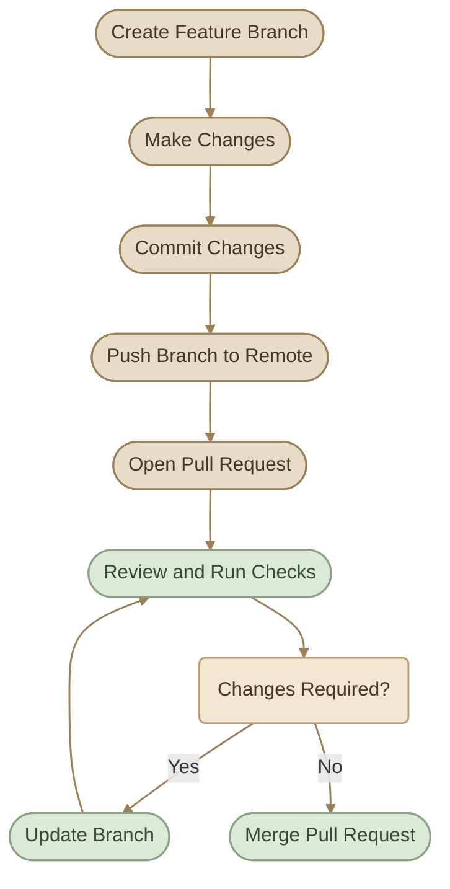
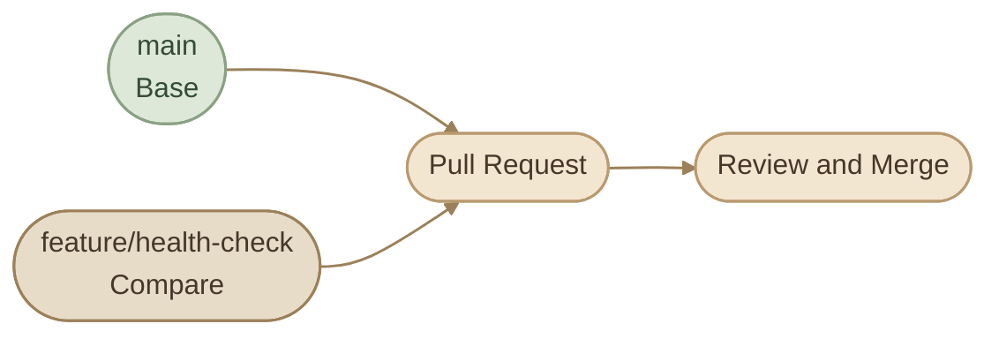
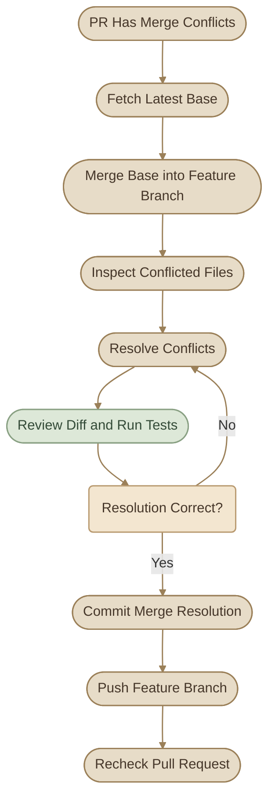

## Introduction

الـ **Pull Request (PR)** هي وسيلة لاقتراح تغييرات من Branch إلى Branch تانية، ومراجعتها ومناقشتها قبل دمجها.

في مشاريع GitHub، الـ PR بتساعد الفريق يفهم التغيير المقترح، يراجع الكود، يشغّل الاختبارات، ويتأكد إن التغيير مناسب قبل ما يدخل الـ Branch المستهدفة.

رغم إن الاسم Pull Request، فهي مش أمر Git محلي؛ دي ميزة على منصات استضافة Git زي GitHub. Git نفسه بيوفّر الـ Branches والـ Commits والـ Merge اللي بتعتمد عليها العملية.

### I. What You Will Learn

<CardGrid columns={2} label="Learning Objectives">
  <InfoCard variant="concept" title="PR Fundamentals" description="افهم دور الـ Pull Request وإزاي بتربط التغيير بالـ Branch المستهدفة." icon="git-pull-request" tags={["Workflow", "Collaboration"]} />
  <InfoCard variant="feature" title="Creating and Updating PRs" description="أنشئ PR واضحة، واستخدم Draft mode، وحدّثها أثناء التطوير." icon="branch" tags={["GitHub", "Branches"]} />
  <InfoCard variant="comparison" title="Reviewing Changes" description="افحص الملفات والتعليقات والاختبارات قبل الموافقة على التغيير." icon="layers" tags={["Review", "Diff"]} />
  <InfoCard variant="warning" title="Conflicts and Merging" description="افهم أسباب التعارضات وإزاي تحلّها وتدمج التغييرات بأمان." icon="git-merge" tags={["Conflicts", "Merge"]} />
</CardGrid>

## 1. What Is a Pull Request?

تخيّل إنك بتشتغل على مشروع، وعندك Branch اسمها `feature/health-check`، وعايز تدخل التغييرات بتاعتها في `main`.

بدل ما تدمج التغييرات مباشرة، بتفتح Pull Request علشان تعرضها على الفريق.

الـ PR بتجمع معلومات مهمة، منها:

<CardGrid columns={2} label="What a PR Contains">
  <InfoCard title="Commits" description="الـ Commits اللي بتحتوي على التغييرات." icon="branch" variant="concept" />
  <InfoCard title="Changed files" description="الملفات والأسطر اللي اتعدّلت." icon="code" variant="concept" />
  <InfoCard title="Description" description="وصف المشكلة والحل المقترح." icon="layers" variant="concept" />
  <InfoCard title="Discussion" description="التعليقات والمناقشات." icon="pulse" variant="concept" />
  <InfoCard title="CI checks" description="نتائج الـ CI checks، لو المشروع بيستخدمها." icon="shield" variant="concept" />
  <InfoCard title="Approvals" description="موافقات الـ Review، لو مطلوبة." icon="flag" variant="concept" />
  <InfoCard title="Merge options" description="خيارات إتمام الدمج." icon="git-merge" variant="concept" />
</CardGrid>

### I. Why Use Pull Requests?

<CardGrid columns={2} label="Benefits of Pull Requests">
  <InfoCard variant="feature" title="Code Review" description="تسمح لزملائك بمراجعة التغييرات قبل دمجها." icon="network" />
  <InfoCard variant="success" title="Quality Checks" description="تساعد على التأكد من نجاح الاختبارات والفحوصات المطلوبة." icon="shield" />
  <InfoCard variant="concept" title="Discussion" description="تجمع الأسئلة والاقتراحات والقرارات في مكان واحد." icon="pulse" />
  <InfoCard variant="insight" title="Traceability" description="تربط التغييرات بالـ Issues والـ Commits والمراجعات." icon="branch" />
</CardGrid>

### II. Typical Pull Request Workflow



**مهم:** فتح PR مش معناه إن التغييرات اتدمجت بالفعل. هي بتفضل اقتراحًا قيد المراجعة لحد ما يتم دمجها أو إغلاقها.

## 2. Creating a PR

هنفترض إنك عامل Fork لمشروع على GitHub، وبتشتغل على Branch اسمها `feature/health-check`.

<Steps>
<li>

<InfoCard title="Create a Branch" icon="branch" />

لو لسه ما أنشأتش Branch:

```bash
git switch main
git switch -c feature/health-check
```

</li>
<li>

<InfoCard title="Make and Review Changes" icon="code" />

بعد تعديل الملفات:

```bash
git status
git diff
git diff --check
```

راجع التغييرات وتأكد إنك مش بتضيف ملفات أو أسرار أو تعديلات غير مقصودة.

</li>
<li>

<InfoCard title="Commit the Changes" icon="pulse" />

```bash
git add .
git commit -m "feat: add application health check"
```

استخدام `git add .` مناسب فقط لو راجعت الملفات المتغيرة واتأكدت إن كل الملفات الموجودة في الـ Working Tree مطلوبة. لو عايز تحكم أدق، أضف الملفات المطلوبة بالاسم.

</li>
<li>

<InfoCard title="Push the Branch" icon="git-pull-request" />

```bash
git push -u origin feature/health-check
```

كده الـ Branch أصبحت موجودة على الـ Remote المشار إليه باسم `origin`.

</li>
<li>

<InfoCard title="Open the Pull Request" icon="network" />

افتح Repository على GitHub، وغالبًا هتلاقي اقتراحًا لإنشاء Pull Request بعد Push الـ Branch الجديدة.

تقدر كمان تدخل على تبويب **Pull requests** وتختار **New pull request**، وبعدها تحدد الـ Branches المطلوبة.

قبل ما تضغط **Create pull request**، راجع:

<CardGrid columns={2} label="Before You Create">
  <InfoCard title="Base" description="الـ Base repository والـ Base branch." icon="network" variant="concept" />
  <InfoCard title="Compare" description="الـ Head repository والـ Compare branch." icon="branch" variant="concept" />
  <InfoCard title="Title" description="عنوان الـ PR." icon="tag" variant="concept" />
  <InfoCard title="Description" description="الوصف." icon="layers" variant="concept" />
  <InfoCard title="Diff" description="الملفات والتغييرات المعروضة." icon="code" variant="concept" />
</CardGrid>

</li>
<li>

<InfoCard title="Submit the PR" icon="git-merge" />

بعد التأكد من التفاصيل، أنشئ الـ PR.

لو المشروع بيستخدم Pull Request Template، ممكن تلاقي وصفًا جاهزًا فيه أسئلة لازم تجاوب عنها.

</li>
</Steps>

<InfoCard variant="tip" title="Keep the PR Focused" description="الأفضل إن الـ PR تعالج مشكلة واضحة أو تضيف تغييرًا مترابطًا، بدل ما تجمع تغييرات كثيرة غير مرتبطة ببعض." icon="flag" />

## 3. Base vs Compare Branch

من أكتر الحاجات اللي لازم تفهمها قبل إنشاء PR هي الفرق بين **Base branch** و**Compare branch**.

### I. Base Branch

هي الـ Branch اللي عايز تدخل التغييرات فيها.

في مثال شائع:

```text
base: main
```

### II. Compare Branch

هي الـ Branch اللي بتقترح التغييرات الموجودة عليها.

مثال:

```text
compare: feature/health-check
```

بمعنى أبسط:

<CardGrid columns={2} label="Direction">
  <InfoCard title="Base" description="التغيير رايح لفين؟" icon="network" variant="concept" />
  <InfoCard title="Compare" description="التغيير جاي منين؟" icon="branch" variant="concept" />
</CardGrid>

### III. Visual Example



### IV. PR from a Fork

لو بتساهم في مشروع مش بتملكه، ممكن تكون الإعدادات بالشكل ده:

<TableCard title="Fork PR Settings">
| Setting | Repository | Branch |
|---|---|---|
| Base | المشروع الأصلي | `main` |
| Compare / Head | الـ Fork بتاعتك | `feature/health-check` |
</TableCard>

أما لو بتشتغل داخل نفس الـ Repository، فالـ Base والـ Compare ممكن يكونوا Branches من نفس المستودع.

**خلي بالك:** الـ Base مش لازم تكون `main` دائمًا. بعض المشاريع بتستقبل التغييرات على Branch تطوير، أو Release branch، أو Branch مخصصة حسب سياسة المشروع.

<InfoCard variant="warning" title="Check Before Creating" description="اختيار Base غلط ممكن يخلي الـ PR تستهدف Branch غير المقصودة. راجع اسم الـ Repository والـ Branch في الاتجاهين قبل إنشاء PR." icon="flag" />

## 4. Draft Pull Requests

الـ **Draft Pull Request** هي PR بتوضح إن التغيير لسه قيد التطوير ومش جاهز للمراجعة النهائية.

ممكن تستخدمها لما تحب:

<CardGrid columns={2} label="When to Use Draft PRs">
  <InfoCard title="Show progress" description="تعرض تقدمك الحالي على الفريق." icon="pulse" variant="concept" />
  <InfoCard title="Discuss design" description="تناقش تصميم الحل قبل إكمال التنفيذ." icon="modules" variant="concept" />
  <InfoCard title="Early feedback" description="تحصل على Feedback مبكر." icon="network" variant="concept" />
  <InfoCard title="Link an issue" description="تربط العمل بـ Issue وتوضح إنه ما زال قيد التطوير." icon="branch" variant="concept" />
</CardGrid>

### I. Creating a Draft PR

على GitHub، عند إنشاء PR، اختار **Create draft pull request** بدل إنشاء PR عادية.

هيظهر إن الـ PR في حالة Draft، وده بيوضح للمساهمين إن التغيير مش جاهز للمراجعة النهائية.

### II. Draft vs Ready for Review

<TableCard title="Draft vs Ready for Review">
| Draft PR | Ready for Review |
|---|---|
| التغيير لسه قيد التطوير | التغيير جاهز للمراجعة |
| مناسب للنقاش المبكر | مناسب للمراجعة الرسمية |
| مش بتُعامل كطلب مراجعة نهائي | ممكن تبدأ مراجعتها وفقًا لسياسة المشروع |
| يمكن تحويلها لاحقًا إلى Ready for review | يمكن طلب مراجعات واستكمال إجراءات الدمج |
</TableCard>

لما تكمّل التغييرات، استخدم **Ready for review** لتحويل الـ Draft إلى PR جاهزة للمراجعة.

<InfoCard variant="insight" title="Draft Does Not Mean Private" description="الـ Draft PR مش بالضرورة مخفية؛ الأشخاص اللي عندهم صلاحية الوصول للـ Repository ممكن يشوفوها. استخدمها لتوضيح حالة العمل، مش لحماية معلومات سرية." icon="network" />

## 5. PR Descriptions and Templates

عنوان ووصف الـ PR بيساعدوا الـ Reviewers يفهموا سبب التغيير وإزاي يراجعوه.

### I. Writing a Good PR Title

خلي العنوان مباشرًا ويعبّر عن التغيير.

أمثلة:

```text
Add health check endpoint
Fix Docker image build failure
Improve installation instructions
Add validation for missing configuration
```

تجنب عناوين عامة زي:

```text
Fix
Updates
Changes
Final version
```

### II. Writing a Useful Description

الوصف الجيد بيجاوب عن الأسئلة دي:

<CardGrid columns={2} label="Description Questions">
  <InfoCard title="What changed?" description="**What changed?** إيه اللي اتغير؟" icon="code" variant="concept" />
  <InfoCard title="Why was it needed?" description="**Why was it needed?** ليه التغيير ده مطلوب؟" icon="flag" variant="concept" />
  <InfoCard title="How was it tested?" description="**How was it tested?** اختبرت التغيير إزاي؟" icon="shield" variant="concept" />
  <InfoCard title="Related issues" description="**Related issues:** هل فيه Issue مرتبطة؟" icon="branch" variant="concept" />
</CardGrid>

### III. Example PR Description

```markdown
## Summary

Add a health check endpoint for the application.

## Why

The deployment environment needs a reliable way to
verify that the application is responding.

## Changes

- Add the health check route.
- Return an appropriate status code.
- Add tests for the endpoint.

## Testing

- Run the application test suite.
- Verify the endpoint response locally.

## Related Issues

Closes #42
```

ده مثال توضيحي؛ لازم تعدّل الوصف علشان يعكس التغييرات والاختبارات اللي نفذتها فعلًا.

### IV. What Are PR Templates?

الـ **Pull Request Template** ملف بيستخدمه المشروع لتوفير هيكل افتراضي لوصف الـ PR.

ممكن تلاقيه في مسارات زي:

```text
.github/pull_request_template.md
```

أو في مسارات أخرى يدعمها GitHub.

ممكن الـ Template تطلب منك:

<CardGrid columns={2} label="Template Prompts">
  <InfoCard title="Summary" description="تلخيص التغيير." icon="layers" variant="concept" />
  <InfoCard title="Issue link" description="ربط الـ Issue." icon="branch" variant="concept" />
  <InfoCard title="Testing" description="ذكر الاختبارات." icon="shield" variant="concept" />
  <InfoCard title="Docs check" description="تأكيد مراجعة Documentation." icon="code" variant="concept" />
  <InfoCard title="Breaking changes" description="توضيح الـ Breaking Changes." icon="wrench" variant="concept" />
  <InfoCard title="Change type" description="تحديد نوع التغيير." icon="tag" variant="concept" />
</CardGrid>

مش كل Repository عندها Template، ومش كل Template بتطلب نفس المعلومات.

<InfoCard variant="success" title="Be Accurate" description="اكتب الاختبارات اللي شغّلتها فعلًا، ووضّح أي قيود أو خطوات لسه ناقصة. الوصف الصادق أهم من وصف يبدو مكتملًا لكنه غير دقيق." icon="shield" />

## 6. Reviewing Files Changed

قبل ما تراجع PR أو تطلب مراجعتها من حد تاني، لازم تفهم التغييرات نفسها.

في GitHub، افتح الـ PR واختار تبويب **Files changed**.

هتقدر تشوف:

<CardGrid columns={2} label="Files Changed Tab">
  <InfoCard title="File changes" description="الملفات اللي اتضافت أو اتحذفت أو اتعدّلت." icon="code" variant="concept" />
  <InfoCard title="Old and new lines" description="الأسطر القديمة والجديدة." icon="layers" variant="concept" />
  <InfoCard title="Diff" description="الـ Diff لكل ملف." icon="branch" variant="concept" />
  <InfoCard title="Inline comments" description="التعليقات المرتبطة بأسطر معينة." icon="pulse" variant="concept" />
  <InfoCard title="Review options" description="بعض خيارات مراجعة التغييرات، حسب صلاحياتك والواجهة المتاحة." icon="sliders" variant="concept" />
</CardGrid>

### I. Understanding the Diff

مثال:

```diff
- timeout = 10
+ timeout = 30
```

التفسير:

<CardGrid columns={2} label="Reading a Diff">
  <InfoCard title="- line" description="السطر اللي بيبدأ بـ `-` كان موجودًا قبل التغيير." icon="tag" variant="concept" />
  <InfoCard title="+ line" description="السطر اللي بيبدأ بـ `+` هو السطر الجديد." icon="flag" variant="concept" />
</CardGrid>

علامات `-` و`+` هنا جزء من عرض الـ Diff، مش بالضرورة أوامر أو محتوى حرفي هيتحط في الملف.

### II. Review Checklist

<CardGrid columns={2} label="PR Review Checklist">
  <InfoCard variant="concept" title="Correctness" description="هل التغيير بيحل المشكلة المطلوبة فعلًا؟" icon="shield" />
  <InfoCard variant="tip" title="Scope" description="هل فيه ملفات أو تغييرات غير مرتبطة بالهدف؟" icon="flag" />
  <InfoCard variant="feature" title="Testing" description="هل الاختبارات مناسبة وبتغطي السلوك المتأثر؟" icon="pulse" />
  <InfoCard variant="warning" title="Security" description="هل التغيير بيضيف Secrets أو صلاحيات زائدة أو مخاطر أمنية؟" icon="shield" />
</CardGrid>

### III. Reviewing a PR vs Approving It

مراجعة الملفات مش معناها إنك لازم توافق على الدمج.

ممكن تراجع التغيير وتختار:

<CardGrid columns={3} label="Review Outcomes">
  <InfoCard title="Comment" description="تسيب تعليقًا أو سؤالًا." icon="pulse" variant="concept" />
  <InfoCard title="Approve" description="توافق على التغيير." icon="shield" variant="concept" />
  <InfoCard title="Request changes" description="تطلب تعديلات قبل الموافقة." icon="wrench" variant="concept" />
</CardGrid>

الأسماء والخيارات المتاحة بتعتمد على واجهة GitHub وصلاحياتك وسياسة المشروع.

كمان وجود Approval مش معناه تلقائيًا إن الـ PR قابلة للدمج؛ ممكن تكون فيه CI checks فاشلة أو Branch protection rules لسه مش مستوفاة.

## 7. Updating a PR

الـ Pull Request بتتحدّث عادةً لما تضيف Commits جديدة إلى نفس الـ Head branch.

مش محتاج تنشئ PR جديدة كل مرة تعدّل فيها على نفس التغيير.

### I. Update the Existing Branch

```bash
git switch feature/health-check
```

عدّل الملفات، وبعدها:

```bash
git status
git diff
git add path/to/changed-file
git commit -m "test: cover health check failure"
git push origin feature/health-check
```

بعد الـ Push، GitHub بتحدّث الـ PR الموجودة تلقائيًا بالـ Commits الجديدة.

استبدل `path/to/changed-file` بالمسار الفعلي للملف اللي عدّلته.

### II. Responding to Review Feedback

لو Reviewer طلب تغييرًا:

<Steps>
<li>

<InfoCard title="Read the comment" description="اقرأ التعليق وافهم المشكلة." icon="pulse" />

</li>
<li>

<InfoCard title="Ask if unclear" description="اسأل لو فيه نقطة غير واضحة." icon="network" />

</li>
<li>

<InfoCard title="Make the change" description="عدّل الكود أو الـ Documentation." icon="code" />

</li>
<li>

<InfoCard title="Run the tests" description="شغّل الاختبارات المناسبة." icon="shield" />

</li>
<li>

<InfoCard title="Commit" description="اعمل Commit جديد." icon="branch" />

</li>
<li>

<InfoCard title="Push" description="Push على نفس الـ Branch." icon="git-pull-request" />

</li>
<li>

<InfoCard title="Reply" description="رد على التعليق ووضّح اللي اتغير." icon="pulse" />

</li>
</Steps>

مش لازم كل تعليق يتحل بنفس الطريقة؛ ممكن تناقش الاقتراح لو عندك سبب تقني واضح لعدم تطبيقه.

### III. What If the Branch Has Changed?

لو الـ Base branch اتقدمت، ممكن تحتاج تحدّث الـ Feature branch علشان تعالج التغييرات الجديدة أو الـ Conflicts.

راجع سياسات المشروع قبل استخدام Merge أو Rebase؛ بعض الفرق بتفضّل طريقة معينة للحفاظ على تاريخ الـ Commits.

<InfoCard variant="tip" title="Keep the Discussion Clear" description="لما تعالج Review comment، وضّح التغيير اللي عملته أو سبب اختلافك مع الاقتراح. ده بيخلّي عملية المراجعة أسرع وأسهل للكل." icon="pulse" />

## 8. Resolving PR Conflicts

الـ **Merge Conflict** بتحصل لما Git مش قادر يدمج تغييرات مختلفة تلقائيًا، مثلًا لما نفس الأسطر تتغيّر في الـ Base branch والـ Feature branch.

GitHub ممكن تعرض إن الـ PR فيها Conflicts، وساعتها قد تحتاج تحلّها محليًا.

<Steps>
<li>

<InfoCard title="Update Your Local Base Branch" icon="network" />

```bash
git fetch origin
git switch main
git pull --ff-only origin main
```

المثال بيفترض إن الـ Base branch موجودة على `origin` واسمها `main`.

لو الـ PR جاية من Fork وعايز تدمج تغييرات المشروع الأصلي، تأكد من الـ Remote والـ Base الصحيحين قبل تنفيذ الأوامر.

</li>
<li>

<InfoCard title="Switch to the Feature Branch" icon="branch" />

```bash
git switch feature/health-check
```

</li>
<li>

<InfoCard title="Merge the Updated Base" icon="git-merge" />

```bash
git merge main
```

لو فيه Conflicts، Git هتوضح الملفات المتعارضة.

</li>
<li>

<InfoCard title="Inspect the Conflict" icon="code" />

ممكن تلاقي في الملف علامات بالشكل ده:

```text
<<<<<<< HEAD
timeout = 10
=======
timeout = 30
>>>>>>> main
```

المقطع الموجود فوق `=======` بيمثل التغيير الموجود في نسختك الحالية، والمقطع الموجود تحته بيمثل التغيير القادم من الـ Branch اللي بتحاول تدمجها، في سيناريو الـ Merge المعتاد.

اختار النتيجة الصحيحة بناءً على سلوك التطبيق ومتطلبات التغيير، ومش شرط تختار أحد السطرين كما هو؛ ممكن تحتاج تجمع بين التعديلين.

</li>
<li>

<InfoCard title="Remove Conflict Markers" icon="wrench" />

بعد حل التعارض، اتأكد إن الملف فيه النتيجة النهائية المطلوبة من غير علامات الـ Conflict.

بعدها:

```bash
git status
git diff
```

</li>
<li>

<InfoCard title="Complete the Merge" icon="shield" />

بعد مراجعة الملفات وتشغيل الاختبارات المناسبة:

```bash
git add path/to/resolved-file
git commit
```

لو Git أنشأت Merge operation منتظمة إكمالها، الأمر `git commit` هيكمّلها باستخدام رسالة الـ Merge المناسبة أو محرر الرسالة. اتبع تعليمات Git حسب الحالة الفعلية.

بعد كده:

```bash
git push origin feature/health-check
```

الـ PR الموجودة هتتحدّث بعد Push.

</li>
</Steps>

### I. Conflict Resolution Flow



<InfoCard variant="danger" title="Do Not Resolve Conflicts Blindly" description="متختارش نسخة كاملة لمجرد إن Git عرضتها. راجع سبب اختلاف التغييرات، وافهم تأثير كل اختيار، وشغّل الاختبارات المناسبة قبل Push." icon="wrench" />

## 9. Closing and Merging PRs

بعد انتهاء المراجعة، ممكن الـ PR تتدمج، أو تتقفل من غير Merge.

### I. Merging a Pull Request

لما تكون التغييرات جاهزة وتستوفي متطلبات المشروع، يقدر شخص عنده الصلاحيات المطلوبة يدمج الـ PR.

GitHub بتدعم طرق دمج مختلفة حسب إعدادات الـ Repository.

<TableCard title="Merge Strategies">
| Strategy | How It Works | Typical Use |
|---|---|---|
| Create a merge commit | بتحتفظ بتاريخ الـ Branches وبتضيف Merge Commit | لما يكون مهم الاحتفاظ بتاريخ الدمج |
| Squash and merge | بتجمع Commits الخاصة بالـ PR في Commit واحدة على الـ Base branch | لما يكون المطلوب تاريخًا أبسط |
| Rebase and merge | بتعيد تطبيق Commits الـ PR على الـ Base branch من غير Merge Commit تقليدية | لما يكون المطلوب تاريخًا خطيًا |
</TableCard>

الاستراتيجيات المتاحة بتعتمد على إعدادات المشروع، ومش كل فريق بيسمح بالثلاثة.

### II. Closing a PR Without Merging

ممكن تقفل PR من غير ما تدمجها لو:

<CardGrid columns={2} label="Reasons to Close">
  <InfoCard title="Not needed" description="التغيير لم يعد مطلوبًا." icon="flag" variant="concept" />
  <InfoCard title="Done elsewhere" description="تم تنفيذ الحل في PR أخرى." icon="branch" variant="concept" />
  <InfoCard title="Out of scope" description="الاقتراح خارج نطاق المشروع." icon="layers" variant="concept" />
  <InfoCard title="Withdrawn" description="صاحب المساهمة قرر عدم الاستمرار." icon="pulse" variant="concept" />
  <InfoCard title="Rejected" description="الـ Maintainers قرروا رفض التغيير." icon="shield" variant="concept" />
</CardGrid>

إغلاق الـ PR مش معناه إن التغييرات اتدمجت في الـ Base branch.

ولو احتجت تكمل الشغل بعدين، راجع حالة الـ Branch والـ PR وقواعد المشروع قبل إعادة فتحها أو إنشاء PR جديدة.

### III. Deleting the Feature Branch

بعد الدمج، GitHub ممكن تعرض خيار حذف الـ Head branch، حسب الصلاحيات والإعدادات.

حذف الـ Branch من GitHub مش هو نفسه حذف الـ Branch المحلية من جهازك.

لو حابب تنظّف الـ Branch المحلية بعد التأكد إنك مش محتاجها:

```bash
git switch main
git branch -d feature/health-check
```

استخدم `-d` للحذف الآمن نسبيًا؛ Git هترفض الحذف لو شايفة إن فيه تغييرات غير مدمجة وفقًا لقواعدها.

لو الـ Branch موجودة على الـ Remote ولسه عايز تحذفها، اتأكد من الاسم والـ Remote قبل استخدام أمر الحذف.

### IV. Closing vs Merging

<TableCard title="Closing vs Merging">
| Action | Result |
|---|---|
| Merge PR | دمج التغييرات في الـ Base branch |
| Close PR without merging | إغلاق الاقتراح من غير دمج التغييرات |
| Reopen a closed PR | إعادة فتح PR، لو GitHub وقواعد المشروع بتسمح |
| Delete the source branch | حذف الـ Branch المصدر، مش الـ PR نفسها |
</TableCard>

### V. Final PR Checklist

<CardGrid columns={2} label="Before Merging">
  <InfoCard variant="success" title="Correct Target" description="تأكد إن Base repository وBase branch هما المستهدفان الصحيحان." icon="branch" />
  <InfoCard variant="success" title="Reviewed Changes" description="افحص الملفات والـ Diff واتأكد إن التغيير محدود وواضح." icon="layers" />
  <InfoCard variant="success" title="Checks Passed" description="تأكد من نجاح الاختبارات والفحوصات المطلوبة." icon="shield" />
  <InfoCard variant="warning" title="Permissions and Policies" description="راجع الموافقات المطلوبة وBranch protection وقواعد الدمج." icon="shield" />
</CardGrid>

## Summary

<CardGrid columns={2} label="Key Takeaways">
  <InfoCard variant="summary" title="Pull Requests" description="الـ Pull Request وسيلة لاقتراح التغييرات ومراجعتها قبل الدمج." icon="git-pull-request" />
  <InfoCard variant="summary" title="Base vs Compare" description="الـ Base branch هي المستهدفة، والـ Compare branch هي مصدر التغييرات المقترحة." icon="branch" />
  <InfoCard variant="summary" title="Draft PRs" description="الـ Draft PR مناسبة لما يكون التغيير لسه قيد التطوير." icon="code" />
  <InfoCard variant="summary" title="Clear descriptions" description="الوصف الواضح والـ Template المناسب بيسهّلوا فهم التغيير ومراجعته." icon="layers" />
  <InfoCard variant="summary" title="Files changed" description="تبويب `Files changed` بيساعدك تفحص الـ Diff والتعليقات." icon="pulse" />
  <InfoCard variant="summary" title="Updating PRs" description="تحديث نفس الـ Head branch بيحدّث الـ PR الموجودة." icon="cycle" />
  <InfoCard variant="summary" title="Conflicts" description="حل الـ Conflicts لازم يتبعه مراجعة واختبارات مناسبة." icon="wrench" />
  <InfoCard variant="summary" title="Merge vs close" description="الدمج والإغلاق عمليتان مختلفتان؛ إغلاق PR لا يعني دمج تغييراتها." icon="git-merge" />
</CardGrid>

### I. Essential Commands

```bash
# Create a feature branch
git switch -c feature/health-check

# Review local changes
git status
git diff
git diff --check

# Commit and push
git add path/to/changed-file
git commit -m "feat: add health check"
git push -u origin feature/health-check

# Fetch and update the base branch
git fetch origin
git switch main
git pull --ff-only origin main

# Merge the base into the feature branch
git switch feature/health-check
git merge main

# Delete a local branch after merging
git switch main
git branch -d feature/health-check
```
