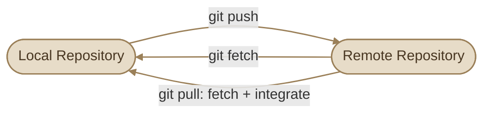
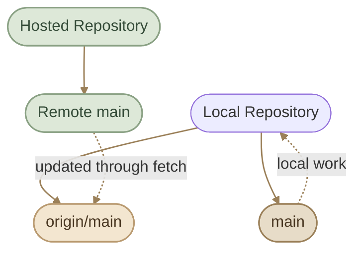
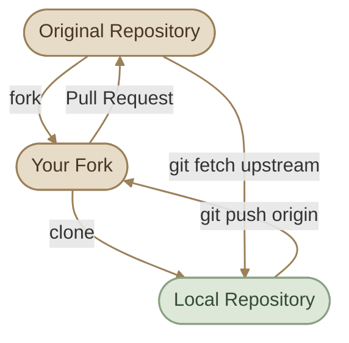

## Overview

لما تشتغل على مشروع باستخدام Git، بيكون عندك **Local Repository** على جهازك. لكن لو عايز تشارك شغلك مع فريق، أو تنقل الكود بين أجهزتك، أو تتعاون مع ناس تانية، هتحتاج تتعامل مع **Remote Repository**.

الـ Remote Repository هو نسخة من المستودع موجودة على سيرفر أو خدمة استضافة زي GitHub أو GitLab. تقدر تبعت لها commits، وتجيب منها commits جديدة، وتراجع التغييرات اللي عملها باقي الفريق.

أهم الأوامر اللي هتستخدمها هنا:

- `git remote` لإدارة اتصالات المستودعات البعيدة.
- `git fetch` لجلب معلومات وتحديثات من remote.
- `git pull` لجلب التحديثات ودمجها في الـ current branch أو تطبيقها عليه باستخدام استراتيجية مناسبة.
- `git push` لنشر commits المحلية على remote.

<CardGrid columns={4} label="Core Remote Commands">
<InfoCard variant="concept" title="git remote" description="Manage the connections that link your local repository to hosted remotes." icon="network" tags={["Setup"]} />
<InfoCard variant="concept" title="git fetch" description="Download updates and refresh remote-tracking refs without integrating them." icon="cycle" tags={["Safe"]} />
<InfoCard variant="concept" title="git pull" description="Fetch updates, then integrate them into the current branch via merge or rebase." icon="git-merge" tags={["Fetch + Integrate"]} />
<InfoCard variant="concept" title="git push" description="Publish local commits and branch updates to the remote repository." icon="git-pull-request" tags={["Publish"]} />
</CardGrid>

<InfoCard variant="concept" title="Local vs Remote" description="Your local repository stores your own branches and commits. A remote repository stores another set of Git references and objects that can be fetched from or pushed to. The two do not synchronize automatically." icon="branch" tags={["Git", "Remotes"]} />

## 1. Understanding Remote Repositories

خلينا نفترض إن عندك مشروع اسمه `my-app`، وعايز ترفعه على GitHub.

الـ local repository موجود على جهازك، والـ remote repository موجود على GitHub. كل واحد عنده branch references خاصة به، وممكن يكون عنده commits مش موجودة عند الطرف التاني.



الـ remote مش لازم يكون GitHub؛ ممكن يكون GitLab أو Bitbucket أو سيرفر Git خاص بالشركة.

كمان، وجود remote في إعدادات المستودع مش معناه إن الاتصال بيه شغال تلقائيًا. لازم يكون عندك عنوان صحيح وصلاحيات مناسبة وطريقة مصادقة صالحة.

### I. Why Remotes Matter

<CardGrid columns={2} label="Why Remotes Matter">
<InfoCard variant="feature" title="Share Commits" description="ابعت الـ commits بتاعتك للآخرين واستقبل شغلهم." icon="git-pull-request" tags={["Collaboration"]} />
<InfoCard variant="feature" title="Hosted Backup" description="احتفظ بنسخة مستضافة من المشروع على سيرفر آمن." icon="cloud" tags={["Backup"]} />
<InfoCard variant="feature" title="Multi-Device Work" description="انقل التغييرات بين أكثر من جهاز بسهولة." icon="network" tags={["Sync"]} />
<InfoCard variant="feature" title="Team Collaboration" description="اتعاون باستخدام branches وPull Requests." icon="cycle" tags={["Workflow"]} />
</CardGrid>


## 2. The `git remote` Command

الأمر `git remote` بيساعدك تعرض وتدير الـ remotes المسجلة في الـ local repository.

### I. List Configured Remotes

```bash
git remote
```

لعرض أسماء الـ remotes فقط.

لعرض الأسماء والعناوين المرتبطة بها:

```bash
git remote -v
```

مثال توضيحي:

```text
origin  https://github.com/user/my-app.git (fetch)
origin  https://github.com/user/my-app.git (push)
```

العنوان ممكن يختلف بين الـ fetch والـ push، حسب إعدادات المستودع.

### II. Add a Remote

لو عندك repository محلي وعايز تربطه بمستودع بعيد:

```bash
git remote add origin https://github.com/USERNAME/REPOSITORY.git
```

استبدل `USERNAME` و`REPOSITORY` بالقيم الحقيقية.

الاسم `origin` مجرد اسم شائع للـ remote الافتراضي؛ مش كلمة إلزامية في Git.

### III. Inspect a Remote

```bash
git remote show origin
```

الأمر ده بيعرض معلومات عن الـ remote، ومنها الفروع البعيدة وحالة بعض إعدادات التتبع. التفاصيل اللي تظهر ممكن تعتمد على نجاح الاتصال بالـ remote.

<InfoCard variant="concept" title="Remote Repository" description="نسخة مستضافة من المستودع يمكن الوصول إليها عبر الشبكة ومشاركتها مع الفريق." icon="cube" tags={["Remote", "Repo"]} />

### IV. Change a Remote URL

لو عنوان المستودع اتغير:

```bash
git remote set-url origin https://github.com/USERNAME/NEW-REPOSITORY.git
```

وبعدها تحقق من العنوان:

```bash
git remote -v
```

### V. Rename or Remove a Remote

إعادة تسمية remote:

```bash
git remote rename origin github
```

حذف تعريف remote من إعدادات الـ local repository:

```bash
git remote remove github
```

حذف الـ remote definition مش معناه حذف المستودع المستضاف على GitHub. هو بس بيزيل الاتصال المسجل في المستودع المحلي.


## 3. Local Branches vs Remote-Tracking Branches

من أهم المفاهيم اللي لازم تفهمها قبل استخدام `fetch` و`pull` و`push` هو الفرق بين الـ local branches والـ remote-tracking branches.

### I. Local Branches

دي الفروع اللي بتشتغل عليها مباشرةً في المستودع المحلي، زي:

```text
main
feature/login
```

لما تعمل commit وإنت واقف على `feature/login`، الـ local branch ده بيتحرك إلى الـ commit الجديد.

### II. Remote-Tracking Branches

دي references محلية بتمثل آخر حالة معروفة عندك لفروع الـ remote، زي:

```text
origin/main
origin/feature/login
```

Git بيحدّث الـ references دي أثناء عمليات زي `git fetch`.

<InfoCard variant="concept" title="Note" icon="flag">

<InfoCard variant="concept" title="Note" icon="flag">

**مهم:** `origin/main` مش هو الـ branch المحلي `main`، ومش اتصال مباشر بيتغير لحظيًا مع GitHub. هو مرجع محلي بيمثل آخر حالة جلبتها من الـ remote.

</InfoCard>

</InfoCard>

لو حد عمل commit جديد على GitHub، `origin/main` عندك مش هيعرف بالتغيير ده إلا بعد عملية جلب ناجحة، أو عملية أخرى بتحدّث معلومات الـ remote.

### III. Visualizing the Relationship



الـ diagram بيوضح الفكرة العامة: الـ local branch والـ remote-tracking branch references موجودين عندك محليًا، بينما الـ remote branch الحقيقي موجود في المستودع المستضاف.

<CardGrid columns={2} label="Local vs Remote-Tracking Branches">
<InfoCard variant="comparison" title="Local Branches" description="الفروع اللي بتشتغل عليها مباشرةً — بتتحرك لما تعمل commit محليًا." icon="branch" tags={["main", "feature/login"]} />
<InfoCard variant="comparison" title="Remote-Tracking Branches" description="مرجع محلي بيمثل آخر حالة معروفة لفرع بعيد، بيتحدّث مع git fetch." icon="cloud" tags={["origin/main"]} />
</CardGrid>

لعرض الفروع المحلية والبعيدة:

```bash
git branch
git branch -r
git branch -a
```

ولعرض تفاصيل الـ branches وعلاقات التتبع:

```bash
git branch -vv
```


## 4. `git fetch`

الأمر `git fetch` بيجيب التحديثات من remote ويحدّث الـ remote-tracking branches والمعلومات المرتبطة بها، من غير ما يدمج التغييرات تلقائيًا في الـ current local branch.

### I. Fetch from a Remote

```bash
git fetch origin
```

الأمر بيجيب التحديثات المتاحة من `origin`، وبيحدّث الـ remote-tracking references المناسبة حسب إعدادات الـ fetch.

بعدها تقدر تقارن الفرعين:

```bash
git log --oneline main..origin/main
```

الأمر ده بيعرض commits موجودة في `origin/main` ومش موجودة في `main`، بافتراض إن الفرعين دول هما المقصودين بالمقارنة.

لمراجعة التغييرات في الملفات:

```bash
git diff main..origin/main
```

ده بيعرض الفرق بين محتوى الفرعين، لكنه مش معناه بالضرورة إن كل التغييرات المعروضة جاية مباشرةً من commit واحد.

### II. Why Fetch Before Integrating?

`git fetch` بيديك فرصة تفحص التحديثات قبل ما تدخلها في شغلك المحلي.

Workflow عملي:

```bash
git status
git fetch origin
git log --oneline --graph --decorate --all -15
git diff main..origin/main
```

بعد المراجعة، قرر هل هتعمل merge أو rebase أو أي طريقة تكامل مناسبة للمشروع.

<InfoCard variant="tip" title="Fetch First, Inspect, Then Integrate" description="Fetching lets you update your knowledge of the remote history without immediately changing your current branch or working files." icon="branch" tags={["git fetch", "Workflow"]} />


## 5. `git pull`

الأمر `git pull` بيجلب التحديثات من remote وبعدها بيحاول يدمجها أو يطبّقها على الـ current branch، حسب الإعدادات والخيارات المستخدمة.

بشكل مبسط:

```text
git pull ≈ git fetch + integration
```

والـ integration ممكن تكون Merge أو Rebase، حسب إعدادات Git والأمر المستخدم.

<CardGrid columns={2} label="Fetch vs Pull">
<InfoCard variant="comparison" title="git fetch" description="بيجلب التحديثات ويحدّث الـ remote-tracking refs بس، من غير ما يغيّر شغلك الحالي." icon="cycle" tags={["Safe", "Inspect first"]} />
<InfoCard variant="comparison" title="git pull" description="بيجلب التحديثات وبعدها بيدمجها أو يعيد تطبيقها على الـ current branch." icon="git-merge" tags={["Fetch + Integrate"]} />
</CardGrid>

### I. Basic Usage

لو الـ current branch متظبط إنه يتتبع فرعًا بعيدًا:

```bash
git pull
```

أو حدد الـ remote والـ branch صراحةً:

```bash
git pull origin main
```

الأمر الثاني بيجلب التحديثات الخاصة بالـ `main` من `origin`، وبعدها بيحاول دمجها أو تطبيقها على الـ current branch وفقًا للإعدادات.

**خلي بالك:** `git pull origin main` مش معناه إنه بينقلك إلى `main`. هو بيحاول يدمج أو يعيد تطبيق تحديثات `origin/main` على الفرع اللي إنت واقف عليه حاليًا.

### II. Pull with Rebase

تقدر تطلب Rebase بشكل صريح:

```bash
git pull --rebase
```

بدل ما ينشئ Merge Commit عند الحاجة، Git بيحاول يعيد تطبيق commits المحلية فوق التاريخ المجلوب.

الـ Rebase هيتم شرحه بشكل أعمق في موضوع Git Workflows؛ المهم هنا إنك تعرف إن `pull` مش مرتبط دائمًا بالـ merge.

### III. Before Pulling

قبل ما تسحب التغييرات:

```bash
git status
git fetch origin
git log --oneline --graph --decorate --all -15
```

راجع حالة الملفات والتاريخ، خصوصًا لو عندك تغييرات محلية غير معمولة لها commit.

لو الـ working tree فيه تغييرات ممكن تتعارض مع الملفات اللي هتتغير، Git ممكن يرفض إكمال العملية حفاظًا على شغلك. وقتها عالج التغييرات المحلية بشكل مناسب قبل إعادة المحاولة.


## 6. `git push`

الأمر `git push` بيبعت commits والـ branch updates من المستودع المحلي إلى remote repository، بشرط إن العملية مسموح بها وإن الـ remote يقبل التحديث.

### I. Basic Push

```bash
git push origin main
```

الأمر بيحاول نشر تحديثات الـ local `main` إلى الـ remote branch `main` على `origin`.

لو عايز تنشر branch جديد لأول مرة وتربطه بالـ remote branch:

```bash
git push -u origin feature/login
```

الخيار `-u` اختصار لـ `--set-upstream`، وبيظبط علاقة التتبع بين الـ local branch والـ remote branch.

بعد كده، لو إعدادات التتبع سليمة، تقدر تستخدم:

```bash
git push
```

### II. What Does Push Actually Require?

في العادة، Git بيقبل الـ push العادي لما يكون تحديث الـ remote branch **fast-forward**؛ يعني التحديث مش هيؤدي إلى فقدان commits موجودة بالفعل على الـ remote branch.

لو الـ remote اتقدم بتغييرات مش موجودة عندك، Git ممكن يرفض الـ push. وقتها محتاج تجلب التغييرات وتتكامل معاها قبل إعادة المحاولة.


## 7. Tracking and Upstream Branches

الـ **Upstream Branch** هو الفرع اللي الـ local branch متظبط يتتبعه. Git بيستخدم العلاقة دي لتسهيل أوامر زي `git status` و`git pull` و`git push`.

مثلًا، ممكن يكون عندك:

```text
Local branch: main
Upstream:     origin/main
```

ده معناه إن `main` المحلي متظبط يتتبع `origin/main`.

### I. Set Upstream on First Push

لما تنشئ branch جديد:

```bash
git switch -c feature/login
```

وتكون عايز تنشره لأول مرة:

```bash
git push -u origin feature/login
```

Git بينشر الفرع وبيضبط الـ upstream tracking relationship.

### II. Inspect Tracking Information

```bash
git branch -vv
```

مثال توضيحي:

```text
* main           abc1234 [origin/main] latest local commit
  feature/login  def5678 [origin/feature/login: ahead 2] add login
```

الـ output الفعلي هيختلف حسب أسماء الـ branches والـ commits وحالة التتبع.

في المثال، `ahead 2` معناها إن الفرع المحلي عنده commitين مش موجودين في الـ upstream reference المعروف محليًا.

### III. Set or Change the Upstream

لو عايز تربط الـ current branch بفرع بعيد موجود:

```bash
git branch --set-upstream-to=origin/main main
```

غيّر `main` في المثال لو الـ local branch اسمه مختلف.

ولو عايز تشيل علاقة التتبع:

```bash
git branch --unset-upstream
```

إزالة الـ upstream relationship مش بتحذف أي branch من الـ local أو remote repository.

### IV. Ahead and Behind

لما تعمل:

```bash
git status -sb
```

ممكن تشوف:

```text
## main...origin/main [ahead 2, behind 1]
```

ده معناه إن الـ local `main` متقدم باثنين commits ومتأخر بواحد مقارنةً بالـ upstream reference المحلي `origin/main`.

لكن خلي بالك: المعلومات دي مبنية على آخر حالة معروفة عندك. نفّذ `git fetch` لو عايز تحدّث الـ remote-tracking references قبل اتخاذ قرار.


## 8. `origin` vs `upstream`

كلمتا `origin` و`upstream` مش أوامر خاصة أو أنواع مختلفة من الـ repositories؛ هما مجرد أسماء للـ remote configurations.

### I. `origin`

غالبًا Git بيسمي الـ remote الافتراضي `origin` لما تعمل:

```bash
git clone https://github.com/example/project.git
```

الاسم ده بيشير عادةً للمستودع اللي عملت منه clone.

### II. `upstream`

في مشاريع الـ Open Source، ممكن تعمل Fork لمشروع شخص آخر على GitHub. وقتها بيكون عندك مستودعك الخاص، وكمان المستودع الأصلي اللي عايز تجيب منه التحديثات.

Convention شائع:

- `origin`: الـ fork الخاص بك.
- `upstream`: المستودع الأصلي.

<CardGrid columns={2} label="origin vs upstream">
<InfoCard variant="comparison" title="origin" description="الـ remote الافتراضي — عادةً المستودع اللي عملت منه clone أو الـ fork الخاص بك." icon="cloud" tags={["Default", "Your fork"]} />
<InfoCard variant="comparison" title="upstream" description="اسم شائع للمستودع الأصلي في سيناريوهات الـ Fork — بتجيب منه التحديثات." icon="network" tags={["Original repo"]} />
</CardGrid>

مثال توضيحي:

```bash
git remote add upstream https://github.com/ORIGINAL-OWNER/PROJECT.git
git remote -v
```

بعدها تقدر تجلب التحديثات من المشروع الأصلي:

```bash
git fetch upstream
```

وتراجع الفروع المتاحة:

```bash
git branch -r
```

لو عايز تدمج تحديثات `upstream/main` في الـ local `main`:

```bash
git switch main
git merge upstream/main
```

نفّذ الدمج بعد مراجعة التغييرات والتأكد من إن حالة الـ working tree مناسبة.

### III. Example: Fork Workflow



<InfoCard variant="concept" title="Note" icon="flag">

<InfoCard variant="concept" title="Note" icon="flag">

**مهم:** `upstream` مش لازم يشير للمشروع الأصلي، و`origin` مش لازم يشير إلى fork. الأسماء دي conventions شائعة، وإنت تقدر تستخدم أسماء مختلفة حسب المشروع.

</InfoCard>

</InfoCard>


## 9. Push Rejections and Synchronization

أحيانًا `git push` بيرفض العملية. ده مش معناه بالضرورة إن فيه مشكلة في الكود؛ ممكن يكون فيه اختلاف بين تاريخ الفرع المحلي والبعيد، أو إعدادات حماية على الـ remote.

<CardGrid columns={2} label="Common Push Rejections">
<InfoCard variant="warning" title="Non-Fast-Forward" description="الـ remote فيه commits مش موجودة عندك — لازم fetch ودمج قبل إعادة المحاولة." icon="cycle" tags={["Sync"]} />
<InfoCard variant="warning" title="Diverged Initial Commits" description="المستودع بدأ بتاريخين مستقلين (README على GitHub + commits محلية) — محتاج دمج مقصود." icon="git-merge" tags={["History"]} />
<InfoCard variant="warning" title="Protected Branch" description="قواعد الحماية بتمنع push مباشر إلى main — محتاج Pull Request وCI checks." icon="shield" tags={["Rules"]} />
<InfoCard variant="warning" title="Auth / Permission Error" description="مشكلة في المصادقة أو الصلاحيات — افحص العنوان واختبر الاتصال." icon="wrench" tags={["SSH / Token"]} />
</CardGrid>

### I. Case 1: Non-Fast-Forward Rejection

رسالة شائعة:

```text
! [rejected] main -> main (non-fast-forward)
```

ده ممكن يحصل لما يكون فيه commits على الـ remote مش موجودة في الـ local branch، وبالتالي Git مش هيقدر يحدّث الفرع البعيد باستخدام push عادي من غير ما يخاطر بإخفاء تاريخ موجود على الـ remote.

### II. Recommended Workflow

أولًا، افحص الحالة:

```bash
git status
git fetch origin
git log --oneline --graph --decorate --all -20
```

راجع التغييرات اللي عندك والتغييرات اللي على الـ remote.

لو قررت تدمج التحديثات:

```bash
git switch main
git merge origin/main
```

لو ظهر conflict، حلّه وراجع النتيجة.

بعد نجاح الدمج والاختبارات:

```bash
git push origin main
```

ولو المشروع بيعتمد على Rebase بدل Merge، ممكن يكون المسار المناسب:

```bash
git pull --rebase origin main
```

لكن اختار استراتيجية واحدة مناسبة للـ workflow بدل ما تخلط بينهما بشكل عشوائي.

### III. Case 2: Remote Contains an Initial Commit

أحيانًا تنشئ repository محليًا وتعمل له commit، وبعدها تنشئ GitHub repository فيه README أو License. لما تحاول تعمل push، ممكن تلاقي إن التاريخين مش متصلين.

في الحالة دي، افحص تاريخ الطرفين:

```bash
git fetch origin
git log --oneline --graph --decorate --all
```

لو المستودعان بدأ كل واحد منهما بتاريخ مستقل، فالحل يعتمد على حالة المشروع. غالبًا هتحتاج تدمج التاريخين بشكل مقصود أو تختار المستودع الصحيح كبداية، بدل ما تستخدم أوامر force عشوائيًا.

### IV. Case 3: Protected Branch Rejection

ممكن الـ remote يرفض الـ push حتى لو التاريخ متوافق، بسبب قواعد حماية الفرع، مثل:

- منع الـ direct pushes إلى `main`.
- اشتراط Pull Request.
- اشتراط نجاح CI checks.
- اشتراط موافقة Code Review.
- عدم امتلاك صلاحيات الكتابة.

في الحالة دي، راجع رسالة الرفض وقواعد المستودع. ممكن يكون الـ workflow المطلوب هو نشر branch جديد ثم فتح Pull Request بدلًا من push مباشر إلى `main`.

### V. Case 4: Authentication or Permission Errors

رسائل زي `Authentication failed` أو `Permission denied` ممكن تشير إلى مشكلة في بيانات المصادقة أو الصلاحيات أو إعدادات SSH.

ابدأ بفحص عنوان الـ remote:

```bash
git remote -v
```

لو بتستخدم SSH، اختبر الاتصال حسب الخدمة وإعداداتك. مع GitHub، مثال شائع:

```bash
ssh -T git@github.com
```

النجاح في اختبار SSH بيثبت إن المصادقة الأساسية نجحت، لكنه مش بالضرورة يثبت إن عندك صلاحية الكتابة إلى كل repository.

متشاركش tokens أو private keys أثناء استكشاف المشكلة.

### VI. Why You Should Avoid `git push --force`

الخيار:

```bash
git push --force
```

بيسمح بتحديث remote branch بطريقة ممكن تستبدل التاريخ الموجود عليه، وده ممكن يخفي commits أو يسبب مشاكل لزملائك.

لو إعادة كتابة التاريخ ضرورية ومسموح بها في المشروع، فالخيار الأكثر أمانًا في حالات كثيرة هو:

```bash
git push --force-with-lease
```

ده بيضيف فحصًا يساعد على رفض التحديث لو الـ remote branch اتحرك بطريقة غير متوقعة مقارنةً بالقيمة اللي Git متوقعها محليًا.

لكن **`--force-with-lease` مش ضمانًا مطلقًا ضد فقدان الشغل**، ومش بديلًا عن جلب التحديثات ومراجعتها والتنسيق مع الفريق. في المشاريع المشتركة، متستخدمش force push إلا لما تكون فاهم سبب إعادة كتابة التاريخ ومتأكد إن ده مسموح.

<CardGrid columns={2} label="Force Push Options">
<InfoCard variant="danger" title="git push --force" description="بيستبدل تاريخ الـ remote branch بالكامل — ممكن يخفي commits ويسبب مشاكل للفريق." icon="shield" tags={["Destructive"]} />
<InfoCard variant="warning" title="git push --force-with-lease" description="أسلم نسخة — بيفحص إن الـ remote ما اتحركش بشكل غير متوقع قبل إعادة الكتابة." icon="wrench" tags={["Safer"]} />
</CardGrid>

<InfoCard variant="warning" title="Never Force Push as Your First Fix" description="When a push is rejected, fetch and inspect the remote history first. A rejection often protects commits that already exist on the remote repository." icon="shield" tags={["Synchronization", "Data Safety"]} />


## 10. Practical Workflow

<Callout type="lab" title="Hands-on: Remote Sync Cycle" />

<Steps>
<li>

<InfoCard title="Step 1 — Check the Remote" description="تأكد إن عنوان الـ remote صحيح." icon="network" tags={["Setup"]} />

```bash
git remote -v
```

</li>
<li>

<InfoCard title="Step 2 — Check Your Local State" description="اعرف إنت على أنهي branch، وهل فيه تغييرات محلية أو upstream relationship." icon="branch" tags={["Status"]} />

```bash
git status
git branch -vv
```

</li>
<li>

<InfoCard title="Step 3 — Fetch Remote Updates" description="حدّث معلوماتك عن الـ remote من غير ما يدمج التغييرات في الـ current branch." icon="cycle" tags={["Safe"]} />

```bash
git fetch origin
```

</li>
<li>

<InfoCard title="Step 4 — Inspect the History" description="قارن الفرعين وافهم اتجاه الاختلاف قبل الدمج أو النشر." icon="layers" tags={["Inspect"]} />

```bash
git log --oneline --graph --decorate --all -20
git log --oneline main..origin/main
git log --oneline origin/main..main
```

`main..origin/main`: commits موجودة في `origin/main` ومش موجودة في `main`.
`origin/main..main`: commits موجودة في `main` ومش موجودة في `origin/main`.

</li>
<li>

<InfoCard title="Step 5 — Integrate When Needed" description="لو الـ remote فيه تغييرات محتاجها، دمجها وراجع أي conflicts." icon="git-merge" tags={["Merge"]} />

```bash
git switch main
git merge origin/main
```

</li>
<li>

<InfoCard title="Step 6 — Push Your Changes" description="انشر الـ local branch بعد التأكد إنه جاهز." icon="git-pull-request" tags={["Publish"]} />

```bash
git push origin main
git push -u origin feature/login
```

</li>
<li>

<InfoCard title="Step 7 — Verify" description="اتأكد إن الحالة النهائية مطابقة للي كنت مستهدفه." icon="pulse" tags={["Check"]} />

```bash
git status -sb
git log --oneline --decorate -10
```

</li>
</Steps>


## 11. Common Mistakes

<InfoCard variant="warning" title="Confusing origin/main with main" description="main is a local branch. origin/main is a local remote-tracking reference. Fetch updates the latter; it does not automatically merge it into the former." icon="shield" tags={["Branches"]} />

<InfoCard variant="warning" title="Running Pull Without Understanding the Current Branch" description="git pull integrates remote changes into the current branch. Check git status and git branch before running it, especially when specifying a remote branch explicitly." icon="shield" tags={["git pull"]} />

<InfoCard variant="warning" title="Using Force Push to Fix Every Rejection" description="A rejected push may protect commits already present on the remote. Fetch and inspect the history before deciding how to synchronize." icon="shield" tags={["git push"]} />

<InfoCard variant="tip" title="Use Explicit Commands While Learning" description="Commands such as git fetch origin, git merge origin/main, and git push -u origin feature/login make the source and destination easier to reason about." icon="layers" tags={["Best Practices"]} />


## 12. Key Takeaways

<InfoCard variant="summary" title="Remote Sync in One Line" description="افحص → fetch → راجع → ادمج → ادفع. الـ remote-tracking refs زي origin/main هي نسختك المحلية من حالة البعيد، ومش بتتحدّث لوحدها." icon="layers" tags={["Mental Model"]} />

- `git remote -v` بيعرض عناوين الـ remotes المسجلة.
- `git fetch` بيجلب التحديثات ويحدّث الـ remote-tracking references من غير دمج تلقائي.
- `git pull` بيجلب التحديثات وبعدها بيعمل integration باستخدام Merge أو Rebase حسب الإعدادات.
- `git push` بينشر commits والـ branch updates إلى remote.
- الـ local branch مختلف عن الـ remote-tracking branch؛ `main` مش هو `origin/main`.
- الـ upstream relationship بتحدد الفرع البعيد المرتبط بالـ local branch.
- `origin` و`upstream` مجرد أسماء شائعة للـ remotes، مش كلمات إلزامية.
- الـ non-fast-forward rejection غالبًا محتاج فحص التاريخ وجلب التحديثات قبل إعادة المحاولة.
- الـ protected branch وauthentication errors ليهم أسباب مختلفة عن تعارض التاريخ.
- `git push --force` ممكن يستبدل تاريخًا موجودًا على remote، فلا تستخدمه كحل افتراضي.

