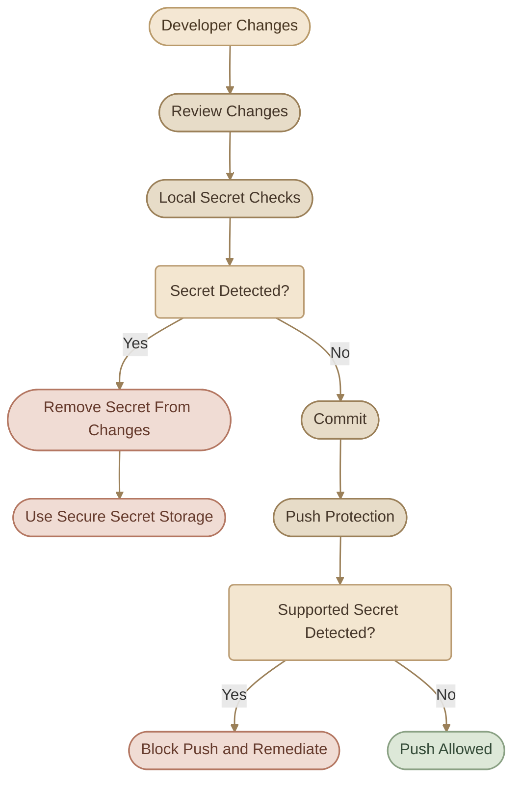
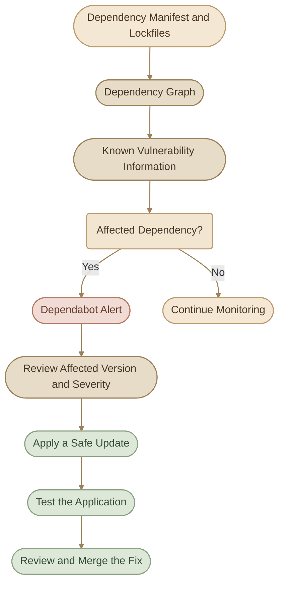

## Introduction

أمن الـ Repository مش مجرد إنك تخليه Private أو تضيف `.gitignore`. لازم تحمي الـ credentials، وتكتشف الأسرار اللي اتسربت، وتراجع الـ dependencies، وتتأكد من مصدر الـ Commits، وتوفّر طريقة واضحة للإبلاغ عن الثغرات.

<CardGrid columns={2} label="Repository Security Fundamentals">
  <InfoCard variant="concept" title="Secret Management" description="إدارة API Keys وTokens وكلمات المرور خارج ملفات الكود والـ Git History." icon="shield" tags={["Credentials", "Secrets"]} />
  <InfoCard variant="concept" title="Supply Chain Security" description="تقليل مخاطر المكتبات الخارجية من خلال اكتشاف الثغرات وتحديث الـ Dependencies." icon="cube" tags={["Dependencies", "Dependabot"]} />
  <InfoCard variant="concept" title="Commit Integrity" description="استخدام التوقيعات للتحقق من أن الـ Commit موقّع بمفتاح موثوق." icon="flag" tags={["Signing", "Verification"]} />
  <InfoCard variant="concept" title="Responsible Disclosure" description="توفير قناة آمنة للإبلاغ عن الثغرات والتعامل معها قبل نشر تفاصيلها." icon="network" tags={["Security Policy", "Vulnerabilities"]} />
</CardGrid>

## 1. Secret Management

الـ **Secret** هو أي معلومة حساسة بتسمح بالوصول إلى نظام أو خدمة أو بيانات، مثل:

- API Keys.
- Database passwords.
- Cloud credentials.
- Personal Access Tokens.
- Private keys.
- Signing credentials.

المشكلة مش بس إن حد يشوف الكود؛ المشكلة إن الـ secret ممكن يدي الشخص اللي حصل عليه صلاحيات فعلية على خدمة أو بيانات.

### I. Where Should Secrets Live?

بدل ما تكتب الـ secret داخل الكود، استخدم آلية مناسبة لبيئة التشغيل:

<TableCard>
| Environment | Common Approach |
|---|---|
| Local development | Environment variables أو ملف محلي مستثنى من Git |
| CI/CD | Platform-managed secrets |
| Production applications | Secret manager أو خدمة إدارة أسرار مناسبة |
| Kubernetes | Kubernetes Secrets مع ضبط RBAC والتشفير والحماية المناسبة |
</TableCard>

Environment variables مش بديل كامل عن Secret Manager في كل الحالات؛ هي طريقة لتمرير القيم إلى العملية، ولازم تتجنب كشفها في Logs أو Process Diagnostics.

### II. Example: Load a Secret Locally

ممكن تستخدم ملف `.env` محليًا، بشرط ألا يكون الملف نفسه جزءًا من الـ Repository.

مثال لمحتوى الملف:

```dotenv
DATABASE_URL=your_local_database_url
API_KEY=your_local_api_key
```

أضف الملف إلى `.gitignore`:

```gitignore
.env
.env.*
!.env.example
```

بعدها أنشئ `.env.example` يحتوي على أسماء المتغيرات والقيم التوضيحية فقط:

```dotenv
DATABASE_URL=
API_KEY=
```

الهدف إن أي Developer يعرف المتغيرات المطلوبة من غير ما يحصل على بياناتك السرية.

<InfoCard variant="warning" title="Environment Variables Are Not a Vault" description="ما تطبعش قيم الأسرار في Logs، وما تعتبرش كل Environment Variable محميًا تلقائيًا. استخدم آلية تخزين وتمرير أسرار تناسب مستوى حساسية التطبيق." icon="sliders" />

## 2. Preventing Accidental Secret Commits

أفضل طريقة للتعامل مع تسريب الأسرار هي منعها من دخول الـ Repository من البداية.

### I. Layer 1: Use `.gitignore`

مثال:

```gitignore
.env
.env.*
!.env.example

*.pem
*.key
secrets/
```

القواعد دي مناسبة كبداية، لكن عدّلها حسب احتياجات المشروع. مثلًا، بعض ملفات المفاتيح قد تكون ملفات عامة مخصصة للاختبار، لذلك ما تستخدمش أنماطًا واسعة بدون مراجعة.

<InfoCard variant="concept" title="Note" icon="flag">

**مهم:** `.gitignore` مش بيوقف Git عن تتبع ملف سبق إضافته للـ Index، ومش بيزيل ملف موجود بالفعل في الـ History.

</InfoCard>

لو ملف اتضاف للـ Index بالغلط، لكنك عايز تفضل محتفظًا به محليًا، تقدر توقف تتبعه باستخدام:

```bash
git rm --cached .env
```

بعد التأكد من وجود قاعدة مناسبة في `.gitignore`، راجع التغييرات قبل الـ Commit.

### II. Layer 2: Inspect Staged Changes

قبل ما تعمل Commit:

```bash
git status
git diff --cached
```

- `git status`: يوضح الملفات المتتبعة وغير المتتبعة والتغييرات الجاهزة للـ Commit.
- `git diff --cached`: يعرض محتوى التغييرات الموجودة في الـ Staging Area.

راجع الملفات والـ Diff بدل الاعتماد على اسم الملف فقط.

### III. Layer 3: Use Secret Scanning and Push Protection

أدوات Secret Scanning بتحاول اكتشاف أنماط معروفة للأسرار. أما Push Protection فبتمنع دفع أنواع مدعومة من الأسرار عند اكتشافها.



الأدوات دي طبقات حماية إضافية، مش ضمان إن كل أنواع الأسرار هتتكتشف. راجع التغييرات دائمًا.

## 3. Secret Scanning — Concept and Availability

**Secret Scanning** هو فحص الـ Repository لاكتشاف بيانات حساسة معروفة، زي Tokens وAPI Keys، وفقًا لأنواع الأسرار وأنماط الكشف المدعومة.

ممكن يساعدك في اكتشاف أسرار داخل الـ Git History، مش بس الملفات الموجودة في آخر نسخة من المشروع.

### I. Secret Scanning vs Push Protection

<TableCard>
| Feature | Purpose |
|---|---|
| Secret Scanning | اكتشاف الأسرار التي تم إدخالها إلى نطاق الفحص وإظهار Alerts |
| Push Protection | منع Push يحتوي على أسرار مدعومة قبل دخولها إلى الـ Repository عن طريق الـ Push |
| `.gitignore` | استبعاد مسارات محددة من التتبع عند انطباق قواعده |
| Local Secret Scanner | فحص محلي قبل الـ Commit أو الـ Push، حسب الأداة المستخدمة |
</TableCard>

### II. Availability Depends on the Plan

توافر ميزات GitHub الأمنية بيختلف حسب نوع الـ Repository والـ Account والـ Plan:

<CardGrid columns={1} label="Availability">
  <InfoCard variant="feature" title="Public repositories" description="GitHub يوفر Secret Scanning تلقائيًا مجانًا للـ Public Repositories وفقًا للميزات المدعومة." icon="cloud" />
  <InfoCard variant="feature" title="Private and internal organization repositories" description="بعض الميزات، مثل Secret Scanning وPush Protection، تتطلب GitHub Secret Protection ضمن الخطط المدعومة." icon="shield" />
  <InfoCard variant="feature" title="Other repository types" description="التوافر يعتمد على نوع الحساب والمنتج المستخدم." icon="cube" />
</CardGrid>

ما تفترضش إن كل Repository خاص عنده نفس ميزات الـ Secret Scanning المتاحة للـ Public Repositories.

### III. What Happens When a Secret Is Detected?

<Steps>
<li>

<InfoCard title="راجع نوع الـ Secret والتنبيه." icon="flag" />

</li>
<li>

<InfoCard title="حدد الخدمة أو الحساب المرتبط به." icon="network" />

</li>
<li>

<InfoCard title="ألغِ الـ Credential أو اعمل له Rotation." icon="cycle" />

</li>
<li>

<InfoCard title="حدد مكان ظهوره في الملفات والـ History." icon="code" />

</li>
<li>

<InfoCard title="نظّف الـ History لو كان ذلك مطلوبًا." icon="wrench" />

</li>
<li>

<InfoCard title="افحص النسخ الأخرى وامنع تكرار التسريب." icon="shield" />

</li>
</Steps>

<InfoCard variant="concept" title="Note" icon="flag">

**القاعدة الأساسية:** اكتشاف الـ Secret لا يعني إنه اتعطل. لازم تتعامل مع صلاحية الـ Credential نفسه.

</InfoCard>

## 4. Removing Secrets from Git History

لو حذفت Secret من ملف وعملت Commit جديد، ده مش معناه إنه اختفى من الـ Commits القديمة.

مثلًا:

```text
Commit A: Add application configuration with a secret
Commit B: Remove the secret from the current file
```

الـ Secret ممكن يظل موجودًا في `Commit A`.

<Steps>
<li>

<InfoCard title="Revoke or Rotate the Secret" icon="shield" />

قبل تنظيف الـ History، ابدأ بتعطيل الـ Credential المكشوف أو استبداله، حسب نوعه والخدمة المرتبطة به.

ده أهم إجراء لأنه يمنع استمرار استخدام السر القديم حتى لو ظل موجودًا في نسخة قديمة من الـ Repository.

</li>
<li>

<InfoCard title="Decide If Rewriting Is Necessary" icon="flag" />

إعادة كتابة الـ History مش دايمًا مطلوبة بعد إلغاء الـ Credential، لكنها قد تكون ضرورية لتقليل استمرار ظهور البيانات الحساسة.

لو هتعمل History Rewrite، لازم تكون فاهم التأثير على الـ Branches والـ Tags والـ Pull Requests ونسخ الـ Repository عند باقي المطورين.

</li>
<li>

<InfoCard title="Use git-filter-repo" icon="wrench" />

الأداة `git-filter-repo` تقدر تساعدك في إزالة ملف أو نص حساس من الـ History.

مثال لحذف ملف محدد من تاريخ الـ Repository:

```bash
git-filter-repo --sensitive-data-removal --invert-paths --path config/secrets.env
```

استبدل `config/secrets.env` بالمسار الفعلي للملف. الأمر ده مثال توضيحي يحتاج نسخة حديثة من الأداة تدعم `--sensitive-data-removal`، ويجب تشغيله بعد فهم نطاق التأثير.

لو الملف كان موجودًا بأسماء أو مسارات مختلفة، لازم تراعي كل المسارات ذات الصلة. ولو المطلوب استبدال نص حساس بدل حذف ملف بالكامل، فالأداة تدعم `--replace-text` باستخدام ملف يحتوي على قواعد الاستبدال.

</li>
<li>

<InfoCard title="Verify and Coordinate" icon="cycle" />

بعد التنظيف:

- راجع الـ History والـ References المتأثرة.
- نسّق مع باقي المطورين لإعادة مزامنة نسخهم.
- تعامل مع الـ Branches والـ Tags التي تحتاج تحديثًا.
- افحص الـ Forks والنسخ الأخرى، لأنها قد تظل محتفظة بالبيانات القديمة.
- لا تفترض أن `git push --force` وحده يمسح كل النسخ أو الـ Cached Views.

</li>
</Steps>

<InfoCard variant="danger" title="History Rewriting Is a Coordinated Operation" description="إعادة كتابة الـ History تغيّر Commit Hashes، وقد تُبطل توقيعات موجودة وتسبب تعارضات مع نسخ الآخرين. لا تنفذ Force Push عشوائيًا على Repository مشترك." icon="wrench" />

## 5. Signed Commits and Verification

الـ **Signed Commit** هو Commit يحتوي على توقيع تشفيري يمكن التحقق منه باستخدام المفتاح العام المناسب.

توقيع الـ Commit بيساعد في التحقق من سلامة محتواه ومن ارتباط التوقيع بمفتاح معين. لكنه مش ضمان إن الكود نفسه آمن أو خالٍ من الثغرات.

GitHub يدعم توقيع الـ Commits باستخدام GPG أو SSH أو S/MIME، حسب طريقة الإعداد.

### I. Configure SSH Commit Signing

لو عندك SSH Key مناسب للتوقيع، تقدر تستخدمه لتوقيع الـ Commits.

أولًا، أضف مفتاح التوقيع العام إلى حساب GitHub من قسم **SSH and GPG keys** باعتباره **Signing Key**، وليس لمجرد استخدامه في المصادقة عبر SSH.

بعدها، اضبط Git على استخدام SSH لتوقيع الـ Commits:

```bash
git config --global gpg.format ssh
git config --global user.signingkey ~/.ssh/id_ed25519.pub
git config --global commit.gpgsign true
```

استخدم مسار المفتاح العام الصحيح عندك. المفتاح المستخدم لتوقيع الـ Commits ممكن يكون منفصلًا عن مفتاح المصادقة، وده خيار جيد لتنظيم الاستخدامات.

أنشئ Commit جديدًا:

```bash
git commit -m "Add repository security documentation"
```

ولعرض تفاصيل التوقيع والتحقق المحلي:

```bash
git log -1 --show-signature
```

يمكنك أيضًا توقيع Commit محدد يدويًا باستخدام `git commit -S` بدل تفعيل التوقيع الافتراضي.

### II. Verified vs Unverified

لما GitHub يتحقق من التوقيع وفقًا لإعداداته ومفاتيحه المسجلة، ممكن يعرض حالة **Verified** بجوار الـ Commit.

لكن وجود Commit من غير علامة Verified لا يعني تلقائيًا إنه خبيث؛ ممكن ببساطة يكون غير موقّع أو لم يتم التحقق منه بالطريقة المطلوبة.

<InfoCard variant="tip" title="Signing Is About Integrity and Attribution" description="التوقيع يساعد في التحقق من مصدر الـ Commit وسلامته، لكنه لا يستبدل Code Review أو Security Testing أو مراجعة صلاحيات الوصول." icon="shield" />

## 6. Dependabot — Basic Concept and Usage

المشروعات عادةً بتعتمد على مكتبات خارجية بدل كتابة كل شيء من الصفر. المكتبات دي ممكن يظهر فيها Security Vulnerability بعد فترة من استخدامها.

**Dependabot** هو أحد أدوات GitHub اللي بتساعدك في متابعة الـ Dependencies والتعامل مع التحديثات الأمنية.

### I. Core Features

<CardGrid columns={1} label="Dependabot Features">
  <InfoCard variant="feature" title="Dependabot Alerts" description="تنبيهات عند اكتشاف ثغرات معروفة في Dependencies مدعومة." icon="flag" />
  <InfoCard variant="feature" title="Dependabot Security Updates" description="اقتراح تحديثات أمنية مدعومة، وغالبًا من خلال Pull Requests." icon="git-pull-request" />
  <InfoCard variant="feature" title="Dependabot Version Updates" description="المساعدة في إبقاء Dependencies محدثة وفقًا للإعدادات." icon="cycle" />
</CardGrid>

دي ميزات مختلفة، وتوافرها وطريقة تفعيلها بيختلفوا حسب نوع الـ Repository والإعدادات.

### II. How It Works



### III. Enable Dependabot Alerts

من الـ Repository على GitHub، راجع إعدادات:

**Settings → Advanced Security**

حسب واجهة GitHub الحالية ونوع الـ Repository، هتلاقي إعدادات الأمان المتاحة، ومنها Dependabot alerts عند دعمها.

لإعداد تحديثات الإصدارات، يمكنك إضافة ملف `.github/dependabot.yml`.

مثال لمشروع يستخدم npm:

```yaml
version: 2
updates:
  - package-ecosystem: "npm"
    directory: "/"
    schedule:
      interval: "weekly"
```

الملف ده يطلب من Dependabot التحقق من تحديثات Dependencies المدعومة في مجلد المشروع وفقًا للجدول المحدد. لا تفترض إن مجرد إضافته يفعّل كل الميزات الأمنية أو يضمن تحديث كل Dependency.

### IV. Handling an Alert

لما يظهر Alert:

<Steps>
<li>

<InfoCard title="اقرأ اسم المكتبة والإصدار المتأثر." icon="code" />

</li>
<li>

<InfoCard title="راجع Severity والنسخة التي تحتوي على الإصلاح إن توفرت." icon="flag" />

</li>
<li>

<InfoCard title="افهم إذا كانت المكتبة مستخدمة في Production أو Development." icon="cube" />

</li>
<li>

<InfoCard title="اختبر التحديث في بيئة مناسبة." icon="terminal" />

</li>
<li>

<InfoCard title="راجع الـ Pull Request قبل الدمج." icon="git-pull-request" />

</li>
</Steps>

**ما تعملش Merge أعمى لكل تحديث**؛ التحديث الأمني مهم، لكن لازم تتأكد إن التطبيق لسه شغال وإن التغيير مناسب.

## 7. Security Policy with `SECURITY.md`

وجود ملف `SECURITY.md` بيوضح للناس إزاي يبلغوا عن ثغرات أمنية في المشروع، وأنهي الإصدارات مدعومة، وإيه المتوقع منهم أثناء الإبلاغ.

مكان شائع للملف هو جذر الـ Repository:

```text
my-project/
├── src/
├── tests/
├── README.md
├── SECURITY.md
└── .gitignore
```

### I. What Should `SECURITY.md` Include?

<ChecklistCard title="SECURITY.md Contents" items={['الإصدارات المدعومة أمنيًا.', 'طريقة الإبلاغ عن Vulnerabilities.', 'معلومات الاتصال أو قناة الإبلاغ المناسبة.', 'توقعات واضحة بشأن الإفصاح عن الثغرات.', 'أي خطوات مطلوبة لتسهيل إعادة إنتاج المشكلة بأمان.']} />

### II. Example `SECURITY.md`

الملف التالي قالب مبدئي؛ عدّل الإصدارات وقناة الإبلاغ حسب مشروعك الفعلي.

```markdown
# Security Policy

## Supported Versions

Security updates are provided for the following versions:

| Version | Supported |
| ------- | --------- |
| 1.x     | Yes       |
| < 1.0   | No        |

## Reporting a Vulnerability

Please do not report security vulnerabilities through
public GitHub Issues.

Use GitHub's private vulnerability reporting feature
if it is enabled for this repository, or contact the
maintainer through an appropriate private channel.

Include:
- A description of the vulnerability
- The affected version or component
- Steps to reproduce the issue safely
- Potential impact, if known

Please avoid including real credentials or other
sensitive data in your report.

## Disclosure

Please allow maintainers reasonable time to investigate
the report and prepare a fix before public disclosure.

We will acknowledge valid reports and communicate
the next steps when possible.
```

<InfoCard variant="warning" title="Note" icon="flag">

**مهم:** ما تسيبش تعليمات عامة زي “contact the maintainer” من غير ما تحدد قناة فعلية مناسبة. ولو بتستخدم GitHub Private Vulnerability Reporting، اتأكد إنها مفعلة ومدعومة في الـ Repository.

</InfoCard>

<InfoCard variant="tip" title="A Security Policy Is a Process" description="وجود SECURITY.md لوحده مش كفاية؛ لازم تكون قناة الإبلاغ قابلة للاستخدام، وفيه شخص أو فريق مسؤول عن مراجعة البلاغات." icon="code" />

## 8. Responsible Disclosure Basics

**Responsible Disclosure** هو التعامل مع الثغرات الأمنية بطريقة تقلل الضرر وتدي المسؤولين فرصة للتحقيق والإصلاح قبل نشر التفاصيل الحساسة.

### I. Recommended Process

<Steps>
<li>

<InfoCard title="Identify" icon="flag" />

حدد المشكلة واجمع أقل قدر ضروري من الأدلة.

</li>
<li>

<InfoCard title="Report Privately" icon="network" />

استخدم قناة الإبلاغ الأمنية المناسبة بدل نشر التفاصيل في Issue عامة.

</li>
<li>

<InfoCard title="Provide Reproducible Details" icon="code" />

اشرح التأثير وخطوات إعادة الإنتاج بأمان.

</li>
<li>

<InfoCard title="Allow Investigation" icon="cycle" />

ادّي المسؤولين وقتًا معقولًا للتحقيق وإعداد الإصلاح.

</li>
<li>

<InfoCard title="Coordinate Disclosure" icon="shield" />

اتفق على توقيت وطريقة نشر المعلومات بعد معالجة المشكلة، قدر الإمكان.

</li>
</Steps>

### II. What Should You Avoid?

<CardGrid columns={2} label="What to Avoid">
  <InfoCard variant="warning" title="نشر API Keys أو بيانات المستخدمين كدليل على الثغرة." icon="shield" />
  <InfoCard variant="warning" title="الوصول إلى بيانات غير مصرح لك باستخدامها." icon="wrench" />
  <InfoCard variant="warning" title="تعطيل الخدمة أو تنفيذ اختبارات تسبب ضررًا." icon="wrench" />
  <InfoCard variant="warning" title="نشر خطوات استغلال عملية قبل منح المسؤولين فرصة مناسبة للاستجابة." icon="flag" />
  <InfoCard variant="warning" title="افتراض أن كل مشروع عنده سياسة أو مهلة إفصاح موحدة." icon="cube" />
</CardGrid>

لو بتتعامل مع مشروع تابع لجهة أخرى، اتبع سياسة الإفصاح المعتمدة عندها وحدود التفويض الممنوح لك. Responsible Disclosure مش تصريحًا لاختبار أنظمة خارج النطاق المسموح.

## 9. Practical Lab

هنطبق على Repository تجريبي تملكه، من غير استخدام أسرار حقيقية أو تعريض حساباتك للخطر.

<Steps>
<li>

<InfoCard title="Prepare a Safe Configuration" icon="code" />

أنشئ `.env.example` يحتوي على أسماء المتغيرات فقط:

```dotenv
API_KEY=
DATABASE_URL=
```

وأضف `.env` إلى `.gitignore`.

</li>
<li>

<InfoCard title="Review Staged Changes" icon="terminal" />

```bash
git status
git diff --cached
```

تأكد إن الملفات الحساسة مش ضمن التغييرات اللي هتعمل لها Commit.

</li>
<li>

<InfoCard title="Inspect Commit Signatures" icon="flag" />

```bash
git log -5 --show-signature
```

راجع إذا كانت الـ Commits موقّعة، وهل التوقيعات قابلة للتحقق.

</li>
<li>

<InfoCard title="Configure Dependabot" icon="cube" />

أنشئ `.github/dependabot.yml` لمشروع تجريبي يستخدم npm، أو عدّل `package-ecosystem` و`directory` بما يناسب المشروع الذي تعمل عليه.

</li>
<li>

<InfoCard title="Write a Security Policy" icon="code" />

أنشئ `SECURITY.md` وحدد:

<ChecklistCard title="SECURITY.md Details" items={['الإصدارات المدعومة.', 'قناة الإبلاغ الخاصة.', 'المعلومات المطلوبة في التقرير.', 'طريقة التنسيق بشأن الإفصاح.']} />

</li>
<li>

<InfoCard title="Simulate a Secret Leak Response" icon="wrench" />

استخدم قيمة وهمية غير صالحة لأي خدمة. اكتب خطة الاستجابة بالترتيب:

<ChecklistCard title="Response Plan" items={['إلغاء الـ Credential الحقيقي إذا كان قد انكشف.', 'تحديد الـ Commits والـ References المتأثرة.', 'تقييم الحاجة إلى تنظيف الـ History.', 'تنسيق إعادة المزامنة مع أصحاب النسخ الأخرى.', 'إضافة وسائل تمنع تكرار المشكلة.']} />

ما ترفعش أسرارًا حقيقية إلى Repository بغرض التجربة.

</li>
</Steps>

## Summary

<CardGrid columns={2} label="Key Takeaways">
  <InfoCard variant="summary" title="Secret Management" description="خزّن الأسرار خارج الكود، واستخدم .gitignore كطبقة مساعدة وليس كضمان كامل." icon="shield" />
  <InfoCard variant="summary" title="Secret Scanning" description="يساعد على اكتشاف أسرار مدعومة، بينما Push Protection يمكنه منع بعض التسريبات قبل الـ Push." icon="terminal" />
  <InfoCard variant="summary" title="Git History" description="إزالة السر من آخر نسخة لا تمسح الـ History. ابدأ بإلغاء الـ Credential أو استبداله." icon="cycle" />
  <InfoCard variant="summary" title="Supply Chain Security" description="استخدم Dependabot لمتابعة التنبيهات والتحديثات، واختبر الإصلاحات قبل دمجها." icon="cube" />
  <InfoCard variant="summary" title="Signed Commits" description="التوقيع يساعد على التحقق من سلامة الـ Commit وارتباطه بمفتاح معين، ولا يثبت أن الكود آمن." icon="flag" />
  <InfoCard variant="summary" title="Security Policy" description="وفّر SECURITY.md وقناة خاصة واضحة للإبلاغ عن الثغرات والتعامل معها بمسؤولية." icon="code" />
</CardGrid>
