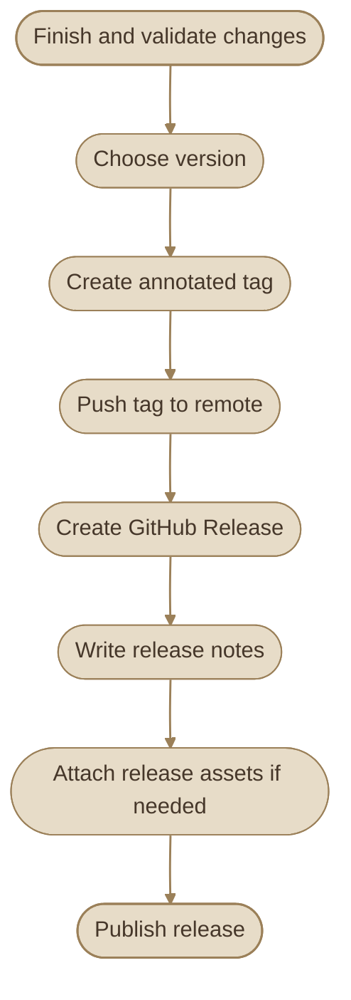
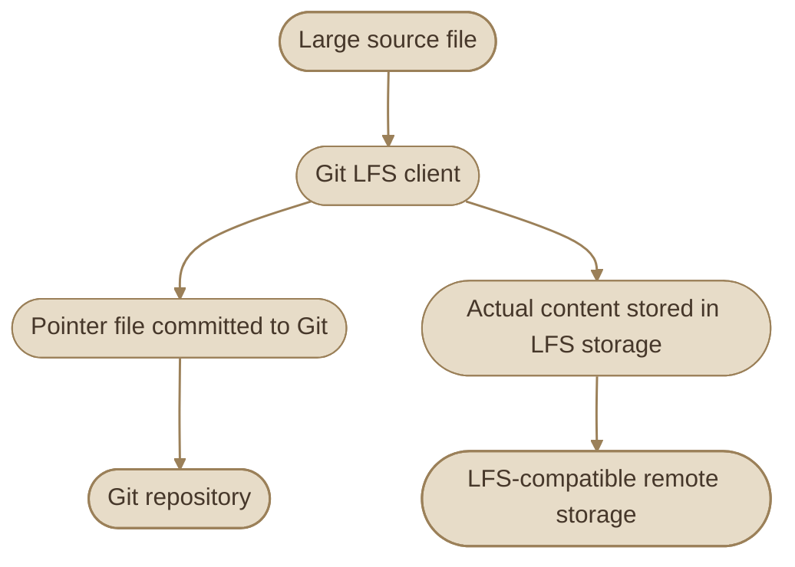

## Overview

لما المشروع يكبر ويبدأ يكون عنده إصدارات مستقرة، محتاج طريقة واضحة تحدد كل إصدار، وتوضح إيه التغييرات اللي دخلت فيه، وتسمح للمستخدمين ينزلوا النسخة المناسبة.

Git بيوفر **Tags** لتسمية نقاط محددة في تاريخ المشروع، بينما منصات زي GitHub بتوفر **Releases** لعرض الإصدارات وملاحظاتها والملفات المرفقة بها.

أما الملفات الكبيرة، زي ملفات التصميم والـ datasets والـ binary assets، فممكن تحتاج طريقة تخزين مختلفة عن التعامل المعتاد مع ملفات الكود.

### I. The Big Picture

<CardGrid columns={2} label="Release Management Concepts">
  <InfoCard variant="concept" title="Git Tags" description="مراجع بتحدد نقاط معينة في تاريخ Git، وغالبًا بنستخدمها لتحديد إصدارات المشروع." icon="tag" tags={["git", "versioning"]} />
  <InfoCard variant="concept" title="Semantic Versioning" description="نظام لتسمية الإصدارات باستخدام MAJOR.MINOR.PATCH وفقًا لطبيعة التغييرات والتوافق." icon="layers" tags={["semver", "compatibility"]} />
  <InfoCard variant="concept" title="GitHub Releases" description="صفحة إصدار بتربط نسخة محددة من المشروع بملاحظات الإصدار والملفات الجاهزة للتنزيل." icon="cloud" tags={["github", "distribution"]} />
  <InfoCard variant="concept" title="Git LFS" description="امتداد لـ Git بيخزن ملفات كبيرة باستخدام pointer files داخل Git وملفات فعلية في LFS storage." icon="database" tags={["large-files", "storage"]} />
</CardGrid>

## 1. Lightweight vs Annotated Tags

الـ **Tag** عبارة عن reference بتسمّي object في Git، وغالبًا بتستخدمها للإشارة إلى commit تمثل إصدارًا معينًا.

عندنا نوعان أساسيان من tags: `lightweight` و`annotated`.

### I. Lightweight Tags

الـ lightweight tag عبارة عن reference بسيطة بتشير مباشرةً إلى object، وغالبًا إلى commit.

```bash
git tag v1.0.0
```

الأمر ده بيعمل tag باسم `v1.0.0` عند الـ commit الحالية، لكنه مش بيضيف tag object تحتوي على رسالة وبيانات مؤلف الـ tag.

استخدمه لما تحتاج تسمية بسيطة لنقطة في التاريخ، أو لما يكون ده متوافقًا مع سياسة المشروع.

### II. Annotated Tags

الـ annotated tag بتنشئ Git object مستقلة تحتوي على معلومات إضافية، منها:

<CardGrid columns={2} label="Annotated Tag Details">
<InfoCard variant="concept" title="Tagger" description="اسم الـ tagger وبياناته." icon="flag" tags={["Metadata"]} />

<InfoCard variant="concept" title="Creation Date" description="تاريخ إنشاء الـ tag." icon="flag" tags={["Metadata"]} />

<InfoCard variant="concept" title="Release Message" description="رسالة توضح الإصدار." icon="code" tags={["Context"]} />

<InfoCard variant="concept" title="Optional Signature" description="توقيع تشفيري اختياري لو أنشأت signed tag." icon="shield" tags={["Verify"]} />
</CardGrid>

```bash
git tag -a v1.0.0 -m "Release version 1.0.0"
```

هنا `-a` معناها إنشاء annotated tag، و`-m` بتحدد رسالة الـ tag.

<CardGrid columns={2} label="Tag Types">
  <InfoCard variant="comparison" title="Lightweight" description="مرجع بسيط يشير إلى object. مناسب للتسمية السريعة، لكنه لا يحتوي على metadata مستقلة خاصة بالـ tag." icon="tag" tags={["simple-reference"]} />
  <InfoCard variant="comparison" title="Annotated" description="Tag object مستقلة تحتوي على metadata ورسالة، ويمكن توقيعها تشفيريًا. غالبًا هي الأنسب للإصدارات المنشورة." icon="shield" tags={["metadata", "releases"]} />
</CardGrid>

### III. Compare Tag Types

<TableCard title="Lightweight vs Annotated" caption="الفرق الحقيقي بيظهر لما تفتح الـ tag object بنفسك.">
<TableCard>
| Aspect | Lightweight | Annotated |
|---|---|---|
| Internal representation | Reference مباشرة إلى object | Reference إلى tag object |
| Tagger metadata | لا توجد metadata مستقلة للـ tag | موجودة |
| Tag message | لا توجد رسالة مستقلة | ممكنة |
| Cryptographic signature | لا | ممكنة |
| Common use | تسمية بسيطة لنقطة في التاريخ | الإصدارات الرسمية |
</TableCard>
</TableCard>

### IV. Inspect Tags

اعرض كل الـ tags:

```bash
git tag --list
```

اعرض تفاصيل tag:

```bash
git show v1.0.0
```

اعرف نوع الـ object اللي بيشير إليها الاسم:

```bash
git cat-file -t v1.0.0
```

لو كانت `v1.0.0` lightweight tag، فغالبًا هتشوف:

```text
commit
```

أما لو كانت annotated tag، فهتشوف:

```text
tag
```

وتقدر تعرض الـ commit اللي بيشير إليها أي نوع من النوعين باستخدام:

```bash
git rev-parse 'v1.0.0^{commit}'
```

الصيغة دي بتخلي Git يحل الـ tag إلى commit، وده مفيد لما تكون بتتعامل مع annotated tags.

## 2. Semantic Versioning

**Semantic Versioning (SemVer)** هو نظام شائع لترقيم إصدارات البرامج بالشكل التالي:

`MAJOR.MINOR.PATCH`

مثال:

`2.4.1`

كل جزء له معنى، بشرط إن المشروع يتبع قواعد SemVer بالفعل.

<CardGrid columns={3} label="Semantic Version Components">
  <InfoCard variant="concept" title="MAJOR" description="زيادة الرقم الرئيسي عند إدخال تغييرات غير متوافقة مع الواجهة أو السلوك العام المتفق عليه." icon="layers" tags={["breaking-changes"]} />
  <InfoCard variant="concept" title="MINOR" description="زيادة الرقم الأوسط عند إضافة وظائف جديدة متوافقة مع الإصدارات السابقة." icon="flag" tags={["new-features"]} />
  <InfoCard variant="concept" title="PATCH" description="زيادة الرقم الأخير عند إجراء إصلاحات متوافقة مع الإصدارات السابقة." icon="wrench" tags={["bug-fixes"]} />
</CardGrid>

### I. Version Examples

<TableCard title="SemVer in Practice" caption="كل رقم بيقولك نوع التغيير اللي حصل.">
<TableCard>
| Version Change | Meaning | Example |
|---|---|---|
| `1.4.2` → `2.0.0` | Breaking change | `2.0.0` |
| `1.4.2` → `1.5.0` | Backward-compatible feature | `1.5.0` |
| `1.4.2` → `1.4.3` | Backward-compatible bug fix | `1.4.3` |
</TableCard>
</TableCard>

الأرقام مش مجرد عدّاد؛ المفروض تعكس طبيعة التغييرات ومدى توافقها مع الإصدار السابق.

### II. Pre-release Versions

قبل الإصدار النهائي، ممكن تنشر نسخة تجريبية:

```text
1.5.0-alpha.1
1.5.0-beta.1
1.5.0-rc.1
1.5.0
```

بشكل عام:

<CardGrid columns={2} label="Pre-release Stages">
<InfoCard variant="concept" title="alpha" description="بتستخدم غالبًا في المراحل المبكرة من التطوير." icon="flag" tags={["Early"]} />

<InfoCard variant="concept" title="beta" description="تشير غالبًا إلى مرحلة اختبار أوسع." icon="pulse" tags={["Testing"]} />

<InfoCard variant="concept" title="rc" description="اختصار لـ Release Candidate، يعني نسخة مرشحة للإصدار النهائي." icon="git-pull-request" tags={["Candidate"]} />

<InfoCard variant="concept" title="1.5.0 (final)" description="هي النسخة النهائية من نفس الإصدار، بشرط اعتمادها ونشرها." icon="tag" tags={["Stable"]} />
</CardGrid>

الأسماء دي conventions شائعة، لكن SemVer لا تفرض على الفريق مراحل تطوير بعينها.

### III. Versioning Rules to Remember

<CardGrid columns={2} label="Versioning Rules to Remember">
<InfoCard variant="concept" title="Stable Public API" icon="tag" tags={["1.0.0"]}>

الإصدارات العامة تبدأ عادةً من `1.0.0` لما المشروع يعلن عن واجهة مستقرة وفقًا لسياسة الإصدار.

</InfoCard>

<InfoCard variant="concept" title="Before 1.0.0" icon="flag" tags={["Early"]}>

قبل `1.0.0`، المشروع بيكون في مرحلة التطوير الأولي، وقواعد التوافق بتختلف عن الإصدارات المستقرة.

</InfoCard>

<InfoCard variant="warning" title="No Leading Zeroes" icon="shield" tags={["Format"]}>

أرقام الإصدارات العادية لا تحتوي على أصفار إضافية في بداية كل جزء؛ مثلًا `1.04.2` مش صيغة SemVer صحيحة.

</InfoCard>

<InfoCard variant="warning" title="Follow Project Policy" description="لو المشروع لا يملك واجهة عامة مستقرة أو لا يتبع SemVer، فلا تفترض أن زيادة رقم معين تضمن مستوى محددًا من التوافق." icon="pulse" tags={["Policy"]} />
</CardGrid>

## 3. Creating and Pushing Tags

إنشاء tag محليًا لا يعني أنها اتنشرت على remote repository. لازم ترفعها بشكل منفصل.

### I. Create a Tag

لو عايز تحدد الإصدار الحالي:

```bash
git tag -a v1.2.0 -m "Release version 1.2.0"
```

ولو عايز تحدد commit قديمة بعينها:

```bash
git tag -a v1.2.0 <commit-hash> -m "Release version 1.2.0"
```

استبدل `<commit-hash>` بالـ commit المناسبة للإصدار، وتأكد إنك بتشير إلى النسخة الصحيحة قبل النشر.

### II. Push a Specific Tag

```bash
git push origin v1.2.0
```

الأمر ده بيرفع tag واحدة إلى remote اسمها `origin`.

### III. Push All Tags

```bash
git push origin --tags
```

ده بيرفع كل الـ tags المحلية غير الموجودة بالفعل على الـ remote. استخدمه بحذر في repositories اللي فيها tags تجريبية أو tags غير مخصصة للنشر الرسمي.

**الأفضل في release workflow** إنك ترفع الـ tag المطلوبة بالاسم، بدل رفع كل الـ tags من غير مراجعة.

### IV. List Remote Tags

```bash
git ls-remote --tags origin
```

الأمر ده بيعرض tags اللي يقدر Git يشوفها على الـ remote.

خلي بالك إن annotated tags ممكن تظهر في الناتج بأكثر من reference، منها reference للـ tag object وreference من نوع `^{}` للـ object اللي بتشير إليها بعد فك الـ tag.

### V. Delete a Tag

حذف tag محلية:

```bash
git tag -d v1.2.0
```

حذف tag من remote:

```bash
git push origin --delete v1.2.0
```

حذف tag منشورة ممكن يسبب ارتباكًا لو مستخدمين أو أدوات نشر اعتمدوا عليها بالفعل. في العادة، لو الإصدار اتنشر رسميًا، الأفضل الحفاظ على tag وعدم إعادة استخدامها للإشارة إلى محتوى مختلف.

### VI. Signed Tags

لو المشروع محتاج التحقق من مصدر الإصدارات، ممكن تنشئ signed annotated tag باستخدام مفتاح توقيع متوافق مع إعدادات Git:

```bash
git tag -s v1.2.0 -m "Release version 1.2.0"
```

التوقيع بيساعد في التحقق من هوية الموقّع وسلامة بيانات الـ tag وفقًا لآلية التوقيع والثقة المستخدمة. لكنه لا يضمن وحده أن الكود آمن أو خالٍ من الأخطاء.

## 4. GitHub Releases

الـ **Git Tag** والـ **GitHub Release** مرتبطين، لكن مش نفس الحاجة.

الـ tag بتحدد نقطة في تاريخ Git، أما الـ release على GitHub فبتضيف صفحة مخصصة للإصدار، ممكن تحتوي على:

<CardGrid columns={3} label="What a GitHub Release Contains">
<InfoCard variant="concept" title="Release Name" description="اسم الإصدار." icon="tag" tags={["Name"]} />

<InfoCard variant="concept" title="Tag" description="الـ tag المرتبطة به." icon="tag" tags={["Reference"]} />

<InfoCard variant="concept" title="Change Description" description="وصف التغييرات." icon="code" tags={["Changes"]} />

<InfoCard variant="concept" title="Release Notes" description="ملاحظات الإصدار (Release Notes)." icon="code" tags={["Notes"]} />

<InfoCard variant="concept" title="Release Assets" description="ملفات قابلة للتنزيل (Release Assets)." icon="database" tags={["Downloads"]} />

<InfoCard variant="concept" title="Published Details" description="معلومات إضافية عن النسخة المنشورة." icon="layers" tags={["Metadata"]} />
</CardGrid>

<InfoCard variant="insight" title="A Release Is More Than a Tag" description="وجود tag في repository لا يعني بالضرورة وجود GitHub Release. تقدر تعمل tag من Git، وبعدها تنشئ Release مرتبطة بها من واجهة GitHub أو باستخدام أدواته." icon="cube" tags={["github", "release-management"]} />

### I. Typical Release Workflow



### II. Creating a Release on GitHub

من واجهة GitHub، اتبع المسار المتاح في repository:

<Steps>
<li>

<InfoCard title="افتح صفحة المشروع" icon="cloud" />
</li>

<li>

<InfoCard title="انتقل إلى قسم Releases" icon="tag" />
</li>

<li>

<InfoCard title="اختار إنشاء Release جديدة" icon="tag" />
</li>

<li>

<InfoCard title="حدد tag موجودة أو أنشئ tag جديدة من الواجهة لو ده مناسب للـ workflow" icon="tag" />
</li>

<li>

<InfoCard title="أضف عنوانًا ووصفًا واضحًا للتغييرات" icon="flag" />
</li>

<li>

<InfoCard title="أرفق ملفات الإصدار عند الحاجة" icon="tag" />
</li>

<li>

<InfoCard title="راجع التفاصيل قبل نشر الـ Release" icon="tag" />
</li>
</Steps>

ممكن تفعّل توليد Release Notes تلقائيًا، لكن راجع الناتج قبل النشر عشان تتأكد إنه واضح ودقيق.

### III. What Should Release Notes Include?

<CardGrid columns={3} label="Release Notes Checklist">
<InfoCard variant="concept" title="New Changes" description="أهم التغييرات الجديدة." icon="flag" tags={["Features"]} />

<InfoCard variant="concept" title="Fixes" description="إصلاحات المشاكل." icon="wrench" tags={["Fixes"]} />

<InfoCard variant="warning" title="Breaking Changes" description="Breaking changes إن وجدت." icon="shield" tags={["Compatibility"]} />

<InfoCard variant="concept" title="Upgrade Steps" description="أي خطوات مطلوبة للترقية." icon="git-pull-request" tags={["Migration"]} />

<InfoCard variant="warning" title="Known Limits" description="قيود معروفة أو مشاكل لسه موجودة." icon="pulse" tags={["Known Issues"]} />

<InfoCard variant="concept" title="Available Artifacts" description="ملفات الإصدار المتاحة وطريقة استخدامها، لو فيه artifacts." icon="database" tags={["Assets"]} />
</CardGrid>

### IV. Source Code vs Release Assets

GitHub بيقدر يوفر source code archives مرتبطة بالـ tag. لكن لو المشروع بيحتاج ملفات binary جاهزة، زي executable أو package أو build artifact، فممكن ترفعها كـ Release Assets.

ما تخلطش بين ملفات المصدر وبين artifacts الناتجة عن عملية build؛ وجود source code لا يعني إن المستخدم عنده كل الملفات الجاهزة لتشغيل البرنامج.

## 5. Git LFS

**Git Large File Storage (Git LFS)** هو امتداد لـ Git مصمم للتعامل مع الملفات الكبيرة بطريقة مختلفة عن تخزين محتواها بالكامل كـ Git blobs عادية في كل نسخة.

بدل ما يخزن محتوى الملف الكبير داخل Git object database بالطريقة المعتادة، بيخزن Git pointer file في repository، بينما المحتوى الفعلي للملف بيتخزن في LFS storage على remote بيدعم الخدمة.

### I. How Git LFS Works



الـ pointer file بيحتوي على معلومات بتحدد نسخة محتوى الملف في LFS storage، مش على محتوى الملف الكبير نفسه.

### II. Install Git LFS

على Fedora، لو Git LFS متاح في الـ repositories المفعلة عندك:

```bash
sudo dnf install git-lfs
```

بعد التثبيت، فعّل تكامل Git LFS:

```bash
git lfs install
```

تقدر تتأكد من الإصدار:

```bash
git lfs version
```

لو الحزمة مش متاحة في إعدادات Fedora عندك، راجع تعليمات التثبيت الرسمية لـ Git LFS بدل استخدام مصادر غير موثوقة.

### III. Track Large Files

افترض إن عندك ملفات تصميم كبيرة بصيغة `.psd`:

```bash
git lfs track "*.psd"
```

الأمر بيحدّث ملف `.gitattributes` عشان يحدد إن الملفات المطابقة للنمط ده تتعامل مع Git LFS.

راجع الملف:

```bash
cat .gitattributes
```

بعدها أضف ملفات المشروع والتزم بملف الإعدادات:

```bash
git add .gitattributes
git add path/to/design.psd
git commit -m "chore: track design files with Git LFS"
```

استبدل المسار بالمكان الفعلي للملف.

<InfoCard variant="concept" title="Note" icon="flag">

<InfoCard variant="concept" title="Note" icon="flag">

**مهم:** إعداد Git LFS لا يحوّل تلقائيًا كل النسخ القديمة من ملف كبير إلى LFS. الملفات اللي اتضافت بالفعل إلى تاريخ Git العادي ممكن تفضل موجودة في التاريخ، حتى لو بدأت تتبع النسخ الجديدة باستخدام LFS.

</InfoCard>

</InfoCard>

### IV. Clone and Pull LFS Files

عند استنساخ repository يدعم Git LFS، بيتم عادةً تنزيل محتوى الملفات المطلوبة من LFS storage حسب الإعدادات. تقدر تستخدم:

```bash
git lfs pull
```

الأمر ده بيطلب تنزيل محتوى LFS المرتبط بالـ working tree الحالية، حسب إعدادات الـ remote وإمكانية الوصول للملفات.

### V. Important LFS Considerations

<CardGrid columns={2} label="Git LFS Considerations">
<InfoCard variant="concept" title="Remote Support" description="الـ remote لازم يدعم Git LFS." icon="cloud" tags={["Support"]} />

<InfoCard variant="warning" title="Verify the Upload" icon="shield" tags={["Push"]}>

رفع pointer files لا يعني أن المحتوى الفعلي اترفع بنجاح؛ تأكد من نجاح عملية `git push` الخاصة بـ LFS.

</InfoCard>

<InfoCard variant="concept" title="Service Limits" description="حدود التخزين وعرض البيانات (bandwidth) بتختلف حسب مزود الخدمة والخطة." icon="database" tags={["Limits"]} />

<InfoCard variant="warning" title="Existing History" description="إضافة Git LFS حاليًا لا تعني تنظيف الملفات الكبيرة الموجودة في تاريخ Git القديم." icon="layers" tags={["History"]} />

<InfoCard variant="warning" title="Plan Migration" description="تحويل تاريخ قديم إلى LFS يحتاج تخطيطًا؛ إعادة كتابة التاريخ قد تتطلب تنسيقًا مع كل أعضاء الفريق." icon="git-merge" tags={["Rewrite"]} />
</CardGrid>

## 6. Handling Large Files

مش كل ملف كبير لازم يتحط في Git LFS. القرار بيعتمد على نوع الملف، وهل لازم يكون جزءًا من تاريخ المشروع، وإزاي الفريق بيشاركه.

### I. Choose the Right Storage Strategy

<CardGrid columns={2} label="Large File Strategies">
  <InfoCard variant="comparison" title="Regular Git" description="مناسب للكود وملفات الإعدادات والملفات النصية الصغيرة اللي نحتاج نراجع تاريخها ونقارن تغييراتها." icon="branch" tags={["source-code"]} />
  <InfoCard variant="comparison" title="Git LFS" description="مناسب للملفات الكبيرة اللي لازم تكون مرتبطة بنسخ المشروع، مع توفر LFS storage مدعوم على الـ remote." icon="database" tags={["large-binaries"]} />
  <InfoCard variant="comparison" title="Release Assets" description="مناسب لتوزيع ملفات binary الناتجة عن build أو ملفات تثبيت مرتبطة بإصدار محدد." icon="cube" tags={["artifacts", "distribution"]} />
  <InfoCard variant="comparison" title="External Artifact Storage" description="مناسب للملفات الكبيرة جدًا أو البيانات اللي لها دورة حياة مستقلة عن تاريخ الكود، مع توثيق واضح للمصدر والإصدار." icon="database" tags={["datasets", "artifacts"]} />
</CardGrid>

### II. Questions Before Adding a Large File

قبل ما تضيف ملفًا كبيرًا، اسأل نفسك:

1. هل الملف جزء ضروري من المصدر، ولا ناتج build ممكن يتولد من جديد؟
2. هل لازم كل نسخة من المشروع تحتوي على إصدار محدد من الملف؟
3. هل الملف binary بيتغير باستمرار، وبالتالي هيزيد حجم التاريخ بسرعة؟
4. هل Git LFS متاح على الـ remote وعند أعضاء الفريق؟
5. هل الملف ممكن يتخزن في artifact storage أو release asset بدلًا من repository؟
6. هل فيه سياسة تمنع تخزين بيانات حساسة أو ملفات خاصة داخل المستودع؟

### III. Files That Usually Should Not Be Committed

أمثلة على ملفات غالبًا الأفضل عدم إضافتها إلى Git:

- ملفات build الناتجة تلقائيًا، لو ممكن إعادة إنشائها.
- مجلدات dependencies اللي بتتولد من package managers.
- ملفات cache المؤقتة.
- logs محلية.
- ملفات secrets زي `.env` اللي تحتوي على credentials حقيقية.
- datasets ضخمة لا يحتاج كل أعضاء الفريق لتخزين نسخها داخل repository.

القرار النهائي يعتمد على المشروع، لكن وجود الملف في مجلد المشروع لا يعني إنه لازم يدخل في Git.

### IV. Check Repository Size

افحص حجم ملفات المستودع:

```bash
du -sh .
```

ولفحص عدد وحجم الـ Git objects:

```bash
git count-objects -v
```

الأمر الأول بيعرض الحجم الإجمالي للـ directory الحالي، بينما الثاني بيوفر معلومات عن تخزين Git الداخلي. الاتنين بيقيسوا حاجات مختلفة، فمتقارنش النتائج باعتبارها نفس المقياس.

### V. If a Large File Was Already Committed

إضافة الملف إلى `.gitignore` مش هتشيله من تاريخ Git لو كان متتبعًا بالفعل.

لو الملف موجود في آخر commit فقط ولسه مش محتاج تحتفظ به في Git، تقدر توقف تتبعه مع الاحتفاظ بنسختك المحلية:

```bash
git rm --cached path/to/large-file
```

بعدها أضف مساره إلى `.gitignore` واعمل commit للتغيير.

لكن الأمر ده **مش بيمسح الملف من الـ commits القديمة**. لو الملف كبير جدًا أو يحتوي على بيانات حساسة، فقد تحتاج إلى إعادة كتابة التاريخ أو إجراءات إضافية، وده لازم يتعمل بحذر لأن التاريخ المنشور قد يتغير ويحتاج تنسيقًا مع الفريق.

## 7. Release Tagging Strategy

وجود tags بأسماء صحيحة مهم، لكن الأهم إن الفريق يستخدمها بطريقة ثابتة وقابلة للتوقع.

### I. A Practical Strategy

لنفترض إن المشروع بيتبع Semantic Versioning:

```text
v1.0.0
v1.0.1
v1.1.0
v2.0.0
```

ممكن تعتمد القواعد التالية:

- استخدم صيغة ثابتة للأسماء، مثل `vMAJOR.MINOR.PATCH`.
- استخدم annotated tags للإصدارات الرسمية.
- اربط كل release بالـ commit الصحيحة.
- لا تعِد استخدام tag منشورة للإشارة إلى محتوى مختلف.
- أنشئ GitHub Release عندما تحتاج صفحة موثقة للتغييرات وملفات التنزيل.
- راجع Release Notes قبل نشرها.
- لو المشروع يحتاج التحقق من مصدر الإصدار، فكّر في signed tags مع إدارة صحيحة لمفاتيح التوقيع.

### II. Example: Prepare a Release

بعد التأكد من أن الكود والاختبارات جاهزان:

```bash
git status
git log --oneline --decorate -10
```

راجع الـ commit الحالية:

```bash
git rev-parse HEAD
```

لو دي فعلًا النسخة المقصودة للإصدار:

```bash
git tag -a v1.2.0 -m "Release version 1.2.0"
git show v1.2.0
```

بعد مراجعة الـ tag، ارفعها:

```bash
git push origin v1.2.0
```

وبعدها أنشئ GitHub Release المرتبطة بها، واكتب وصف التغييرات، وأرفق artifacts لو المشروع بيحتاجها.

### III. Avoid Moving Published Tags

لو اكتشفت مشكلة في إصدار تم نشره بالفعل، تجنب نقل نفس tag إلى commit مختلفة، لأن مستخدمين أو أنظمة build ممكن يكونوا احتفظوا بالـ tag القديمة.

في العادة، أنشئ إصدارًا جديدًا برقم مناسب، مثل `v1.2.1` لو الإصلاح متوافق مع الإصدار السابق، بدل إعادة استخدام `v1.2.0`.

لو اضطررت لتصحيح tag منشورة بسبب خطأ إداري، لازم تنسق مع الفريق والمستهلكين، وتوضح أثر التغيير بدل تغييره في صمت.

<InfoCard variant="warning" title="A Tag Is a Release Identifier, Not a Backup" description="الـ tag بتحدد object في تاريخ Git، لكنها مش نسخة احتياطية مستقلة، ومش بتضمن وحدها إن الملفات الكبيرة في Git LFS متاحة أو إن الـ release artifacts لسه موجودة." icon="shield" tags={["release-safety", "reliability"]} />

## 8. Common Mistakes

- استخدام lightweight tags للإصدارات الرسمية من غير مراعاة سياسة المشروع.
- إنشاء tag على commit غير جاهزة للإصدار.
- نسيان `git push` للـ tag بعد إنشائها محليًا.
- افتراض إن إنشاء tag يعني إنشاء GitHub Release تلقائيًا.
- اعتبار Git LFS وسيلة لتصغير كل محتويات Git القديمة تلقائيًا.
- إضافة ملفات build وcache ضخمة إلى Git من غير سبب.
- افتراض إن `.gitignore` هتشيل الملفات المتتبعة بالفعل أو تمسحها من التاريخ.
- نقل tag منشورة إلى commit مختلفة من غير تنسيق مع المستخدمين.
- نسيان التأكد من نجاح رفع محتوى Git LFS نفسه.

## Key Takeaways

- Lightweight tags مراجع بسيطة، بينما annotated tags تحتوي على metadata مستقلة.
- Semantic Versioning بينظم أرقام الإصدارات وفقًا لطبيعة التغييرات والتوافق.
- إنشاء tag محلية ورفعها إلى remote خطوتان منفصلتان.
- GitHub Releases بتضيف وصفًا وملفات قابلة للتنزيل حول إصدار مرتبط بـ tag.
- Git LFS بيخزن pointer files في Git، والمحتوى الكبير في LFS storage.
- مش كل ملف كبير مناسب لـ Git LFS؛ أحيانًا Release Assets أو artifact storage اختيار أفضل.
- استراتيجية tagging ثابتة بتسهّل تتبع الإصدارات والتحقق منها.
- الإصدارات المنشورة لازم تتعامل معاها كمرجع ثابت، مش كأسماء ممكن تغير معناها في أي وقت.
