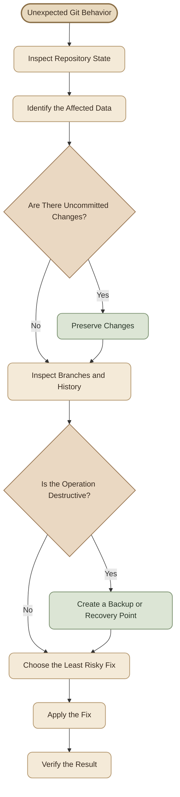

## Introduction

مش كل مشكلة في Git محتاجة أمر جديد، ومش كل خطأ معناه إن الـ Repository باظ. في أغلب الحالات، المشكلة بتكون إننا مش فاهمين الـ Repository واقف فين، أو بنحاول ننفّذ عملية مش مناسبة للحالة الحالية.

الهدف من الدليل ده إنك تتعلم **تشخّص المشكلة الأول، وتختار الإجراء الأقل خطورة، وبعدها تنفّذه وتتحقق من النتيجة.**

<Callout type="note" title="Golden Rule">

قبل أي عملية ممكن تمسح تغييرات أو تعيد كتابة الـ History، افهم الحالة الحالية، وحدد إيه اللي لازم تحافظ عليه، وخد Backup لو فيه أي شك.

</Callout>

## 1. Troubleshooting Workflow

ابدأ بالفحص قبل ما تحاول تصلّح أي حاجة.



### I. Diagnostic Commands

شغّل الأوامر دي قبل ما تقرر تعمل `reset` أو `rebase` أو أي عملية Recovery.

```bash
# Current branch
git branch --show-current

# Working tree and staging area
git status

# Recent commits
git log --oneline --graph --decorate -15

# Local and remote branches
git branch -avv

# Configured remotes
git remote -v

# Changes not yet staged
git diff

# Changes staged for the next commit
git diff --staged

# Recent HEAD movements
git reflog -10
```

<CardGrid>
  <InfoCard title="git status" icon="pulse">
    بيقولك إيه اللي اتغير، وإيه اللي Staged، وهل فيه Merge أو Rebase لسه ما خلصش.
  </InfoCard>
  <InfoCard title="git log" icon="branch">
    بيساعدك تفهم ترتيب الـ Commits والعلاقات بين الـ Branches.
  </InfoCard>
  <InfoCard title="git reflog" icon="cycle">
    بيسجل تحركات الـ Local HEAD، وممكن يساعدك ترجع لـ Commit كنت واقف عليه قبل عملية غلط.
  </InfoCard>
  <InfoCard title="git diff" icon="layers">
    بيوضح محتوى التغييرات قبل ما تختار تحفظها أو تتراجع عنها.
  </InfoCard>
</CardGrid>

## 2. `fetch` vs `pull`

الاتنين بيجيبوا معلومات من الـ Remote، لكن الفرق الأساسي إن `pull` بيجمع بين جلب التحديثات ومحاولة دمجها في الـ Branch الحالي.

<TableCard title="Fetch vs Pull">

<table>
<thead><tr><th>Command</th><th>What it does</th><th>When to use it</th></tr></thead>
<tbody>
<tr><td><code>git fetch</code></td><td>يحدّث معلومات الـ Remote-tracking branches بدون دمجها في الـ Current Branch</td><td>لما تحب تفحص التحديثات الأول</td></tr>
<tr><td><code>git pull</code></td><td>يعمل Fetch ثم يدمج التحديثات باستخدام Merge أو Rebase حسب الإعدادات والخيارات</td><td>لما تكون جاهز تحدّث الـ Branch الحالي</td></tr>
</tbody>
</table>

</TableCard>

### I. Inspect Before Integrating

```bash
# Download remote updates
git fetch origin

# Inspect commits available on the remote-tracking branch
git log --oneline HEAD..origin/main

# Inspect changes introduced by those commits
git diff HEAD..origin/main
```

لو قررت تحدّث `main` باستخدام Merge:

```bash
git switch main
git merge origin/main
```

أو باستخدام Pull مع Rebase:

```bash
git pull --rebase origin main
```

**اختار `fetch` لو لسه بتفحص التغييرات، واختار `pull` لما تكون مستعد تدمج التحديثات.**

<InfoCard title="Important" icon="shield">

`git fetch` مش بيحدّث ملفات الـ Working Tree بتاعتك مباشرة، لكن `git pull` ممكن يغيّرها نتيجة الدمج أو الـ Rebase، وقد ينتج عنه Conflicts.

</InfoCard>

## 3. `merge` vs `rebase`

الاتنين بيجمعوا شغل جاي من أكتر من خط تطوير، لكن طريقة التعامل مع الـ History مختلفة.

<CardGrid columns={2}>
  <InfoCard title="Merge" icon="git-merge">
    بيجمع فرعين، وممكن ينشئ Merge Commit يحافظ على شكل التاريخ الأصلي للفرعين.

    مناسب لما تحب تحافظ على الـ Branching History، خصوصًا في الشغل المشترك.
  </InfoCard>
  <InfoCard title="Rebase" icon="branch">
    بيعيد تطبيق Commits بتاعتك فوق Base أحدث، وده بيغيّر Commit IDs الخاصة بالـ Commits اللي اتعاد تطبيقها.

    مناسب لترتيب الـ History المحلي قبل نشره، بشرط تفهم تأثيره على أي شغل مشترك.
  </InfoCard>
</CardGrid>

### I. Merge Example

```bash
git fetch origin
git switch feature/login
git merge origin/main
```

### II. Rebase Example

```bash
git fetch origin
git switch feature/login
git rebase origin/main
```

لو ظهر Conflict أثناء الـ Rebase:

```bash
git status

# Resolve the conflicts in the affected files
git add path/to/resolved-file

git rebase --continue
```

لو قررت تلغي العملية:

```bash
git rebase --abort
```

**قاعدة مهمة:** تجنّب إعادة كتابة History منشور ومشترك مع زملائك إلا لو فيه اتفاق واضح على ده. لو الـ Branch بتاعك خاص بيك ولسه ما اتشاركش، الـ Rebase غالبًا بيكون أسهل في الإدارة.

## 4. `reset` vs `revert`

دي من أهم المقارنات، لأن الاختيار الغلط ممكن يضيّع شغل أو يغيّر تاريخ الـ Repository.

<TableCard title="Reset vs Revert">

<table>
<thead><tr><th>Command</th><th>Behavior</th><th>Typical use</th></tr></thead>
<tbody>
<tr><td><code>git reset</code></td><td>يحرّك الـ Current Branch إلى Commit مختلف، وقد يغيّر الـ Index أو الـ Working Tree حسب الـ Mode</td><td>تصحيح History محلي أو تعديل حالة Staging</td></tr>
<tr><td><code>git revert</code></td><td>ينشئ Commit جديد يعكس تأثير Commit سابق</td><td>التراجع عن تغيير موجود في History مشترك</td></tr>
</tbody>
</table>

</TableCard>

### I. Example: Undo a Shared Commit Safely

```bash
git log --oneline
git revert <commit-hash>
```

الأمر بينشئ Commit جديد، وده بيخلي التراجع واضح في الـ History من غير ما يمسح الـ Commit القديم.

### II. Understanding Reset Modes

```bash
# Move HEAD and the branch pointer; keep working-tree changes
git reset --mixed <commit-hash>

# Move HEAD and the branch pointer; keep index and working tree aligned
git reset --hard <commit-hash>
```

الـ `--mixed` هو الـ Default لو ما حددتش Mode؛ بيغيّر الـ Index وبيسيب تغييرات الملفات في الـ Working Tree.

أما `--hard` فبيغيّر الـ Branch pointer والـ Index والـ Working Tree، وممكن يمسح تغييرات محلية غير محفوظة.

<Callout type="warning" title="Danger: git reset --hard">

ما تستخدمش `git reset --hard` لمجرد إنك عايز تنظّف الـ Repository. افحص `git status` و`git diff` الأول، واحفظ أي شغل مهم. التغييرات غير المحفوظة ممكن تضيع، والـ Commits اللي خرجت من الـ Branch ممكن تحتاج `reflog` لاستعادتها.

</Callout>

## 5. `restore` vs `checkout`

الأمر `git checkout` قديم وبيستخدم لأكتر من غرض، منها التنقل بين الـ Branches واستعادة الملفات. الأوامر الحديثة بتفصل المسؤوليات دي بصورة أوضح.

<TableCard title="Restore vs Checkout">

<table>
<thead><tr><th>Command</th><th>Purpose</th></tr></thead>
<tbody>
<tr><td><code>git restore &lt;file&gt;</code></td><td>استعادة محتوى ملف في الـ Working Tree</td></tr>
<tr><td><code>git restore --staged &lt;file&gt;</code></td><td>إزالة الملف من الـ Staging Area مع الاحتفاظ بتغييراته في الـ Working Tree</td></tr>
<tr><td><code>git switch &lt;branch&gt;</code></td><td>التنقل بين الـ Branches</td></tr>
<tr><td><code>git checkout &lt;branch&gt;</code></td><td>التنقل بين الـ Branches باستخدام الأمر القديم</td></tr>
<tr><td><code>git checkout -- &lt;file&gt;</code></td><td>استعادة ملف من الـ Index إلى الـ Working Tree</td></tr>
</tbody>
</table>

</TableCard>

### I. Unstage a File Without Losing Its Edits

```bash
git restore --staged app.py
```

ده بيشيل الملف من الـ Staging Area، لكنه بيسيب تعديلاته في الـ Working Tree.

### II. Discard Changes to a File

```bash
git diff -- app.py
git restore -- app.py
```

الأمر التاني بيرجع محتوى الملف في الـ Working Tree لمحتواه في الـ Index، وبالتالي ممكن يمسح التعديلات غير الـ Staged.

لو التغيير كان Staged بالفعل، فالأمر ده مش بالضرورة يرجّع الملف لآخر Commit؛ لأن الـ Index نفسه ممكن يكون مختلف عن `HEAD`.

**اختار `restore` لاستعادة الملفات، و`switch` للتنقل بين الـ Branches.** استخدم `checkout` لما تتعامل مع مشروع أو Workflow قديم بيعتمد عليه.

## 6. `stash` vs Temporary Commit

الاتنين ممكن يحافظوا على شغل مؤقت، لكن لكل واحد استخدام مختلف.

<CardGrid columns={2}>
  <InfoCard title="git stash" icon="database">
    مناسب لما تحتاج تشيل تغييرات مؤقتًا من الـ Working Tree علشان تبدّل Branch أو تنفّذ مهمة عاجلة، من غير ما تعمل Commit عادي.
  </InfoCard>
  <InfoCard title="Temporary Commit" icon="branch">
    مناسب لما تحتاج تحفظ نقطة استرجاع واضحة داخل الـ History، أو لما التغييرات تكون جاهزة جزئيًا للحفظ كـ Commit.
  </InfoCard>
</CardGrid>

### I. Save Work with Stash

```bash
git stash push -m "WIP: login changes"

git stash list

# Restore the latest stash and remove it from the stash list
git stash pop
```

لو عايز تطبّق التغيير من غير ما تحذف الـ Stash:

```bash
git stash apply
```

خلي بالك إن `git stash` افتراضيًا مش بيشمل الملفات الـ Untracked. لو محتاج تضمّنها:

```bash
git stash push -u -m "WIP including untracked files"
```

### II. Save Work with a Temporary Commit

```bash
git add .
git commit -m "WIP: save current progress"
```

الـ Temporary Commit بيحفظ التغييرات في الـ History المحلي. لو هتنشره على Branch مشترك، تأكد إنك عايز فعلًا تشارك الحالة دي.

**نصيحة:** استخدم `stash` للتأجيل المؤقت السريع، واستخدم Commit لما تحتاج نقطة استرجاع واضحة وقابلة للمراجعة.

## 7. `clone` vs `fork`

الفرق الأساسي إن `clone` بينزّل Repository على جهازك، أما `fork` فبينشئ نسخة مستقلة من Repository على حسابك في GitHub.

<TableCard title="Clone vs Fork">

<table>
<thead><tr><th>Operation</th><th>Location</th><th>Typical use</th></tr></thead>
<tbody>
<tr><td><code>git clone</code></td><td>جهازك المحلي</td><td>تنزيل Repository للعمل عليه</td></tr>
<tr><td>GitHub Fork</td><td>حسابك على GitHub</td><td>المساهمة في مشروع لا تملك صلاحية الكتابة على الـ Original Repository</td></tr>
</tbody>
</table>

</TableCard>

### I. Clone Your Own Repository

```bash
git clone https://github.com/USERNAME/project.git
cd project
```

### II. Contribute Through a Fork

بعد ما تعمل Fork من GitHub، نزّل نسختك المحلية:

```bash
git clone https://github.com/YOUR-USERNAME/project.git
cd project

git remote add upstream https://github.com/ORIGINAL-OWNER/project.git

git remote -v
```

غالبًا هيكون عندك:

- `origin`: الـ Fork الخاص بيك.
- `upstream`: الـ Original Repository اللي بتساهم فيه.

لتحديث الـ Local Branch من المصدر الأصلي:

```bash
git fetch upstream
git switch main
git merge upstream/main
```

تقدر بعدها تعمل Push لنسختك على `origin` وتفتح Pull Request للمشروع الأصلي.

## 8. Fixing `non-fast-forward` Errors

ممكن تشوف رسالة زي دي لما تحاول تعمل Push:

```text
! [rejected] main -> main (non-fast-forward)
error: failed to push some refs
```

ده معناه إن الـ Remote عنده Commits مش موجودة في الـ Local Branch بتاعك، وبالتالي Git بيرفض الـ Push العادي علشان ما يكتبش فوق تاريخ موجود على الـ Remote.

### I. Fixing `non-fast-forward` Errors

<Steps>
<li>
<b>Inspect the Repository</b>
<p>افحص حالة الـ Repository:</p>
<pre>git status
git branch --show-current
git fetch origin
git log --oneline --graph --decorate --all -20</pre>
</li>
<li>
<b>Integrate the Remote Changes</b>
<p>لو الـ Branch اسمه <code>main</code> و<code>origin</code>:</p>
<pre>git switch main
git merge origin/main</pre>
<p>أو لو عايز تعيد تطبيق الـ Local Commits:</p>
<pre>git rebase origin/main</pre>
<p>لو ظهرت Conflicts، حلّها وكمل العملية.</p>
</li>
<li>
<b>Push Again</b>
<pre>git push origin main</pre>
</li>
</Steps>

<Callout type="warning" title="Avoid Blind Force Pushes">

ما تستخدمش `git push --force` لمجرد إن الـ Push اترفض. ده ممكن يستبدل تاريخ موجود على الـ Remote ويؤثر على شغل أشخاص تانيين.

لو عندك سبب واضح لإعادة كتابة History على Branch مسموح بإعادة كتابته، فـ `--force-with-lease` أكثر أمانًا من `--force` لأنه بيرفض التحديث لو الـ Remote تغيّر بشكل غير متوقع. لكنه مش بديل عن مراجعة الحالة والاتفاق مع الفريق.

</Callout>

## 9. Fixing Authentication Problems

مشاكل الـ Authentication غالبًا بترجع لواحد من الأسباب دي:

- استخدام Password عادي بدل وسيلة مصادقة مدعومة.
- SSH Key مش مضاف لحساب GitHub أو الـ SSH Agent مش محمّله.
- Credential قديم أو غير صحيح محفوظ في النظام.
- Token انتهت صلاحيته أو ما عندوش الصلاحيات المطلوبة.
- الحساب عنده Authentication صحيحة، لكن ما عندوش Permission للعملية المطلوبة.
- الـ Remote URL بيستخدم HTTPS بينما أنت مجهّز SSH، أو العكس.

### I. Fixing Authentication Problems — Step by Step

<Steps>
<li>
<b>Check the Remote URL</b>
<pre>git remote -v</pre>
<p>HTTPS مثال:</p>
<pre>https://github.com/OWNER/REPOSITORY.git</pre>
<p>SSH مثال:</p>
<pre>git@github.com:OWNER/REPOSITORY.git</pre>
</li>
<li>
<b>Test SSH Authentication</b>
<p>لو الـ Remote بيستخدم SSH:</p>
<pre>ssh -T git@github.com</pre>
<p>لو فشل الاتصال، افحص الـ Keys:</p>
<pre>ls -la ~/.ssh
ssh-add -l</pre>
<p>لو مفيش Key مناسبة، أنشئ واحدة، وبعدها أضف الـ Public Key لحسابك.</p>
</li>
<li>
<b>Check GitHub CLI Authentication</b>
<pre>gh auth status
gh auth login</pre>
</li>
<li>
<b>Check Permissions</b>
<p>اتأكد من صلاحيات حسابك، وصلاحيات الـ Token، وأي شروط خاصة بالـ Organization.</p>
</li>
</Steps>

- صلاحيات حسابك أو عضويتك في الـ Organization.
- صلاحيات الـ Personal Access Token ونطاق وصوله.
- أي شروط إضافية خاصة بالـ Organization، مثل موافقة المسؤول أو SSO authorization.

<InfoCard title="Security Reminder" icon="shield">

ما تحطّش Token أو Password داخل أوامر ممكن تظهر في Shell History أو Logs، وما ترفعش Secrets إلى Git. لو Token اتسرّب، أبطله ودوّر على بديل آمن فورًا.

</InfoCard>

## 10. Recovering an Unexpected Branch or History

لو لقيت نفسك على Branch غلط، أو اكتشفت إن `HEAD` اتحرك لعنوان غير متوقع، ما تبدأش بـ `reset --hard`. الأول حدّد إيه اللي حصل.

### I. Case A: You Are on the Wrong Branch

```bash
git status
git branch --show-current
git branch -a
```

لو مفيش تغييرات هتتأثر بالتنقل:

```bash
git switch main
```

لو عندك تغييرات غير محفوظة، احفظها في Commit أو Stash قبل التنقل لو Git مش قادر يسمح بالتبديل بأمان.

### II. Case B: A Commit Disappeared from the Current Branch

افحص الـ Recent History:

```bash
git log --oneline --graph --decorate -20
git reflog -10
```

لو لقيت الـ Commit المطلوب في الـ Reflog، تقدر تنشئ Branch لاستعادته من غير ما تغيّر الـ Branch الحالي:

```bash
git branch recovery/previous-state <commit-hash>
```

بعدها افحص الـ Branch الجديد:

```bash
git log --oneline --decorate recovery/previous-state
git switch recovery/previous-state
```

راجع المحتوى وتأكد إنك وصلت للحالة المطلوبة قبل ما تقرر تدمج التغييرات أو تنقلها لفرع آخر.

### III. Case C: A Merge or Rebase Is In Progress

```bash
git status
```

لو Git بيقول إن فيه Merge شغال، تقدر تلغيه باستخدام:

```bash
git merge --abort
```

ولو فيه Rebase شغال:

```bash
git rebase --abort
```

استخدم أمر الإلغاء المناسب للعملية اللي بدأت فعلًا. ما تشغّلوش لمجرد وجود Conflict قديم أو تغييرات عادية.

### IV. Case D: You Need to Recover a Deleted Branch

افحص الـ Reflog علشان تحدد آخر Commit كان الـ Branch بيشاور عليه:

```bash
git reflog --all
```

بعد ما تحدد الـ Commit الصحيح، استرجع الـ Branch:

```bash
git branch recovered-feature <commit-hash>
```

الـ Reflog محلي ومش ضمان دائم للاحتفاظ بكل Commit؛ ممكن تتنظف بيانات قديمة مع الوقت. عشان كده، كل ما تكتشف فقدان شغل، حاول تستعيده بدري.

## 11. Choosing the Safest Action

قبل تنفيذ أي أمر، اسأل نفسك: أنا عايز أغيّر إيه تحديدًا؟

<CardGrid>
  <InfoCard title="Inspect First" icon="wrench">
    استخدم `status`, `diff`, `log`, و`reflog` علشان تفهم الحالة الحالية قبل الإصلاح.
  </InfoCard>
  <InfoCard title="Preserve Work" icon="shield">
    لو فيه تعديلات مهمة، اعمل Commit أو Stash أو أنشئ Recovery Branch قبل أي عملية خطرة.
  </InfoCard>
  <InfoCard title="Prefer Reversible Changes" icon="branch">
    لما يكون مناسب، فضّل `revert` على إعادة كتابة History مشترك.
  </InfoCard>
  <InfoCard title="Verify the Result" icon="shield">
    بعد الإصلاح، راجع الـ Status والـ History واختبر إن التغيير المطلوب حصل فعلًا.
  </InfoCard>
</CardGrid>

### I. Risk-Based Decision Table

<TableCard title="Risk-Based Decision Table">

<table>
<thead><tr><th>Situation</th><th>Safer first choice</th><th>Why</th></tr></thead>
<tbody>
<tr><td>You want to inspect remote changes</td><td><code>git fetch</code></td><td>بيجيب المعلومات من غير دمج مباشر</td></tr>
<tr><td>You need to undo a shared commit</td><td><code>git revert</code></td><td>بيضيف Commit جديد بدل حذف القديم من التاريخ</td></tr>
<tr><td>You need to unstage a file</td><td><code>git restore --staged &lt;file&gt;</code></td><td>بيحافظ على تعديلات الملف في الـ Working Tree</td></tr>
<tr><td>You need to discard unstaged edits</td><td>Inspect <code>git diff</code>, then <code>git restore &lt;file&gt;</code></td><td>بتعرف إيه اللي هتتراجع عنه قبل التنفيذ</td></tr>
<tr><td>Your push is rejected</td><td><code>git fetch</code> then inspect and integrate</td><td>بيكشف الاختلافات قبل محاولة Push جديدة</td></tr>
<tr><td>You lost track of a local commit</td><td><code>git reflog</code></td><td>ممكن يوصّلك للـ Commit السابق</td></tr>
<tr><td>You need to pause local work</td><td><code>git stash</code></td><td>بيحفظ التغييرات مؤقتًا</td></tr>
<tr><td>You want to erase local changes</td><td>Back up first, then choose a precise command</td><td>تقليل احتمالية فقدان شغل مهم</td></tr>
</tbody>
</table>

</TableCard>

## 12. A Practical Troubleshooting Checklist

<ChecklistCard title="Pre-Fix Checklist" items={[
  "شغّلت git status وفهمت حالة الـ Working Tree.",
  "عرفت الـ Current Branch باستخدام git branch --show-current.",
  "راجعت الـ Local وRemote branches.",
  "راجعت الـ Recent Commits باستخدام git log.",
  "فحصت التغييرات غير المحفوظة باستخدام git diff وgit diff --staged.",
  "حفظت التعديلات المهمة قبل أي عملية ممكن تمسحها.",
  "فهمت الفرق بين التأثير المحلي والتأثير على الـ Remote.",
  "تجنّبت Force Push أو reset --hard من غير سبب واضح.",
  "نفّذت إصلاحًا واحدًا في كل مرة.",
  "تحققت من النتيجة باستخدام git status والاختبارات المناسبة."
]} />

## 13. Final Practical Challenge

تخيّل إنك بتشتغل على `feature/login`، وعندك تغييرات محلية لسه ما عملتلهاش Commit، وزميلك عمل Push لتغييرات جديدة على `main`. لما حاولت تعمل Push، ظهر `non-fast-forward`.

المطلوب منك تحدد ترتيب خطوات آمن يعالج المشكلة من غير فقدان شغلك.

**فكّر في الأسئلة دي:**

1. إيه الأوامر اللي هتشغّلها علشان تعرف حالة الـ Repository؟
2. هتحافظ على التغييرات المحلية إزاي؟
3. هتجيب تحديثات الـ Remote إزاي من غير دمج فوري؟
4. هتختار Merge ولا Rebase؟ وليه؟
5. لو حصل Conflict، هتتعامل معاه إزاي؟
6. إزاي تتأكد إن شغلك موجود وإن الـ Branch جاهز للـ Push؟

مفيش إجابة واحدة مناسبة لكل الحالات؛ الاختيار بيعتمد على حالة الـ Working Tree، وسياسة الفريق، وهل الـ Commits اتنشرت واتشاركَت بالفعل.

## Summary

<Callout type="tip" title="The Git Troubleshooting Mindset">

**Inspect → Preserve → Decide → Apply → Verify**

افهم الحالة، حافظ على شغلك، اختار أقل إجراء خطورة يحقق هدفك، نفّذه، وبعدها تأكد من النتيجة. دي أهم مهارة هتخليك تتعامل مع مشاكل Git بثقة بدل الاعتماد على أوامر محفوظة من غير فهم.

</Callout>

