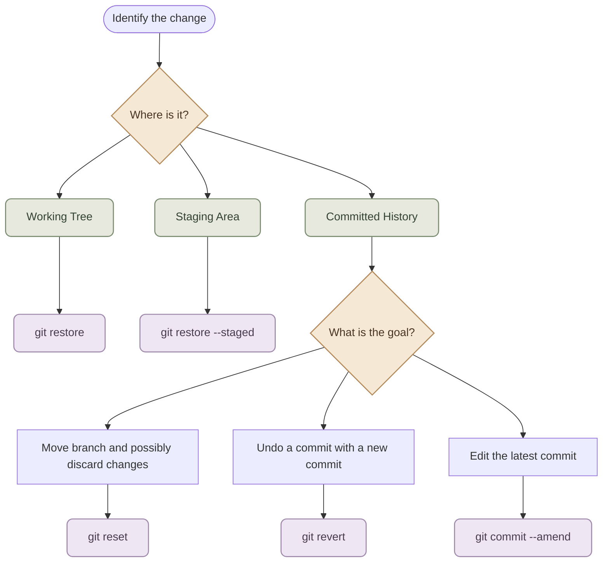
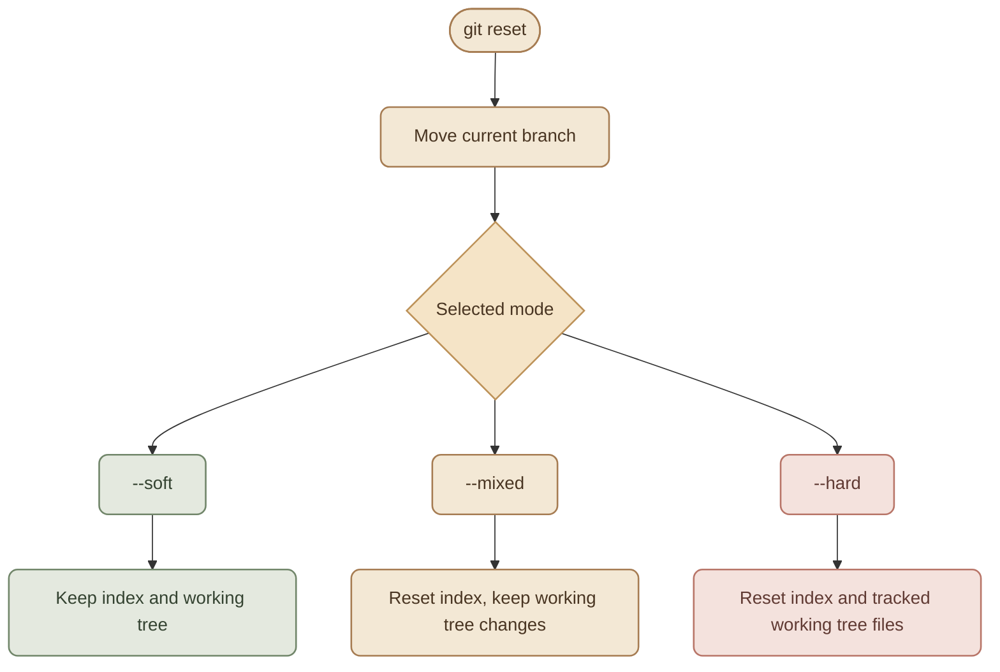
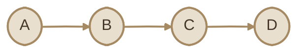
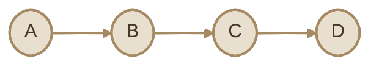

## Overview

أثناء شغلك على أي مشروع، هتقابل مواقف محتاج فيها تتراجع عن تغيير، تصلّح commit، أو تسترجع شغل اتحركت بعيد عنه بالغلط.

Git بيوفر أكتر من طريقة للتراجع، لكن **مش كل الأوامر بتعمل نفس الحاجة**. فيه أوامر بتغيّر الملفات، وأوامر بتغيّر الـ staging area، وأوامر بتحرّك الـ current branch إلى commit أقدم، وأوامر بتنشئ commit جديد يعكس تغيير سابق.

فهم الفرق ده مهم جدًا، خصوصًا قبل استخدام أوامر زي `git reset --hard` أو تعديل تاريخ commits اتشارك بالفعل مع الفريق.

<InfoCard variant="concept" title="The Golden Rule" description="Before undoing anything, inspect the repository state and identify exactly what you want to undo: working tree changes, staged changes, a commit, or a previously reachable commit." icon="shield" tags={["Recovery", "Data Safety"]} />

## 1. Understand What You Are Undoing

قبل ما تختار الأمر، لازم تعرف التغيير موجود فين.

في Git، فيه ثلاث مناطق أساسية مرتبطة بالتعديلات:

<CardGrid columns={3} label="Where the Change Lives">
<InfoCard variant="concept" title="Working Tree" description="الملفات اللي بتشتغل عليها حاليًا — التعديلات غير المعمولة لها commit." icon="wrench" tags={["Uncommitted"]} />
<InfoCard variant="concept" title="Index / Staging Area" description="التغييرات اللي جهزتها للـ next commit بعد git add." icon="layers" tags={["Staged"]} />
<InfoCard variant="concept" title="Repository History" description="الـ commits اللي Git سجلها بالفعل — التاريخ النهائي." icon="branch" tags={["Committed"]} />
</CardGrid>

الأوامر المختلفة بتتعامل مع المناطق دي بطرق مختلفة.

<TableCard title="Which Command for Which Situation" caption="اختار الأمر حسب مكان التغيير والهدف من التراجع.">
| Situation | Typical command | What it changes |
|---|---|---|
| Discard unstaged file changes | `git restore <file>` | Working tree |
| Unstage a file | `git restore --staged <file>` | Index |
| Move the current branch backward | `git reset` | Branch reference and, depending on the mode, index and working tree |
| Create a new commit that reverses a previous commit | `git revert <commit>` | Repository history |
| Replace the latest commit | `git commit --amend` | Latest commit and branch history |
| Find previous HEAD positions | `git reflog` | No changes by itself |
</TableCard>



ابدأ دائمًا بالأوامر دي قبل أي عملية تراجع:

```bash
git status
git diff
git diff --cached
git log --oneline --decorate -10
```

- `git status`: يوضح حالة الملفات والـ staging area.
- `git diff`: يعرض التغييرات غير الموجودة في الـ staging area.
- `git diff --cached`: يعرض التغييرات الموجودة في الـ staging area.
- `git log`: يعرض آخر commits في التاريخ.

---

## 2. `git restore`

الأمر `git restore` مخصص لاستعادة محتوى الملفات. تقدر تستخدمه للتراجع عن تغييرات غير معمولة لها commit، سواء كانت في الـ working tree أو في الـ staging area.

### I. Discard Unstaged Changes

افترض إنك عدّلت ملفًا ولسه معملتش له `git add`، وبعد مراجعة التغيير قررت إنك مش محتاجه.

اعرض التغيير الأول:

```bash
git diff
```

لو متأكد إنك عايز ترجع الملف لآخر نسخة موجودة في الـ index:

```bash
git restore src/app.js
```

في الاستخدام المعتاد، ده بيرجع التغييرات غير المعمولة لها stage في الملف إلى النسخة الموجودة في الـ staging area، أو إلى آخر نسخة متاحة في الـ index لو الملف مش معمول له stage.

**تحذير:** الأمر ده ممكن يمسح تعديلات محلية غير محفوظة في الملف المحدد. لو محتاج التغييرات، احفظ نسخة منها قبل الاستعادة.

### II. Unstage a File

لو نفّذت:

```bash
git add src/app.js
```

وبعدها اكتشفت إنك مش عايز التغيير يدخل في الـ next commit، تقدر تشيل الملف من الـ staging area من غير ما تتخلص من تعديلاته في الـ working tree:

```bash
git restore --staged src/app.js
```

النتيجة:

- التعديل هيفضل موجودًا في الملف.
- الملف هيتشال من الـ staging area بالنسبة للتغييرات دي.
- تقدر تعدّل الملف أو تعمل له stage مرة تانية لاحقًا.

### III. Restore a File to a Specific Commit

تقدر تستعيد محتوى ملف من commit معين:

```bash
git restore --source=<commit> -- src/app.js
```

مثال:

```bash
git restore --source=HEAD~2 -- src/app.js
```

ده بيستعيد محتوى الملف من النسخة المشار إليها بـ `HEAD~2`، أي الـ commit الموجود قبل الـ current commit بمرحلتين في سلسلة الـ first-parent المعتادة.

الأمر ده بيغيّر الـ working tree، لكنه **مش بيحرّك الـ branch إلى الـ commit القديم** ومش بيعمل commit تلقائيًا.

لو عايز تحفظ النسخة المستعادة في التاريخ، راجع التغيير واعمله stage ثم commit:

```bash
git diff
git add src/app.js
git commit -m "fix: restore previous app implementation"
```

<InfoCard variant="warning" title="Restore Is Not a History-Recovery Command" description="git restore changes file contents in the working tree or index. It does not move the current branch pointer or recover a deleted commit reference by itself." icon="wrench" tags={["git restore", "Safety"]} />

### IV. Quick Reference

<TableCard title="git restore Variants" caption="كل variant بيستهدف منطقة مختلفة — راجع التأثير قبل التنفيذ.">
| Command | Effect |
|---|---|
| `git restore file.txt` | Discard unstaged changes to the file |
| `git restore --staged file.txt` | Unstage the file while preserving working-tree changes |
| `git restore --source=HEAD~1 -- file.txt` | Restore the file from an older commit into the working tree |
| `git restore --staged --worktree file.txt` | Restore both the index and working tree from the default source |
</TableCard>

في الأمر الأخير، المصدر الافتراضي هو `HEAD`؛ بالتالي الأمر ممكن يتخلص من تغييرات staged وunstaged في الملف المحدد. استخدمه فقط لو ده فعلًا المطلوب.

---

## 3. `git reset` — Soft, Mixed, and Hard

الأمر `git reset` بيحرّك الـ current branch reference إلى commit معين. حسب الـ mode، ممكن كمان يغيّر الـ staging area والـ working tree.

دي من أهم أوامر Git اللي لازم تفهم تأثيرها قبل استخدامها.

### I. Understanding the Three Modes

الـ modes الأساسية هي:

- `--soft`
- `--mixed`
- `--hard`

لو نفّذت `git reset` من غير تحديد mode، فالافتراضي هو `--mixed`.

### II.`git reset --soft`

الـ `--soft` بيحرّك الـ current branch إلى commit أقدم، لكنه بيحتفظ بالتغييرات الموجودة في الـ staging area والـ working tree.

مثال:

```bash
git reset --soft HEAD~1
```

لو كنت عامل commit بالغلط وعايز تلغيه مع الاحتفاظ بتغييراته جاهزة للـ commit التالي، ده اختيار مناسب.

النتيجة المعتادة:

- الـ current branch بيرجع للـ parent commit.
- التغييرات اللي كانت في الـ commit الملغي بتفضل staged.
- الملفات بتفضل محتفظة بمحتواها الحالي.

### III. `git reset --mixed`

الـ `--mixed` بيحرّك الـ current branch، وبيحدّث الـ index إلى محتوى الـ target commit، لكنه بيحتفظ بتغييرات الملفات في الـ working tree.

```bash
git reset --mixed HEAD~1
```

استخدام شائع: إلغاء آخر commit مع الاحتفاظ بالتغييرات، لكن إرجاعها لحالة unstaged.

النتيجة المعتادة:

- الـ branch بيرجع للـ parent commit.
- الـ staging area بتتحدّث إلى محتوى الـ target commit.
- التغييرات بتفضل موجودة في الملفات كـ unstaged changes.

وبما إن `--mixed` هو الافتراضي، فالأمر ده له نفس تأثير المثال السابق:

```bash
git reset HEAD~1
```

### IV. `git reset --hard`

الـ `--hard` بيحرّك الـ current branch، وبيحدّث الـ index والـ working tree إلى محتوى الـ target commit.

```bash
git reset --hard HEAD~1
```

النتيجة المعتادة:

- الـ branch بيرجع للـ parent commit.
- التغييرات الموجودة في الـ staging area بتتخلص منها.
- التغييرات المحلية في الملفات المتأثرة بتتكتب فوقها النسخة الموجودة في الـ target commit.

**ده أمر destructive.** ممكن تفقد بسببه تعديلات محلية غير معمولة لها commit، سواء كانت staged أو unstaged.

كمان، الملفات غير المتتبعة مش بتتحذف كلها تلقائيًا لمجرد إنك استخدمت `git reset --hard`؛ الأمر بيعيد ضبط الملفات المتتبعة، وقد يحذف ملفات غير متتبعة تعوق كتابة ملفات متتبعة في بعض الحالات.

### V. Compare the Modes

<CardGrid columns={3} label="Reset Modes">
<InfoCard variant="comparison" title="--soft" description="بيحرّك الـ branch بس — التغييرات بتفضل staged وجاهزة للـ commit التالي." icon="layers" tags={["Safest"]} />
<InfoCard variant="comparison" title="--mixed" description="بيحرّك الـ branch وبيرجّع التغييرات لحالة unstaged (الافتراضي)." icon="wrench" tags={["Default"]} />
<InfoCard variant="comparison" title="--hard" description="بيحرّك الـ branch وبيمسح الـ index والـ working tree — destructive." icon="shield" tags={["Destructive"]} />
</CardGrid>

<TableCard title="git reset Modes Compared" caption="كل mode بيحدد إيه اللي بيتم ضبطه تلقائيًا بعد تحريك الـ branch.">
| Mode | Moves branch | Resets index | Resets working tree | Typical use |
|---|---|---|---|---|
| `--soft` | Yes | No | No | Undo a commit but keep changes staged |
| `--mixed` | Yes | Yes | No | Undo a commit and keep changes unstaged |
| `--hard` | Yes | Yes | Yes | Discard local changes and reset tracked files |
</TableCard>

### VI. Visualizing Reset



### VII. A Practical Example

لنفترض إن تاريخك بالشكل ده:


وعايز تلغي آخر commit، اللي هو `D`.

لو نفّذت:

```bash
git reset --soft HEAD~1
```

الـ `main` هيرجع إلى `C`، لكن تغييرات `D` هتفضل staged.

لو استخدمت:

```bash
git reset --mixed HEAD~1
```

الـ `main` هيرجع إلى `C`، وتغييرات `D` هتفضل في الـ working tree لكن من غير stage.

أما:

```bash
git reset --hard HEAD~1
```

فالـ `main` هيرجع إلى `C`، والملفات المتتبعة هترجع إلى محتوى `C`، مع فقدان التغييرات المحلية اللي الأمر بيستبدلها.

### VIII. Resetting to a Specific Commit

مش لازم تستخدم `HEAD~1`. تقدر تحدد commit hash:

```bash
git reset --mixed a1b2c3d
```

استبدل `a1b2c3d` بالـ commit ID الفعلي.

قبل تنفيذ reset، اعرض التاريخ وحدد الـ target بعناية:

```bash
git log --oneline --decorate -10
```

**مهم:** `git reset` بيغيّر التاريخ اللي بيشير إليه الـ current branch. لو الـ commits دي اتعمل لها push واتشارك بها مع الفريق، تغيير التاريخ ممكن يسبب مشاكل للآخرين. في الحالات دي، `git revert` غالبًا أنسب.

---

## 4. `git revert`

الأمر `git revert` بيعمل **commit جديد يعكس التغييرات اللي عملها commit سابق**، من غير ما يحذف الـ commit الأصلي من التاريخ.

ده بيخليه اختيارًا مناسبًا لما تحتاج تتراجع عن تغيير موجود بالفعل في branch مشترك.

### I. Basic Usage

اعرض التاريخ:

```bash
git log --oneline
```

وبعد تحديد الـ commit المطلوب التراجع عنه:

```bash
git revert <commit>
```

مثال:

```bash
git revert a1b2c3d
```

Git هيحاول ينشئ commit جديد يعكس التغييرات اللي دخلها الـ commit المحدد. ممكن يفتح محرر رسالة الـ commit، وممكن يحصل conflict لو التغييرات الحالية بتتعارض مع التراجع.

### II. How Revert Changes History

قبل التراجع:



لنفترض إن `D` أدخل تغييرًا غير مرغوب فيه.

بعد تنفيذ `git revert D` بنجاح:


الـ commit `D` لسه موجود في التاريخ، والـ commit الجديد `E` بيعكس تأثيره قدر الإمكان.

### III. Reset vs Revert

<TableCard title="git reset vs git revert" caption="الأول بيعيد كتابة التاريخ، والتاني بيضيف commit جديد يعكس التأثير.">
| Aspect | `git reset` | `git revert` |
|---|---|---|
| Creates a new commit | No | Yes |
| Moves current branch backward | Yes | No; adds a new commit |
| Preserves original commit in branch history | May remove it from the current branch history | Yes |
| Appropriate for shared history | Requires care; can rewrite branch history | Often safer |
| Can cause conflicts | Depending on operation and later work | Yes |
</TableCard>

### IV. Revert a Merge Commit

التراجع عن merge commit محتاج تحديد الـ mainline parent، لأن الـ merge commit له أكتر من parent.

الشكل العام:

```bash
git revert -m 1 <merge-commit>
```

الخيار `-m 1` بيحدد الـ first parent باعتباره الـ mainline. في السيناريو المعتاد، ده بيكون الفرع اللي كنت واقف عليه وقت الدمج، لكن لازم تتأكد من ترتيب الـ parents قبل التنفيذ.

تقدر تفحص الـ merge commit باستخدام:

```bash
git show --no-patch --pretty=raw <merge-commit>
```

اختيار الـ parent الغلط ممكن ينتج عنه تراجع مختلف عن المطلوب. كمان، revert للـ merge commit بيأثر على التغييرات اللي أدخلها الدمج مقارنة بالـ mainline؛ مش معناه إن كل تاريخ الفرع المدموج هيختفي.

<InfoCard variant="tip" title="Prefer Revert for Shared History" description="When a commit has already been shared with teammates, creating a compensating commit is usually safer than moving a shared branch backward with reset." icon="wrench" tags={["Collaboration", "History"]} />

---

## 5. `git commit --amend`

الأمر `git commit --amend` بيستبدل آخر commit بواحد جديد. بتستخدمه عادةً لتصحيح رسالة الـ commit أو إضافة تغييرات نسيت تضمّنها.

### I. Amend the Commit Message

لو آخر commit فيه رسالة غير واضحة:

```bash
git commit --amend -m "feat(auth): add login validation"
```

ده بيعمل commit جديد بدل آخر commit، برسالة جديدة.

### II. Add Forgotten Changes

افترض إنك عملت commit وبعدها اكتشفت إنك نسيت تضيف ملفًا مرتبطًا بنفس التغيير.

```bash
git add src/auth/validator.js
git commit --amend --no-edit
```

الخيار `--no-edit` بيحتفظ برسالة الـ commit الحالية.

### III. Important: Amend Rewrites the Commit

حتى لو محتوى الـ commit الجديد قريب جدًا من القديم، Git بيُنشئ commit object جديدًا. بالتالي، الـ commit hash غالبًا هيتغير، وأي commits مبنية على النسخة القديمة ممكن تحتاج معالجة لو كانت اتشاركت بالفعل.

استخدم `--amend` عادةً مع آخر commit محلي لم يتم نشره بعد.

لو الـ commit اتعمل له push وناس تانية اعتمدت عليه، متعدّلوش بشكل عشوائي؛ تعديل التاريخ ممكن يتطلب تحديث الـ remote history والتنسيق مع الفريق.

---

## 6. `git reflog`

الـ **Reflog** هو سجل محلي بيسجل تحركات مراجع Git، خصوصًا تغييرات `HEAD` والـ branch references.

ممكن يساعدك تلاقي commit كنت واقف عليه قبل `reset` أو بعد تبديل branches أو تعديل آخر commit.

### I. Inspect the Reflog

لعرض سجل تحركات `HEAD`:

```bash
git reflog
```

مثال توضيحي:

```text
f4e5d6a HEAD@{0}: reset: moving to HEAD~1
a1b2c3d HEAD@{1}: commit: feat(auth): add login
9e8d7c6 HEAD@{2}: commit: docs: update setup guide
```

في المثال ده، `HEAD@{1}` بيمثل موضع `HEAD` المسجل في الخطوة السابقة في الـ reflog. والـ hash `a1b2c3d` ممكن يكون هو الـ commit اللي عايز تستعيده.

تقدر كمان تعرض سجل تحركات branch محدد:

```bash
git reflog show main
```

### II. What Reflog Is — and Isn't

الـ reflog:

- بيسجل تحركات المراجع المحلية.
- ممكن يسهّل العثور على commits خرجت من التاريخ الحالي للـ branch.
- مش بديل عن backups أو remote repositories.
- مش سجلًا مشتركًا مع باقي الفريق.
- مش ضمانًا إن أي commit قديم هيفضل قابلًا للاسترجاع إلى الأبد.

عادةً، سجلات الـ reflog بتكون محلية، وليها سياسات انتهاء صلاحية. ولو الـ commit objects بقت غير قابلة للوصول وتم حذفها فعليًا من قاعدة بيانات Git بعد عمليات الصيانة، ممكن الاسترجاع يبقى مستحيلًا.

---

## 7. Recovering Lost Commits

من أشهر حالات الاسترجاع إنك تعمل reset بالغلط، وبعدها تكتشف إنك محتاج commit كنت بتفتكر إنه اختفى.

خلينا نمشي بمثال عملي.

### I. Scenario: Accidental Reset

كان التاريخ:



وبعد تنفيذ:

```bash
git reset --hard HEAD~2
```

الـ branch رجع إلى `B`، والتاريخ الحالي للـ branch بقى بالشكل ده:


الـ commits `C` و`D` بقوا خارج التاريخ الحالي للـ branch، لكن ده مش معناه إنهم اتحذفوا فورًا من Git's object database.

----

<Callout type="lab" title="Hands-on: Recovery" />

<Steps>
<li>

<InfoCard title="Step 1 — Inspect Reflog" description="راجع سجل التحركات بـ git reflog." icon="layers" tags={["Inspect"]} />

```bash
git reflog
```

</li>
<li>

<InfoCard title="Step 2 — Identify Commit" description="افحص الـ commit المطلوب بـ git show." icon="wrench" tags={["Identify"]} />

```bash
git show --stat <commit>
```

</li>
<li>

<InfoCard title="Step 3 — Create Recovery Branch" description="أنشئ branch جديد يشير للـ commit المسترجع." icon="branch" tags={["Branch"]} />

```bash
git branch recovery/profile-page <commit>
```

</li>
<li>

<InfoCard title="Step 4 — Decide Restore" description="قرر كيف تعيد الشغل بناءً على المراجعة." icon="shield" tags={["Plan"]} />

</li>
</Steps>

---

### II. Alternative: Restore a Commit Without Moving the Branch Backward

افترض إنك لقيت الـ commit `D`:

```text
d4e5f6a HEAD@{1}: commit: feat: add profile page
```

افحصه قبل أي تغيير:

```bash
git show --stat d4e5f6a
git show --no-patch --format=fuller d4e5f6a
```

اتأكد إن ده فعلًا الـ commit اللي محتاج تسترجعه.

### III. Create a Recovery Branch

الطريقة الأكثر حذرًا هي إنشاء branch جديد يشير إلى الـ commit المسترجع:

```bash
git branch recovery/profile-page d4e5f6a
```

بعدها تقدر تفحصه:

```bash
git switch recovery/profile-page
git log --oneline --decorate -10
```

كده استرجعت إمكانية الوصول للـ commit من خلال branch reference جديد، من غير ما تغيّر `main` مباشرةً.

### IV. Decide How to Restore the Work

بعد مراجعة الـ recovery branch، عندك اختيارات حسب المطلوب:

- تنقل شغلك إلى branch جديد وتكمل عليه.
- تدمج التغييرات في branch آخر بعد مراجعتها.
- تعيد `main` إلى commit معين لو متأكد إن ده المطلوب.

لو تأكدت إنك عايز `main` يشير إلى نفس commit المسترجع، وكان ده آمنًا بالنسبة لحالة المشروع:

```bash
git switch main
git reset --hard d4e5f6a
```

**نفّذ الأمر ده فقط بعد التأكد من الـ target ومن إنك مش هتفقد تغييرات محلية مهمة.** إنشاء recovery branch أولًا بيديك reference ثابتًا تقدر ترجع له أثناء المراجعة.

### V. Alternative: Restore a Commit Without Moving the Branch Backward

لو هدفك استرجاع التغيير في branch الحالي من غير إعادة كتابة التاريخ، ممكن تستخدم `git cherry-pick` على الـ commit المطلوب:

```bash
git cherry-pick d4e5f6a
```

الأمر بيحاول يطبّق التغيير الموجود في الـ commit كـ commit جديد فوق الـ current branch. ممكن يحصل conflict، ومش دايمًا تطبيق commit قديم فوق التاريخ الحالي هينجح من غير تدخل.

### VI. What If Reflog Does Not Help?

لو مش لاقي الـ commit في الـ reflog، ممكن تبحث عن commits غير مرتبطة حاليًا بأي branch أو reference باستخدام:

```bash
git fsck --full --no-reflogs --unreachable
```

ده أمر فحص متقدم؛ ممكن يعرض objects غير قابلة للوصول، ومش كل النتائج هتكون commits مفيدة للاسترجاع.

لو ظهر commit محتمل:

```bash
git show <commit>
```

راجع محتواه قبل ما تنشئ recovery branch أو تغيّر أي references.

الاسترجاع بيكون أسهل بكتير قبل انتهاء صلاحية الـ reflog أو حذف objects غير القابلة للوصول. عشان كده، أول ما تكتشف فقدان commit، تجنّب تشغيل أوامر cleanup عشوائية، وابدأ بالفحص.

---

## 8. Safe vs Destructive Operations

مش كل عمليات التراجع ليها نفس مستوى الخطورة. التصنيف هنا بيعتمد على تأثير الأمر في التغييرات المحلية والتاريخ، مش على إن الأمر آمن في كل الظروف.

<CardGrid columns={3} label="Safety Spectrum">
<InfoCard variant="success" title="Safe" description="أوامر فحص وعرض مش بتغيّر الملفات أو التاريخ." icon="pulse" tags={["Read-only"]} />
<InfoCard variant="warning" title="Needs Care" description="أوامر بتغيّر الملفات أو التاريخ — محتاجة فهم للسياق." icon="wrench" tags={["Review first"]} />
<InfoCard variant="danger" title="Destructive" description="أوامر بتمسح تعديلات أو تاريخ بشكل ممكن ما يرجعش." icon="shield" tags={["Backup"]} />
</CardGrid>

### I. Safer Operations

<TableCard title="Safer Operations" caption="بتغيّر شكل العرض أو الملفات بشكل محدود وقابل للتراجع.">
| Operation | Why it is generally safer |
|---|---|
| `git status` | فحص الحالة من غير تغيير الملفات |
| `git diff` | عرض التغييرات من غير تعديلها |
| `git log` | استعراض التاريخ |
| `git reflog` | استعراض تحركات المراجع |
| `git restore --staged <file>` | إزالة الـ file changes من الـ staging مع الاحتفاظ بها في الـ working tree |
| `git revert <commit>` | إنشاء commit جديد يعكس تغييرًا سابقًا بدل إزالة الـ commit من التاريخ الحالي |
</TableCard>

حتى الأوامر دي محتاجة فهم للسياق؛ مثلًا، `git revert` ممكن ينتج عنه conflicts، و`git restore --staged` مش معناه إن التغيير اتلغى من الملف.

### II. Operations That Need Extra Care

<TableCard title="Operations That Need Extra Care" caption="بتغيّر الـ branch reference أو الـ index — راجع النتيجة بعد التنفيذ.">
| Operation | Main risk |
|---|---|
| `git restore <file>` | التخلص من تعديلات غير معمولة لها commit في الملف |
| `git reset --soft` | نقل branch reference مع إبقاء التغييرات staged |
| `git reset --mixed` | نقل branch reference وإرجاع التغييرات إلى حالة unstaged |
| `git commit --amend` | استبدال آخر commit وتغيير الـ commit hash |
| `git cherry-pick` | إنشاء commit جديد وقد ينتج عنه conflicts |
</TableCard>

### III. Destructive Operations

<TableCard title="Destructive Operations" caption="بيمسحوا تعديلات أو references — اعمل backup قبل التنفيذ.">
| Operation | Main risk |
|---|---|
| `git reset --hard` | فقدان تعديلات محلية متتبعة عند استبدالها بمحتوى الـ target commit |
| `git clean -fd` | حذف ملفات ومجلدات غير متتبعة |
| `git clean -fdx` | حذف الملفات غير المتتبعة، بما فيها الملفات المتجاهلة بواسطة `.gitignore` |
| `git branch -D <branch>` | حذف branch reference حتى لو كان يحتوي على commits غير مدمجة |
</TableCard>

قبل تنفيذ `git clean`، اعرض الملفات اللي هتتحذف باستخدام dry run:

```bash
git clean -nd
```

ولو عايز تشوف كمان الملفات المتجاهلة اللي ممكن يحذفها `-x`:

```bash
git clean -ndx
```

الخيار `-n` بيعرض ما كان الأمر سيحذفه من غير تنفيذ الحذف. راجع الناتج بعناية قبل إزالة `-n`.

### IV. A Practical Safety Checklist

قبل أي عملية تراجع، امشِ بالترتيب ده:

<Steps>
<li>

<InfoCard title="Inspect" description="استخدم git status وراجع الـ diff قبل أي تغيير." icon="pulse" tags={["Check"]} />

</li>
<li>

<InfoCard title="Identify" description="حدد الـ file أو commit أو branch المقصود بدقة." icon="branch" tags={["Target"]} />

</li>
<li>

<InfoCard title="Preserve" description="لو فيه شغل مهم، اعمل commit أو أنشئ backup branch قبل المتابعة." icon="layers" tags={["Backup"]} />

</li>
<li>

<InfoCard title="Choose" description="اختار الأمر اللي يحقق هدفك بأقل تغيير مطلوب." icon="wrench" tags={["Decide"]} />

</li>
<li>

<InfoCard title="Execute" description="نفّذ الأمر على الهدف الصحيح." icon="terminal" tags={["Run"]} />

</li>
<li>

<InfoCard title="Verify" description="راجع git status والتاريخ والملفات بعد التنفيذ." icon="pulse" tags={["Confirm"]} />

</li>
</Steps>

<InfoCard variant="warning" title="A Recovery Tool Is Not a Backup Strategy" description="Reflog can help recover recent local history changes, but it is not permanent storage. Keep important work committed and use appropriate backups or remotes for critical repositories." icon="shield" tags={["Recovery", "Best Practices"]} />

## 9. Troubleshooting Scenarios

### I. Scenario A: I Added a File but Don't Want It in the Next Commit

**Goal:** الاحتفاظ بالتعديلات في الملف، لكن إزالته من الـ staging area.

```bash
git restore --staged src/app.js
git status
```

### II. Scenario B: I Want to Discard Unstaged Changes in One File

**Goal:** إعادة الملف إلى النسخة الموجودة في الـ index.

```bash
git diff -- src/app.js
git restore src/app.js
```

راجع الـ diff قبل التنفيذ؛ لأن التغييرات غير المحفوظة في commit ممكن تضيع.

### III. Scenario C: I Committed Too Early

**Goal:** إلغاء آخر commit مع الاحتفاظ بتغييراته staged.

```bash
git reset --soft HEAD~1
```

بعدها تقدر تضيف الملفات المطلوبة وتعمل commit جديد.

### IV. Scenario D: I Need to Undo a Commit Already Shared With the Team

**Goal:** عكس تأثير الـ commit من غير إزالة الـ commit الأصلي من التاريخ.

```bash
git revert <commit>
```

راجع التغيير الناتج، وشغّل الاختبارات المناسبة قبل نشره.

### V. Scenario E: I Lost a Commit After Reset

**Goal:** العثور على commit سابق وإمكانية الوصول إليه.

```bash
git reflog
git show <commit>
git branch recovery/restore-work <commit>
```

استبدل `<commit>` بالـ hash الصحيح بعد مراجعته.

### VI. Scenario F: I Want to Fix the Latest Commit Message

**Goal:** استبدال آخر commit برسالة مصححة.

```bash
git commit --amend -m "docs: clarify recovery workflow"
```

استخدم ده بحذر لو الـ commit سبق نشره أو الاعتماد عليه من الآخرين.

## 10. Key Takeaways

<InfoCard variant="summary" title="Undo Decision Tree" description="ملف معدّل؟ restore. Commit غلط؟ reset --soft لو محلي، revert لو اتشارك. آخر commit؟ --amend. ضيعت commit؟ reflog." icon="layers" tags={["Mental Model"]} />

- `git restore` بيستعيد محتوى الملفات في الـ working tree أو الـ index.
- `git restore --staged` بيشيل التغييرات من الـ staging area من غير ما يمسحها من الـ working tree.
- `git reset --soft` بيحرّك الـ branch وبيحتفظ بالتغييرات staged.
- `git reset --mixed` بيحرّك الـ branch ويحدّث الـ index مع الاحتفاظ بتغييرات الملفات.
- `git reset --hard` بيعيد ضبط الـ branch والـ index والملفات المتتبعة، وممكن يتسبب في فقدان تغييرات محلية.
- `git revert` بينشئ commit جديد يعكس تغييرًا سابقًا، وغالبًا بيكون الاختيار الأنسب للتراجع عن تغييرات اتشاركت مع الفريق.
- `git commit --amend` بيستبدل آخر commit، وبالتالي بيغيّر تاريخ الـ branch.
- `git reflog` ممكن يساعدك تلاقي commits خرجت من التاريخ الحالي للـ branch.
- إنشاء recovery branch بيساعدك تحتفظ بمرجع ثابت للـ commit قبل اتخاذ خطوات إضافية.
- افحص الحالة والتاريخ قبل التراجع، وراجع النتيجة بعد التنفيذ.

