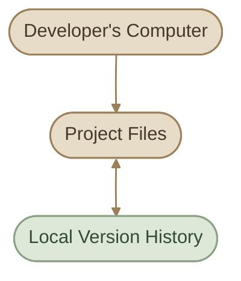
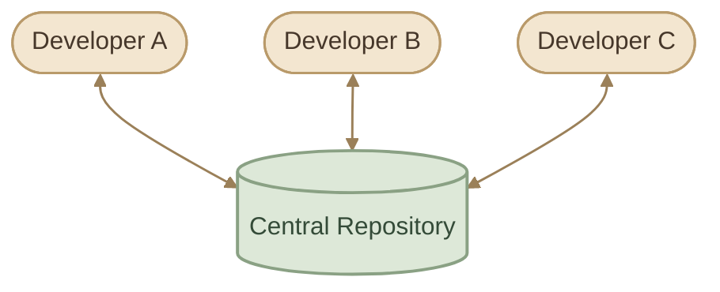
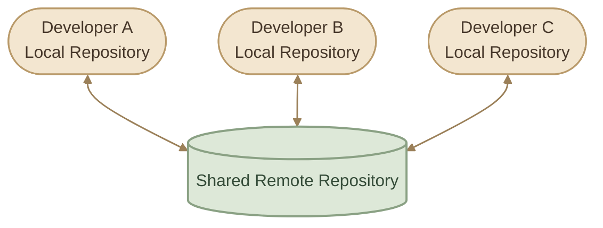
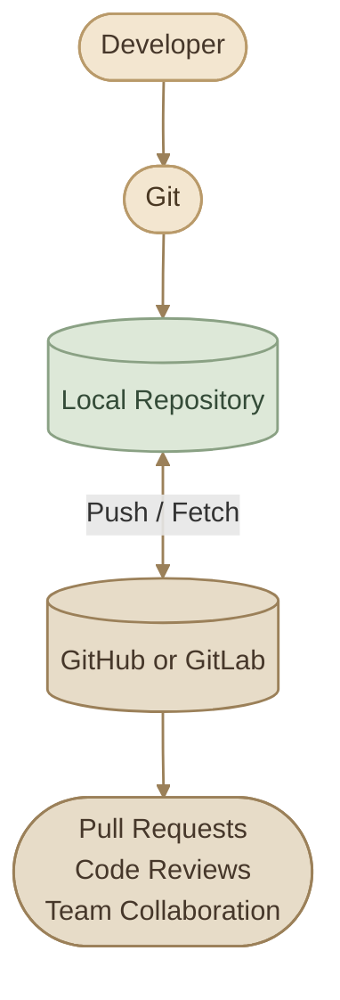

---
title: Version Control Fundamentals
description: Understand version control, its importance, the main types of version control systems, and the difference between Git and code hosting platforms.
category: version-control
order: 1
level: beginner
draft: false
tags:
  - git
  - version-control
  - git-basics
language: ar
---

## Overview

لما تشتغل على أي Project، الملفات بتتغير باستمرار. بتضيف Features، تصلّح Bugs، تعدّل Configuration، وأحيانًا تغيير صغير ممكن يسبب مشكلة في جزء تاني من المشروع.

المشكلة مش في التعديل نفسه؛ المشكلة إنك تحتاج تعرف **إيه اللي اتغير، وليه اتغير، وإزاي ترجع لحالة سابقة لو احتجت**.

هنا بييجي دور الـ **Version Control**.

الـ Version Control System (VCS) هو نظام بيسجل التغييرات اللي بتحصل على الملفات بمرور الوقت، وبيساعدك تراجع تاريخ المشروع، وتقارن بين الإصدارات، وتسترجع تغييرات سابقة، وتتعاون مع Developers تانيين.

<InfoCard variant="concept" title="The Core Idea" description="بدل ما تعتمد على نسخ الملفات يدويًا وتفتكر كل تعديل بنفسك، الـ Version Control بيدير تاريخ التغييرات بطريقة منظمة وقابلة للمراجعة والاسترجاع." icon="layers" tags={["Change Tracking", "History", "Recovery"]} />

## 1. Why Do We Need Version Control?

تخيل إنك بتطوّر تطبيق، وعندك نسخة شغالة بالفعل. قررت تضيف Feature جديدة، وبعد شوية اكتشفت إن التطبيق مبقاش شغال زي الأول.

من غير Version Control، ممكن تلاقي نفسك بتقارن ملفات يدويًا أو بتحاول تفتكر التعديلات اللي عملتها.

لكن لما تستخدم Version Control، تقدر تفحص التغييرات المسجلة، وتحدد إيه اللي اتضاف أو اتشال، وتختار طريقة مناسبة لاسترجاع الحالة السابقة أو إصلاح المشكلة.

### I. Key Benefits

<CardGrid columns={2} label="Version Control Benefits">
  <InfoCard variant="concept" title="Change History" description="تقدر تراجع التغييرات السابقة وتفهم تطور المشروع بدل ما تعتمد على الذاكرة." icon="layers" tags={["History", "Diff"]} />
  <InfoCard variant="concept" title="Recovery" description="تقدر تسترجع تغييرات سابقة أو تعكس تعديلًا خاطئًا باستخدام آليات الاسترجاع المناسبة." icon="wrench" tags={["Restore", "Revert"]} />
  <InfoCard variant="concept" title="Parallel Development" description="تقدر تطوّر Features مختلفة في Branches منفصلة قبل دمج التغييرات." icon="branch" tags={["Branches", "Isolation"]} />
  <InfoCard variant="concept" title="Collaboration" description="الفريق يقدر يشارك التغييرات ويراجعها ويدمجها بطريقة منظمة." icon="sliders" tags={["Teamwork", "Code Review"]} />
</CardGrid>

## 2. How Version Control Works

لفهم الفكرة، خلينا نبص على مشروع بيتطور على مراحل.

في البداية، عندك نسخة أولية. بعد كده تضيف Feature، وبعدها تصلّح Bug، وبعدها تعدّل Configuration.

الـ Version Control بيسجل التغييرات في نقاط محفوظة من تاريخ المشروع. في Git، النقاط دي غالبًا بنسميها **Commits**، وكل Commit بيمثل حالة مسجلة من المشروع مع معلومات عن التغيير.

كل مرحلة هنا بتعبّر عن تطور المشروع. تقدر تراجع الفروق بين المراحل، وتعرف التغيير اللي حصل في كل واحدة.

<InfoCard variant="concept" title="Note" icon="flag">

<InfoCard variant="concept" title="Note" icon="flag">

**مهم:** الـ Version Control مش بالضرورة بيعمل نسخة كاملة مستقلة من كل ملف عند كل تغيير. طريقة تخزين التاريخ بتختلف من نظام للتاني. Git مثلًا بيستخدم Objects وبيمثل تاريخ المشروع في صورة Snapshots مترابطة.

</InfoCard>

</InfoCard>

هنشرح الـ Commits والـ Snapshots بالتفصيل في صفحة Git Architecture & Core Concepts.

## 3. Types of Version Control Systems

أنظمة الـ Version Control مش كلها بتشتغل بنفس الطريقة. لفهم Git، محتاجين نعرف الفرق بين ثلاثة أنواع أساسية.

<CardGrid columns={3} label="VCS Types">
<InfoCard variant="comparison" title="Local VCS" description="التاريخ محفوظ على نفس الجهاز — تراجع نسخ سابقة محليًا." icon="cube" tags={["Single machine"]} />
<InfoCard variant="comparison" title="Centralized VCS" description="مستودع مركزي واحد بيتشاركه الفريق — كل تعامل بيمر على السيرفر." icon="cloud" tags={["SVN"]} />
<InfoCard variant="comparison" title="Distributed VCS" description="كل Developer عنده Local Repository كامل بالتاريخ — Git مثال عليه." icon="branch" tags={["Git"]} />
</CardGrid>

### I. Local Version Control

في الـ Local Version Control، نظام إدارة الإصدارات بيحتفظ بالتاريخ على نفس الجهاز اللي بتشتغل عليه.

ده بيساعدك تراجع نسخ سابقة من الملفات، لكن التعاون مع فريق أو مشاركة التاريخ بين أجهزة مختلفة مش هو محور التصميم الأساسي هنا.

**Main limitation:** لو محتاج تشارك التغييرات مع فريق على أجهزة مختلفة، هتحتاج آلية إضافية للتبادل والتعاون.

### II. Centralized Version Control (CVCS)

في الـ Centralized Version Control System، فيه **Central Server** بيحتفظ بالمستودع المشترك، وأعضاء الفريق بيتعاملوا معاه للحصول على الملفات ومشاركة التغييرات.

أمثلة على الأنظمة دي: **Subversion (SVN)** وPerforce في استخداماتهما المركزية.

الفريق هنا بيتشارك مستودعًا مركزيًا واحدًا. لكن مدى الاعتماد على السيرفر بيختلف حسب النظام والعملية المطلوبة.

### III. Distributed Version Control (DVCS)

في الـ Distributed Version Control، كل Developer عنده **Local Repository** يحتوي على تاريخ المشروع، مش مجرد نسخة من الملفات الحالية.

ده معناه إن عمليات كتير، زي تسجيل Commits ومراجعة History وإنشاء Branches، ممكن تتم محليًا من غير اتصال بالـ Remote Repository.

**Git** هو مثال أساسي على النوع ده.

كل مستودع محلي عنده تاريخ المشروع، والتغييرات ممكن تتبادل بين المستودعات من خلال عمليات Git المناسبة.

<InfoCard variant="insight" title="A Key Difference" description="في Git، الـ Remote Repository مش هو المكان الوحيد اللي بيحتفظ بتاريخ المشروع. تقدر تشتغل على الـ Local Repository وتراجع الـ Commits حتى لو مفيش اتصال بالإنترنت." icon="branch" />

### IV. Centralized vs Distributed

<TableCard title="Centralized vs Distributed VCS" caption="الفرق الأساسي في مكان تخزين التاريخ وطريقة التعاون.">
<TableCard>
| Comparison | Centralized VCS | Distributed VCS |
|---|---|---|
| Repository model | مستودع مركزي مشترك | مستودعات محلية كاملة مع إمكانية وجود Remotes |
| Local history | بيعتمد على النظام | متاح داخل الـ Local Repository |
| Offline work | بيعتمد على العملية والنظام | معظم عمليات Git المحلية متاحة |
| Collaboration | غالبًا من خلال السيرفر المركزي | من خلال تبادل التغييرات بين المستودعات |
| Example | SVN | Git |
</TableCard>
</TableCard>

مش معنى كده إن كل نظام Distributed مناسب لكل سيناريو؛ الفكرة إن Git بيدينا نموذج مرن لإدارة التاريخ والعمل محليًا والتعاون مع الآخرين.

## 4. Git vs GitHub vs GitLab

دي نقطة أساسية لازم تكون واضحة قبل ما نبدأ استخدام Git.

**Git هو Version Control System.** أما GitHub وGitLab فهما منصتان بتستضيفا Git Repositories وبتوفرا أدوات إضافية للتعاون وإدارة المشاريع.

<CardGrid columns={2} label="Git and Hosting Platforms">
  <InfoCard variant="concept" title="Git" description="البرنامج المسؤول عن تتبع تغييرات الملفات، وإنشاء Commits، وإدارة Branches وMerges داخل مستودعات Git." icon="branch" tags={["Version Control", "Local Workflow"]} />
  <InfoCard variant="concept" title="GitHub" description="منصة لاستضافة Git Repositories، وتوفير Pull Requests وCode Reviews وIssues وأدوات للتعاون." icon="cloud" tags={["Hosting", "Collaboration"]} />
  <InfoCard variant="concept" title="GitLab" description="منصة لاستضافة Git Repositories وإدارة التعاون والمشروعات، مع إمكانيات مدمجة لأتمتة عمليات التطوير والتسليم." icon="modules" tags={["Hosting", "DevOps Platform"]} />
</CardGrid>

### I. How They Work Together

خلينا نفترض إنك بتشتغل على Project على جهازك، وعايز تشارك التغييرات مع باقي الفريق.

الـ Workflow هنا بيتقسم إلى جزئين:

- **Git:** إدارة التغييرات والتاريخ على جهازك، وتجهيزها للمشاركة.
- **Hosting Platform:** مشاركة المستودع مع الآخرين، ومراجعة التغييرات، وتنظيم عملية التعاون.

وتقدر تستخدم Git من غير GitHub أو GitLab. كمان تقدر تستضيف Git Repository على سيرفر خاص بدل استخدام منصة عامة.

<InfoCard variant="warning" title="Don't Confuse the Tools" description="إنك تعمل git commit مش معناه إن التغييرات اترفعت على GitHub. الـ Commit بيسجل التغيير في المستودع المحلي، أما مشاركة التغييرات مع Remote Repository فعادةً بتتم باستخدام git push." icon="shield" />

## 5. Where Git Fits in Your Workflow

في شغل التطوير اليومي، Git بيساعدك تدير دورة حياة التغيير من لحظة تعديل الملفات لحد مشاركة التغيير مع الفريق.

ده تصور مبسط للـ Workflow، مش تسلسل إجباري لكل تغيير. مثلًا، ممكن تعمل عدة Commits قبل الـ Push، وممكن تحتاج تزامن التغييرات من الـ Remote قبل ما تشارك شغلك.

<Steps>
<li>

<InfoCard title="Modify Files" description="عدّل الملفات في الـ working directory حسب المطلوب." icon="wrench" tags={["Edit"]} />

</li>
<li>

<InfoCard title="Review Changes" description="راجع الـ diff عشان تعرف إيه اللي اتغير قبل التسجيل." icon="pulse" tags={["Diff"]} />

</li>
<li>

<InfoCard title="Create Commit" description="سجّل لقطة من المشروع مع رسالة توضح الهدف." icon="layers" tags={["Snapshot"]} />

</li>
<li>

<InfoCard title="Push to Remote" description="انشر الـ commits على الـ remote repository لمشاركة الفريق." icon="git-pull-request" tags={["Share"]} />

</li>
<li>

<InfoCard title="Review & Collaborate" description="افتح Pull Request وراجع شغل الفريق قبل الدمج النهائي." icon="cycle" tags={["Teamwork"]} />

</li>
</Steps>

هنفصّل كل خطوة في الصفحات القادمة، بدايةً من Git Architecture & Core Concepts، وبعدها الـ Basic Git Workflow.

## 6. Key Takeaways

<InfoCard variant="summary" title="The One-Line Version" description="Version Control = إدارة تاريخ التغييرات. Git = نظام Distributed VCS محلي. GitHub/GitLab = منصات استضافة بتضيف collaboration فوق Git." icon="layers" tags={["Mental Model"]} />

<CardGrid columns={2} label="Fundamental Concepts">
  <InfoCard variant="summary" title="Version Control" description="إدارة تاريخ التغييرات ومراجعتها واسترجاعها." icon="layers" />
  <InfoCard variant="summary" title="Centralized VCS" description="نموذج يعتمد على مستودع مركزي مشترك." icon="cube" />
  <InfoCard variant="summary" title="Distributed VCS" description="نموذج يتيح لكل Developer امتلاك Local Repository يحتوي على تاريخ المشروع." icon="branch" />
  <InfoCard variant="summary" title="Git vs GitHub" description="Git يدير Version Control، وGitHub يستضيف المستودعات ويوفر أدوات للتعاون." icon="cloud" />
</CardGrid>
