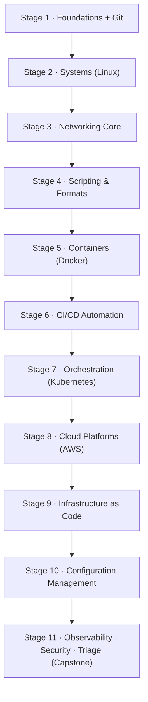
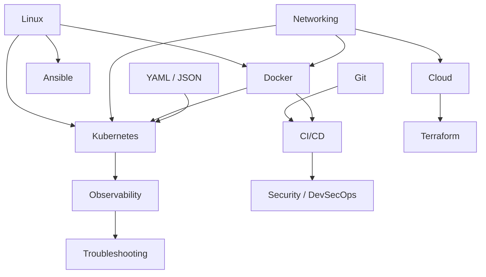

# Ops Handbook — Content Roadmap & Learning Architecture

> [!NOTE]
> **Human-Readable Content Blueprint**  
> This document answers: *what should exist in Ops Handbook, how it is organized, what to learn first, and what depends on what.* It defines topic scope, learning dependencies, and writing priorities. Nothing here is hardwired into application runtime — the structure adapts as the handbook evolves.

---

### Blueprint at a Glance

|  Documentation Areas |  Learning Progression |  Core Target |  Scope Tiers |
| :---: | :---: | :---: | :---: |
| **14 Canonical Areas** | **11 Learning Stages** | **70–90 Core Articles** | **Core · Recommended · Advanced** |
| Foundations to Triage | Sequential Journey | Maintainable Baseline | Balanced Depth |

---

##  Documentation Architecture

The handbook organizes all knowledge into a strict three-level hierarchical model:

```text
Documentation Area → Technology / Tool → Article

content/<area>/<tool>/<article>.md        →  /docs/<area>/<tool>/<article>
content/<area>/<tool>/<article>/index.mdx →  /docs/<area>/<tool>/<article>
content/<area>/<concept>.md               →  /docs/<area>/<concept>
```

| Level | Component | Role & Behavior | Example Path |
| :--- | :--- | :--- | :--- |
| **Level 1** | **Area (Category)** | Top-level folder under `content/`. Maps directly to `/docs/<area>`. Category metadata (label, icon) is registered in `src/data/categories.ts`. | `content/operating-systems/` |
| **Level 2** | **Technology / Tool** | Second folder level (`docker`, `kubernetes`, `linux`…). Any tool folder with at least one article automatically gets a landing page at `/docs/<area>/<tool>`. | `content/operating-systems/linux/` |
| **Level 3** | **Article / Topic** | The actual documentation leaf. Written in Markdown (`.md`) or MDX (`.mdx`). Can live under a tool or directly under an area. | `.../linux/introduction.md` |

---

## A. Documentation Areas & Priorities

> [!TIP]
> **Priority = Authoring Sequence (Not Importance)**  
> - `P0 (Learning Spine)`: Foundational baseline that subsequent topics build upon. Authored first.  
> - `P1 (Professional Core)`: Daily engineering tools (Cloud, CI/CD, Kubernetes, Terraform).  
> - `P2 (Production Depth)`: Observability, security, configuration management, and triage playbooks.

### Priority Tiers Summary

| Tier | Focus Areas | Total Scope | Status / Strategy |
| :--- | :--- | :---: | :--- |
| **P0 · Learning Spine** | `devops-fundamentals`, `operating-systems`, `networking`, `version-control`, `containers` | 5 Areas | Active baseline; required for all subsequent tracks |
| **P1 · Professional Core** | `programming-scripting`, `ci-cd-automation`, `container-orchestration`, `cloud-platforms`, `infrastructure-as-code` | 5 Areas | Core industry stack; write alongside real projects |
| **P2 · Production Depth** | `configuration-management`, `observability`, `security-devsecops`, `troubleshooting-production` | 4 Areas | Operations capstone; deepens production maturity |

### 14 Canonical Areas Registry

| Priority | Area (`category` ID) | Core Purpose | Primary Technologies |
| :---: | :--- | :--- | :--- |
| `P0` | `devops-fundamentals` | Shared principles, culture, and delivery models | SDLC, CI/CD principles, environments, toolchains |
| `P0` | `operating-systems` | Host OS where modern DevOps workloads execute | Linux: shell, filesystem, permissions, systemd |
| `P0` | `networking` | Protocols and transport layers connecting systems | TCP/IP, DNS, HTTP/TLS, SSH, firewalls, routing |
| `P0` | `version-control` | Source control workflows and collaboration | Git (+ GitHub / GitLab pull request flows) |
| `P0` | `containers` | Packaging, container images, and runtime engines | Docker (+ containerd / Podman fundamentals) |
| `P1` | `programming-scripting` | Automation glue, APIs, and data serialization | Bash, Python, YAML, JSON, regex, REST APIs |
| `P1` | `ci-cd-automation` | Continuous integration and deployment pipelines | GitHub Actions (+ GitLab CI, Jenkins orientation) |
| `P1` | `container-orchestration` | Multi-host container scheduling and lifecycle | Kubernetes (+ Helm package manager) |
| `P1` | `cloud-platforms` | Cloud infrastructure and managed services | AWS core (+ Azure / GCP conceptual comparisons) |
| `P1` | `infrastructure-as-code` | Declarative cloud resource provisioning | Terraform (+ OpenTofu) |
| `P2` | `configuration-management` | OS state automation and server configuration | Ansible |
| `P2` | `observability` | Production metrics, log aggregation, and tracing | Prometheus, Grafana, Loki/ELK, OpenTelemetry |
| `P2` | `security-devsecops` | Pipeline security, secrets, and vulnerability scans | Secrets management, IAM, Trivy scanning, hardening |
| `P2` | `troubleshooting-production` | Incident debugging methods and postmortems | Diagnostics methodology, runbooks, RCA |

---

## B. Learning Stages & Curriculum Flow

A suggested sequential progression across the knowledge base. Arrows indicate **recommended learning order**, not an enforced course engine — stages can overlap and the site remains reference-first.



### Stage-by-Stage Rationale

1. **Stage 1 — Foundations + Git:** Every subsequent topic assumes deployment vocabulary and Git change tracking.
2. **Stage 2 — Linux:** Modern tools run as Linux processes, files, permissions, and services; systems cannot be debugged without this foundation.
3. **Stage 3 — Networking:** DNS, HTTP, and TCP underpin containers, cloud APIs, ingress, and the vast majority of production outages.
4. **Stage 4 — Scripting & Formats:** Bash, YAML, and JSON are the configuration glue for every pipeline and manifest (overlaps Stages 2–3).
5. **Stage 5 — Docker:** Packages applications and dependencies deterministically; requires Linux and basic networking.
6. **Stage 6 — CI/CD:** Combines Git and containers to automate building, testing, and shipping — the first automated workflow payoff.
7. **Stage 7 — Kubernetes:** Assumes containers, networking, and YAML; solves running multiple services across multiple nodes.
8. **Stage 8 — Cloud (AWS):** Managed versions of compute, networking, and storage; network fundamentals transfer directly.
9. **Stage 9 — Terraform:** Replaces manual console clicking with repeatable, declarative code.
10. **Stage 10 — Ansible:** Complements IaC by managing inside-the-OS software state and server configuration.
11. **Stage 11 — Observability · Security · Triage:** A parallel capstone track. With real services running, you now have workloads to monitor, secure, and troubleshoot.

---

## C. Technology Scope by Area

> Topic definitions by tier:  
> - **Core:** Must exist for the area to function as a learning track.  
> - **Recommended:** Practical depth for day-to-day engineering.  
> - **Advanced:** Specialized concepts written last or on demand.

<details open>
<summary><strong>1. DevOps Fundamentals (<code>devops-fundamentals</code>)</strong></summary>

- **Core:** Software Delivery Lifecycle (SDLC) · CI/CD core principles · Environment tiers (dev/stage/prod) · IaC vs. Config Management concepts · DevOps toolchain overview · DevOps culture & collaboration
- **Recommended:** Release strategies (blue/green, canary) · SLO/SLI vocabulary · DORA metrics · Managing technical debt
- **Advanced:** Platform engineering intro · Site reliability engineering (SRE) foundations · Value stream mapping
</details>

<details open>
<summary><strong>2. Operating Systems: Linux (<code>operating-systems</code>)</strong></summary>

- **Core:** Shell navigation & basics · Filesystem hierarchy & paths · Permissions & ownership (chmod, chown) · Users, groups & sudo · Process lifecycle (ps, kill, signals) · Package managers (apt, dnf) · Text processing (grep, sed, awk)
- **Recommended:** Systemd services & unit files · Network commands (ss, ip, curl) · Disks, partitions & mounts · System logs with `journalctl` · Bash scripting basics
- **Advanced:** Kernel tuning with `sysctl` · SELinux & AppArmor profiles · Performance analysis (top, iostat, vmstat) · Systemd timers & cron
</details>

<details open>
<summary><strong>3. Networking (<code>networking</code>)</strong></summary>

- **Core:** OSI 7-layer & TCP/IP models · IPv4 addressing & CIDR subnetting · DNS resolution architecture · HTTP & HTTPS protocols · TLS/SSL handshakes & certificates · SSH authentication & key management
- **Recommended:** Load balancing (L4 vs. L7) · Firewalls & security groups · NAT, gateways & routing tables · Diagnostic commands (ping, dig, traceroute)
- **Advanced:** Packet analysis (tcpdump, Wireshark) · IPv6 deployment · Service mesh concepts · eBPF network monitoring
</details>

<details open>
<summary><strong>4. Version Control: Git (<code>version-control</code>)</strong></summary>

- **Core:** Commits & object history · Staging mechanics · Branching & branch strategies · Merging & conflict resolution · Remotes & Pull Request collaboration
- **Recommended:** Interactive rebasing · Stashing changes · Semantic tags & releases · Git hooks (pre-commit) · Monorepo workflow tips
- **Advanced:** Reflog commit recovery · Git submodules · Git worktrees for concurrent branches · Packfiles & internals
</details>

<details open>
<summary><strong>5. Programming & Scripting (<code>programming-scripting</code>)</strong></summary>

- **Core:** Bash syntax, pipes & process substitution · Variables, loops & conditionals · Exit codes & strict mode (`set -euo pipefail`) · JSON manipulation with `jq` · YAML structure & validation · Regular expressions
- **Recommended:** Python automation scripts · REST APIs with `curl` & Python requests · File parsing & format transformation · Environment variables & secrets loading
- **Advanced:** Script test frameworks · Async automation jobs · Go fundamentals for cloud-native tools · Cross-platform CLI patterns
</details>

<details open>
<summary><strong>6. Containers: Docker (<code>containers</code>)</strong></summary>

- **Core:** Containers vs. VMs · Dockerfile syntax & best practices · Image building & layer caching · Container storage & volumes · Container networking & port mapping · CLI essentials (run, exec, logs, ps)
- **Recommended:** Docker Compose multi-service apps · Container registries & image tagging · Multi-stage builds for minimal size · Container logging stdout/stderr
- **Advanced:** Container vulnerability scanning with Trivy · Rootless containers & cgroup limits · Alternative runtimes (containerd, Podman) · Image signing
</details>

<details open>
<summary><strong>7. CI/CD & Automation (<code>ci-cd-automation</code>)</strong></summary>

- **Core:** Pipeline concepts: triggers, jobs, runners, steps · GitHub Actions syntax · Automated build & test workflows · Secret management in CI · Workflow artifacts & caching
- **Recommended:** GitLab CI & Jenkins comparisons · Deployment strategies (rolling, blue/green) · Branch protection & status checks · Automated versioning & changelog generation
- **Advanced:** Self-hosted runners & autoscaling · Matrix builds across platforms · Release workflows · GitOps delivery intro (Argo CD)
</details>

<details open>
<summary><strong>8. Container Orchestration: Kubernetes (<code>container-orchestration</code>)</strong></summary>

- **Core:** Cluster architecture (Control Plane & Nodes) · Pods lifecycle & restart policies · Deployments & ReplicaSets · Services (ClusterIP, NodePort, LoadBalancer) · Namespaces & isolation · Labels & selectors · `kubectl` inspection & debugging
- **Recommended:** Ingress controllers & HTTP routing · ConfigMaps & Secrets · Storage: Volumes, PVs, and PVCs · StatefulSets & DaemonSets · Helm charts & release management
- **Advanced:** NetworkPolicies for pod isolation · RBAC Roles & ServiceAccounts · Horizontal Pod Autoscaler (HPA) · Custom Resource Definitions (CRDs) & Operators · Control plane disaster recovery
</details>

<details open>
<summary><strong>9. Cloud Platforms: AWS (<code>cloud-platforms</code>)</strong></summary>

- **Core:** IAM: users, roles, and least privilege · Compute: EC2 instances, security groups, AMIs · Storage: S3 buckets, permissions, lifecycle · Networking: VPC, subnets, route tables, IGWs · Cloud billing & cost models
- **Recommended:** Managed databases (RDS) · Application Load Balancers (ALB) · DNS with Route 53 · Serverless intro (AWS Lambda) · Multi-AZ high availability
- **Advanced:** CloudFront CDN · Advanced VPC (peering, Transit Gateway, PrivateLink) · AWS Organizations & multi-account security · Well-Architected framework
</details>

<details open>
<summary><strong>10. Infrastructure as Code: Terraform (<code>infrastructure-as-code</code>)</strong></summary>

- **Core:** HCL syntax & structure · Providers & provider blocks · Resources & data sources · State file fundamentals · Core workflow (`init`, `plan`, `apply`, `destroy`)
- **Recommended:** Input variables, locals & outputs · Terraform module composition · Remote backends (S3 + DynamoDB locking) · Importing pre-existing infrastructure
- **Advanced:** Terraform workspaces · State drift detection & fixes · Automated Terraform pipelines · OpenTofu differences
</details>

<details open>
<summary><strong>11. Configuration Management: Ansible (<code>configuration-management</code>)</strong></summary>

- **Core:** Ad-hoc commands over SSH · Inventory files and groupings · Playbook structure and syntax · Core modules (copy, file, apt, service) · The idempotency principle
- **Recommended:** Ansible Roles architecture · Variables & host facts · Handlers for service restarts · Jinja2 template rendering
- **Advanced:** Ansible Vault for secrets · Dynamic inventory plugins · AWX / AAP automation · Testing roles with Molecule
</details>

<details open>
<summary><strong>12. Observability (<code>observability</code>)</strong></summary>

- **Core:** Three pillars: Metrics, Logs, and Traces · Prometheus architecture & exporters · PromQL queries · Grafana dashboards & alerts · Alertmanager routing
- **Recommended:** Grafana Loki / ELK log aggregation · Structured JSON logging · USE and RED monitoring methods · Service Level Objectives (SLOs) in practice · OpenTelemetry overview
- **Advanced:** High-cardinality metric tuning · Distributed tracing with Jaeger · Tail-based sampling · On-call rotation & incident escalation
</details>

<details open>
<summary><strong>13. Security / DevSecOps (<code>security-devsecops</code>)</strong></summary>

- **Core:** Secrets management (preventing hardcoded credentials) · Principle of least privilege · Trivy vulnerability scanning in CI · SSH key hardening · Host-level Linux hardening
- **Recommended:** Vault / AWS Secrets Manager · SAST and DAST scanning in pipelines · Software Bill of Materials (SBOM) & signing · Container security best practices
- **Advanced:** Policy as Code (OPA / Kyverno) · Zero Trust security model · Incident response playbooks · CIS compliance benchmarks
</details>

<details open>
<summary><strong>14. Troubleshooting & Production (<code>troubleshooting-production</code>)</strong></summary>

- **Core:** Systematic triage methodology · Correlating logs and metrics · HTTP status code debugging · Host resource bottlenecks (CPU, RAM, I/O) · Essential tools (curl, journalctl, dmesg)
- **Recommended:** Network diagnostics (DNS timeouts, MTU, packet drops) · Database connection pool exhaustion · Establishing baseline performance · Blameless postmortems
- **Advanced:** Chaos Engineering & fault injection · Capacity modeling & load testing · Cascading failure case studies · Memory leak profiling
</details>

---

## D. Dependency Map

Prerequisites are **guidelines for natural reading order**, never an application locking mechanism.

### Multi-Prerequisite Breakdown

```text
Kubernetes
├── Linux (processes, cgroups, systemd services)
├── Networking (DNS, CNI, routing, port forwarding)
├── Containers (Docker images, container runtime)
└── Data Formats (YAML syntax, JSON schemas)
```

### Cross-Technology Prerequisite Graph



---

## E. Hands-On Project Opportunities

> [!IMPORTANT]
> **Documentation First, Projects Second**  
> Projects validate and reinforce learning outcomes *after* the Core topics for a stage are written.

| Stage | Practical Project Concept | Primary Skills Reinforced |
| :---: | :--- | :--- |
| **Stage 5** | Containerize a multi-tier web application; manage with Docker Compose | Dockerfile, images, volumes, port binding |
| **Stage 6** | Automated CI pipeline: lint → test → security scan → push container image | GitHub Actions, secrets, container registry |
| **Stage 7** | Deploy the containerized application to a local Kubernetes cluster | Pods, Deployments, Services, ConfigMaps, Ingress |
| **Stage 8** | Provision a free-tier AWS footprint: VPC, subnets, EC2, S3 | Cloud networking, security groups, IAM policies |
| **Stage 9** | Codify the entire AWS infrastructure using modular Terraform | Terraform HCL, remote state, variables, modules |
| **Stage 10** | Configure and harden provisioned servers using an Ansible playbook | Ansible inventory, roles, systemd, idempotency |
| **Stage 11** | **Capstone:** Git push → CI → Registry → Cluster → Dashboards & Alerts | Full-lifecycle DevOps delivery & observability |

### Stage 11 Capstone Milestones

- [ ] **Source Control:** Git branching model with pull requests and branch protection
- [ ] **Automated CI:** Pipeline with linting, unit tests, and Trivy container vulnerability scanning
- [ ] **Artifact Management:** Tagged, immutable container image published to registry
- [ ] **Infrastructure as Code:** Declarative cloud infrastructure provisioned with Terraform
- [ ] **Server Configuration:** Automated host provisioning and hardening via Ansible
- [ ] **Continuous Delivery:** Automated zero-downtime deployment rollout to cluster
- [ ] **Telemetry:** Prometheus metrics scraped and displayed in Grafana with alerting rules
- [ ] **Production Runbook:** Tested incident triage playbook simulating a service outage

---

## F. Boundary Disambiguation Matrix

Where two areas touch the same topic, the **canonical home** owns the primary article. Cross-cutting audiences are served via `tags` and the automated *Related topics* section.

| Overlapping Areas | Boundary Rule & Canonical Home |
| :--- | :--- |
| **Networking vs. Troubleshooting** | Explaining how DNS, TLS, or routing *works* belongs in `networking`. Diagnosing and fixing an active network failure belongs in `troubleshooting-production`. |
| **Observability vs. Troubleshooting** | Instrumenting metrics and configuring Grafana belongs in `observability`. Using alerts and metrics to triage an incident belongs in `troubleshooting-production`. |
| **Fundamentals vs. CI/CD** | Theoretical definitions and delivery philosophies belong in `devops-fundamentals`. Concrete tool workflows (e.g. GitHub Actions) belong in `ci-cd-automation`. |
| **Programming vs. Operating Systems** | Language syntax, Bash scripts, and jq parsing belong in `programming-scripting`. Interactive shell administration and systemd units belong in `operating-systems`. |
| **Containers vs. Orchestration** | Single-host container runtimes and Dockerfiles belong in `containers`. Multi-host scheduling, Pods, and clusters belong in `container-orchestration`. |
| **Cloud vs. Infrastructure as Code** | Cloud primitives and managed services belong in `cloud-platforms`. The declarative code that provisions them belongs in `infrastructure-as-code`. |
| **IaC vs. Configuration Management** | Creating infrastructure resources belongs in `infrastructure-as-code`. Configuring software packages on those resources belongs in `configuration-management`. |
| **Security vs. CI/CD** | Pipeline mechanics belong in `ci-cd-automation`. Pipeline vulnerability scanning, secrets protection, and signing belong in `security-devsecops`. |

---

## G. Architecture Evolution Workflow

```text
1. Add an Article  ──► Copy content/_template/article.mdx to content/<area>/<tool>/<article>.mdx
2. Add a Tool     ──► Create content/<area>/<tool>/; landing page auto-generates with 1st article
3. Add an Area     ──► Create content/<area>/ and register in src/data/categories.ts
4. Reorder Content ──► Update frontmatter `order:` (10, 20, 30...); never use numeric folder prefixes
5. Retire Content  ──► Set frontmatter `draft: true` or delete file
```

> [!WARNING]
> **Never Prefix Folder Names with Numbers**  
> Keep directory paths clean (e.g. `content/operating-systems/linux/`). Never name folders `01-linux` or `02-networking`. Ordering belongs exclusively in frontmatter metadata.

---

## 🔗 Related References

- [Content Authoring Guide](content/README.md) — Day-to-day writing instructions, frontmatter specification, and components cheatsheet
- [Platform Technical Overview](README.md) — Architecture decisions, Astro configuration, and build pipeline
